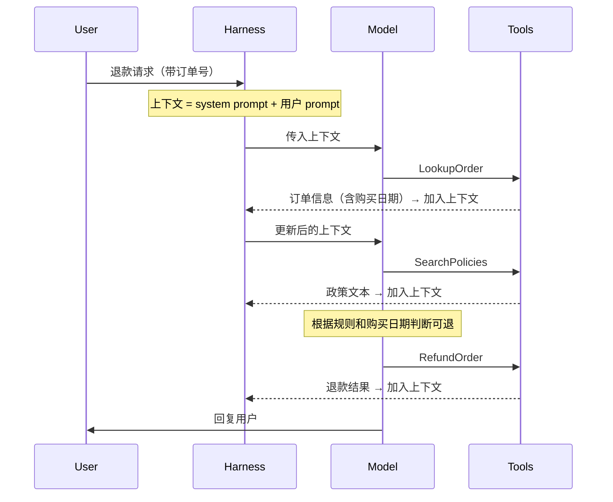
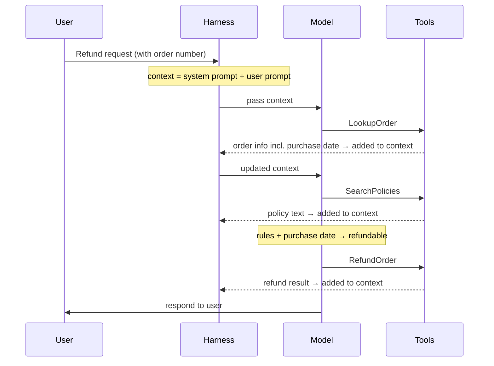

> DeepLearning.AI × Chroma｜Module 1｜
> 总览：[Module 1 Overview](/Context-Engineering-Module-1-Overview/)

## 核心观点
开始做 context engineering 时，先**看清并给 agent 要处理的各类上下文命名**。

## 从聊天机器人到 agent，上下文怎么变多的
- **早期聊天机器人**：单次调用、单次回复，只需关心三样东西：
  system prompt（行为指令）、用户输入、模型回复。
- **RAG**：为了突破模型训练数据的截止日期，系统被**写死**成固定流程：
  拿到用户 prompt → 用相似度搜索等方法从向量库找相关数据 → 注入上下文 → 交给模型推理。
- **Agent**：模型自己决定调用哪些工具，每一步的结果都加进上下文。

## 一次退款请求里，上下文是怎么累积的
**Harness** 是 AI 工程师对所有支撑代码的统称：数据处理、调用模型、执行工具等。

每一步工具调用都会让上下文变长，模型基于**更新后的上下文**决定下一步。

## 上下文的组成部分

| 组成部分 | 说明 |
|---|---|
| **System prompt** | 整体行为指令。理想情况下应**简单、稳定**，因为它始终在 agent 上下文的开头，适合放不随时间变化的信息 |
| **用户输入** | 来自人类用户的输入 |
| **Memory** | 持续管理的信息，用于个性化，或在合适的时候拿到正确的任务指令（Module 4） |
| **Reasoning traces** | agent 内部记录的解题过程 |
| **工具相关上下文** | 工具输出、检索到的数据 |

要管理的数据很多，管不好就会影响系统表现——
下一节：[Context Failure Modes](/Context-Failure-Modes/)。

> DeepLearning.AI × Chroma | Module 1 |
> Overview: [Module 1 Overview](/Context-Engineering-Module-1-Overview/)

## Key Idea
When you start on context engineering, begin by **looking at and naming the types of
context** your agent has to deal with.

## How Context Grew from Chatbots to Agents
- **Early chatbots**: single calls and responses; the only context was the system prompt
  (instructions), the user input and the model's response.
- **RAG**: to get past the model's training cutoff, systems were **hardwired** to take
  the user prompt → find relevant data in a vector store (e.g. similarity search) →
  inject it into the context → let the model reason over it.
- **Agents**: the model decides which tools to call, and each result is added to the
  context.

## How Context Accumulates in a Refund Request
The **harness** is what AI engineers call all the supporting code: data handling,
calling the models, executing tools, and so on.

Every tool call makes the context longer, and the model picks its next step from the
**updated context**.

## Components of Context

| Component | What it is |
|---|---|
| **System prompt** | Overall instructions. Ideally **simple and stable**, since it stays at the start of the agent's context; the place for information that doesn't change over time |
| **User input** | Input from human users |
| **Memory** | Ongoing management of information for personalization or getting the right instructions at the right time (Module 4) |
| **Reasoning traces** | The agent's internal record of how it's solving the problem |
| **Tool-related context** | Tool outputs and retrieved data |

That's a lot of data, and managing it poorly hurts performance — next:
[Context Failure Modes](/Context-Failure-Modes/).

