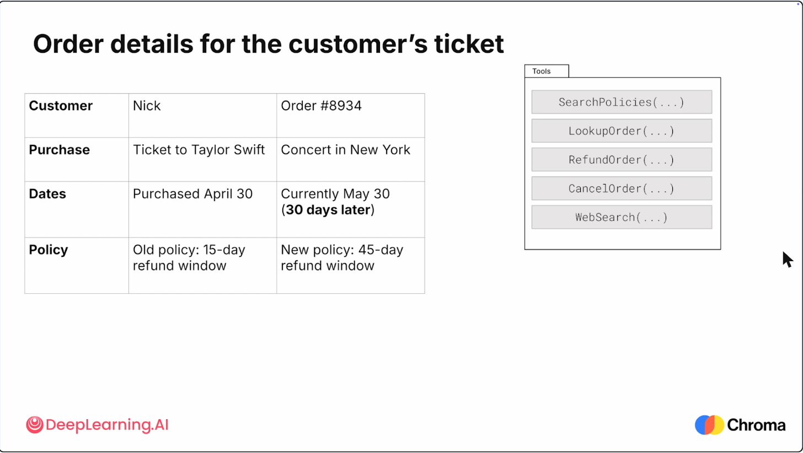
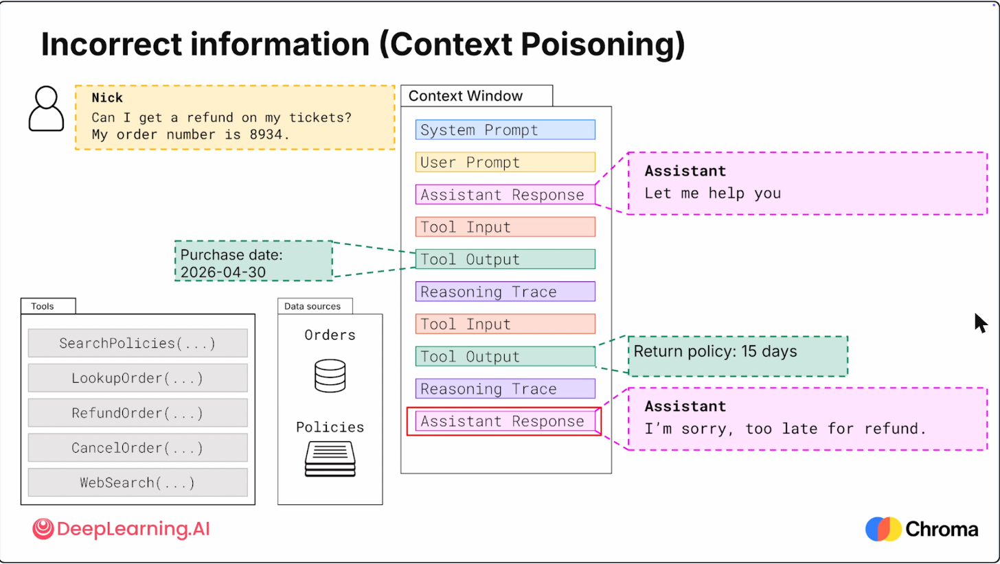
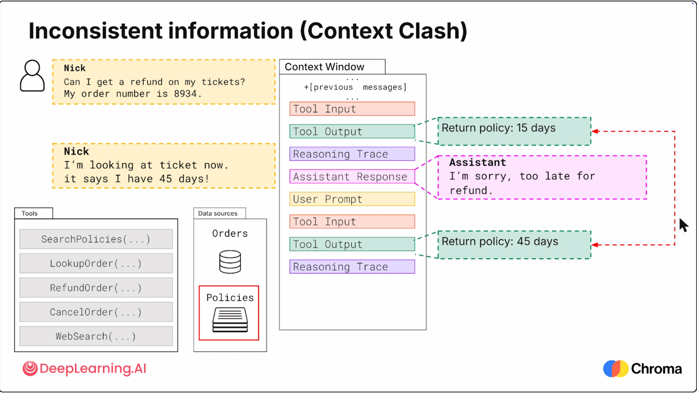
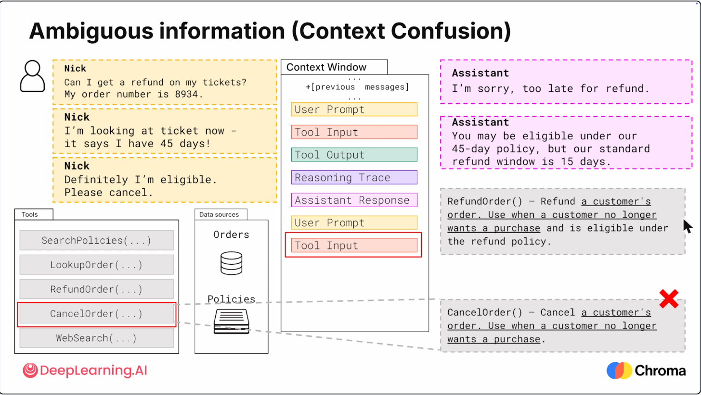
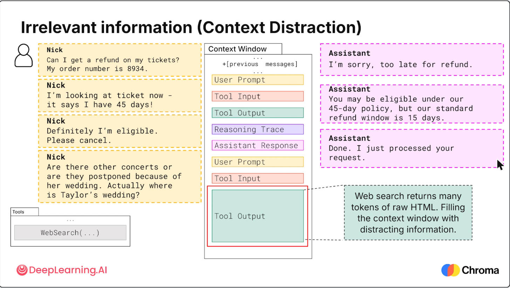
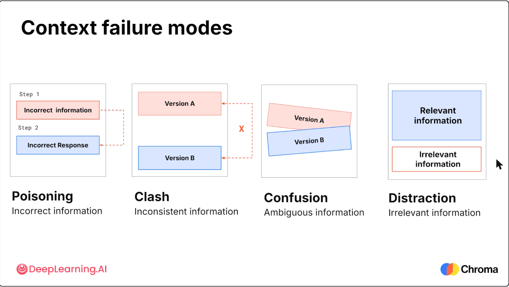
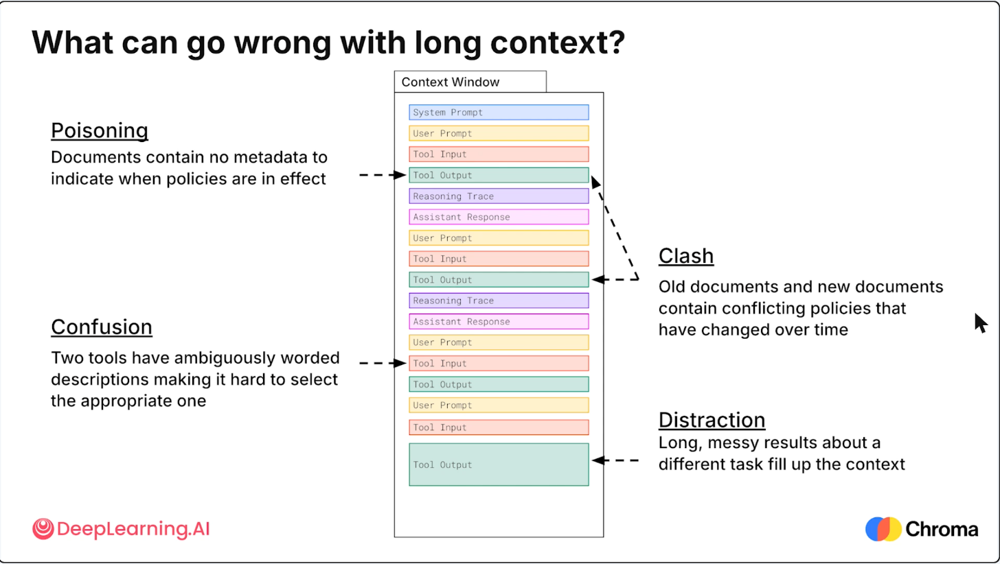

> DeepLearning.AI × Chroma｜Module 1，视频约 7 分钟

## 核心观点
即使模型能力很强，**上下文管理不好**，agent 也会失败。这些失败其实不是模型的问题，而是**送进模型的信息质量**出了问题。

**Context Engineering** = 控制每次模型调用时：
1. **什么信息**进入上下文
2. 信息**表达得是否清晰**
3. 信息**能保持有用多久**

## 案例背景
客服 agent 处理退款：Nick，订单 #8934，Taylor Swift 纽约演唱会门票，4/30 购买，现在 5/30（30 天后）。
- 旧政策：15 天内可退；新政策：45 天内可退
- 问题：**新旧两份政策都在 Policies 文档库里**
- 可用工具：SearchPolicies / LookupOrder / RefundOrder / CancelOrder / WebSearch

## 四种失败模式

### 1. Context Poisoning（上下文中毒）— 错误信息
- SearchPolicies 检索到了**过时的 15 天政策**，模型据此告诉 Nick 不能退款。
- 模型推理本身没错，但文档**没有标明自己已过时**，模型就默认它是对的。
- 根因：文档缺少元数据（生效时间）。

### 2. Context Clash（上下文冲突）— 不一致信息
- Nick 反驳后，再次检索拿到 45 天政策，上下文里同时有 15 天和 45 天两份政策。
- 两者都看似合理，但**没标明生效时间或哪个是权威版本**。
- 大模型也许能推断出新的取代旧的，但小模型（如为隐私部署在本地的）可能做不到。
- **系统不应依赖模型去推断**；更大的上下文窗口也无法告诉模型哪个是最新的。

### 3. Context Confusion（上下文混淆）— 模糊信息
- Nick 说 "please cancel"，本意是要退款。
- RefundOrder 和 CancelOrder 的**工具描述高度重叠**（都写着 "Use when a customer no longer wants a purchase"）。
- 工具描述类似函数的 docstring，决定模型选哪个工具；描述不区分就会选错。
- 结果：调用了 CancelOrder → **票没了，钱也没退**，产生真实后果。

### 4. Context Distraction（上下文干扰）— 无关信息
- Nick 问起 Taylor Swift 的婚礼，模型调用 WebSearch，返回大量**原始 HTML**，被塞进下一次模型调用。
- 原任务要和大量无关信息竞争注意力（里面可能还恰好包含 refund、policy 等词）。
- agent 变慢、变不可靠——恰恰是在客户已经不耐烦的时候。

## 总结

| 失败模式 | 信息问题 | 本例原因 |
|---|---|---|
| Poisoning 中毒 | 错误（Incorrect） | 过时政策，无生效时间元数据 |
| Clash 冲突 | 不一致（Inconsistent） | 新旧政策并存，无版本/日期说明 |
| Confusion 混淆 | 模糊（Ambiguous） | 两个工具描述重叠，选错工具 |
| Distraction 干扰 | 无关（Irrelevant） | 无边界的网页搜索结果塞满上下文 |

## 要点
- 这些错误在**短任务**中也会发生；在**长任务**中会**叠加放大**。
- 上下文不断变长会带来新问题 → **Context Rot（上下文腐烂）**，见下一节 [Context Rot](/Context-Rot/)。

> DeepLearning.AI × Chroma | Module 1, ~7 min video

## Key Idea
Even agents powered by the most capable models can fail when **context is not carefully managed**. These failures are not really the model's fault; they come from the **quality of the information** that reaches it.

**Context Engineering** = controlling, for each model call:
1. **What** information reaches the model
2. **How clearly** that information is represented
3. **How long** it remains useful

## The Scenario
A customer service agent handles a refund: Nick, order #8934, ticket to a Taylor Swift concert in New York, purchased April 30, now May 30 (30 days later).
- Old policy: 15-day refund window; new policy: 45-day refund window
- Problem: **both policies live in the same Policies document store**
- Tools: SearchPolicies / LookupOrder / RefundOrder / CancelOrder / WebSearch

## The Four Failure Modes

### 1. Context Poisoning — Incorrect information
- SearchPolicies returns the **outdated 15-day policy**, so the model tells Nick he is not eligible.
- The model's reasoning is fine, but the document **doesn't identify itself as outdated**, so the model assumes it's correct.
- Root cause: documents have no metadata saying when a policy is in effect.

### 2. Context Clash — Inconsistent information
- Nick pushes back; a second search retrieves the 45-day policy. Now the context holds both 15 days and 45 days.
- Both look plausible, and **neither says when it applied or which version is authoritative**.
- A large model might infer the newer one wins, but a small model (e.g., running on-platform for privacy) may not.
- **The system shouldn't depend on that inference**, and a bigger context window won't tell the model which policy is current.

### 3. Context Confusion — Ambiguous information
- Nick says "please cancel," but he still wants his money back.
- RefundOrder and CancelOrder have **overlapping tool descriptions** (both say "Use when a customer no longer wants a purchase").
- A tool description works like a function's docstring; if it doesn't clearly distinguish outcomes, the word "cancel" pushes the model to the wrong tool.
- Result: CancelOrder runs → **Nick loses the ticket and gets no refund**, a real-world consequence.

### 4. Context Distraction — Irrelevant information
- Nick asks about Taylor Swift's wedding; the model calls WebSearch, which returns lots of **raw HTML** that gets added to the next model call.
- The original task now competes with irrelevant content (which may even contain words like "refund" or "policy").
- The agent becomes slower and less reliable, right when a frustrated customer needs a clear resolution.

## Recap

| Failure mode | Information issue | Cause in this example |
|---|---|---|
| Poisoning | Incorrect | Outdated policy, no effective-date metadata |
| Clash | Inconsistent | Old and new policies coexist without versions/dates |
| Confusion | Ambiguous | Overlapping tool descriptions → wrong tool chosen |
| Distraction | Irrelevant | Unbounded web search floods the context |

## Takeaways
- These errors can happen even in **short tasks**; in **long-running tasks** they **compound**.
- As the context keeps filling up, a new problem appears → **Context Rot** (next lesson: [Context Rot](/Context-Rot/)).

