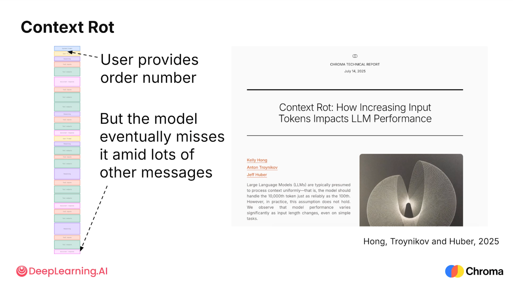
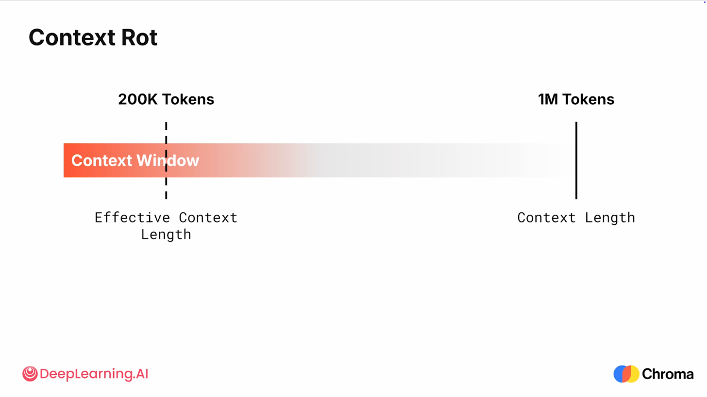
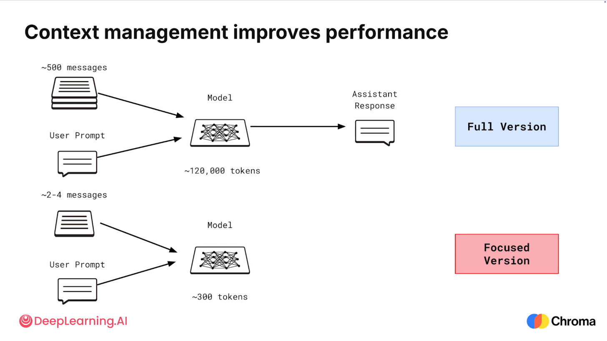
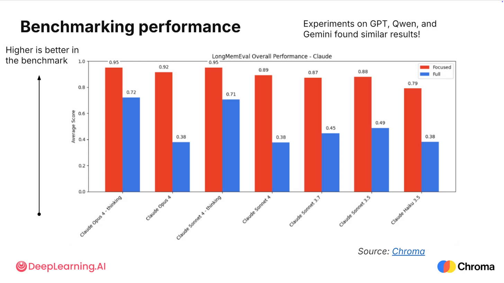
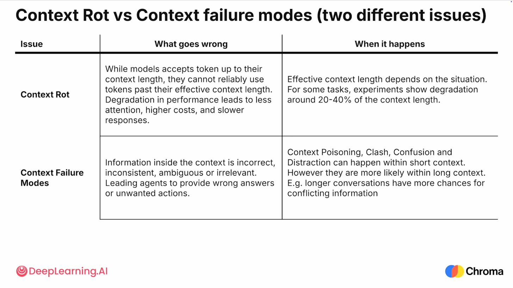
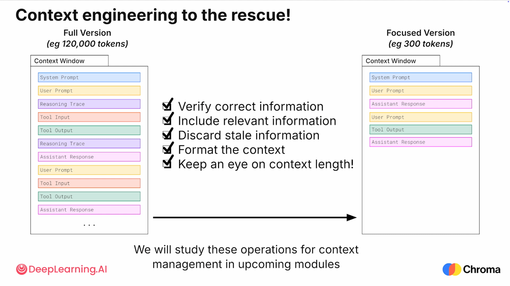

> DeepLearning.AI × Chroma｜Module 1，视频约 6 分钟｜上一节：[Context Failure Modes](/Context-Failure-Modes/)

## 核心观点
长任务里，上下文窗口会被逐渐填满——即使窗口本身很大。**上下文越满，模型表现越差**，尤其是：
- 只被提到过**一两次**的细节
- 位于上下文**中间位置**的细节

Chroma 团队在 2025 年的研究里把这个现象命名为 **Context Rot（上下文腐烂）**。
例：客服 agent 在对话开头拿到了订单号，聊了很多轮之后就"忘了"。

## 上下文长度 ≠ 有效上下文长度
- **Context Length（标称上下文长度）**：模型一次调用**最多能接收**多少 token，比如 1M。
- **Effective Context Length（有效上下文长度）**：在某个具体任务上，模型**能可靠使用**的上下文有多少。
- 没有统一的"超过百分之多少就崩"的阈值，它取决于：模型、任务、周围的信息、信息的排列方式。
- Chroma 的实验显示，有效长度可能**低至标称长度的 20%–40%**（图中 1M 窗口，有效的可能只有约 200K）。
- 结论：**能塞进去 ≠ 能用好**，往上下文里放东西要有意识、有取舍。

## 实验：LongMemEval，Full vs Focused
任务：给一段用户与聊天机器人的对话，回答一个问题；模型必须找到对话中**特定的那一段**才能答对。

| 版本 | 输入 | 规模 |
|---|---|---|
| **Full** 完整版 | 全部对话历史 | 约 500 条消息，约 120,000 token |
| **Focused** 聚焦版 | 只有回答问题所需的片段 | 3–5 条消息，平均不到 300 token |

两个版本里**都有答案**。区别在于：Focused 只需要对相关证据做推理；Full 要先在几百条消息里**找到**证据，再推理，难度大得多。

### 结果
- 所有被测模型上，**Focused 都明显好于 Full**（例：Claude Opus 4 为 0.92 vs 0.38）。
- **推理模式（thinking）在两种条件下都有帮助，但消除不了差距**（Opus 4 thinking：0.95 vs 0.72）。
- 在 GPT、Qwen、Gemini 上也得到了类似结果。
- 如果模型在整个上下文窗口内表现均匀，周围的历史不应造成这么大的差异 → 说明模型**远在达到标称长度之前**就开始吃力了。

## Context Rot vs 四种失败模式：两个不同的问题

| | 出了什么问题 | 什么时候发生 |
|---|---|---|
| **Context Rot** | 和上下文的**大小**有关：超过有效长度后，模型无法可靠使用这些 token；还带来更高成本、更慢响应 | 有效长度视场景而定，部分任务在标称长度的 20%–40% 就开始退化 |
| **Failure Modes**（中毒/冲突/混淆/干扰） | 和上下文的**质量**有关：信息错误、不一致、模糊或无关 → 错误回答或不想要的动作 | 短上下文里也会发生，但长上下文里更容易发生（比如对话越长，越可能出现互相矛盾的内容 → Clash） |

关键：Context Rot 是**独立的问题**，源于语言模型**注意力机制**的工作方式；即使上下文里的信息全部正确、一致、清晰、相关，填得太满也会腐烂。

## Context Engineering 怎么应对
目标是把 Full 版本的上下文变成 Focused 版本：
1. **验证信息正确**：比如只传最新的政策（对应 Poisoning / Clash）
2. **只放相关信息**：改进检索工具，让 agent 拿到最相关的上下文（对应 Distraction）
3. **丢弃过时 / 无关信息**：在 agent 里加代码，主动从上下文中清理掉它们
4. **格式化上下文**：加结构、总结关键事实，让重要信息更**显眼（salient）**（对应 Confusion）
5. **盯住上下文长度**：别撞上 Context Rot

做法上就是给 agent 构建工具和功能，用来：改进搜索、清理并格式化工作上下文、**按需（just-in-time）**检索知识或指令。后续模块会逐一展开。

## 要点
- **能塞进去 ≠ 能用好**：设计时按"有效上下文长度"估算，而不是标称长度。
- Rot 管"量"，四种失败模式管"质"；两者独立，但上下文变长会让失败模式更容易出现。
- 上下文管理的这些代码和工具，最终要落在 agent 的整体系统（模型、工具、数据源，以及把它们连起来的 **harness**）里 → 下一节讲 agent 的组成。

**English summary:** A model's advertised context length is not how much it can use well. As the window fills, recall drops — especially for rarely mentioned or mid-context details (Context Rot). Context engineering keeps the window focused: verify, include only what's relevant, discard stale data, format it, and watch the length.

> DeepLearning.AI × Chroma | Module 1, ~6 min video | Previous: [Context Failure Modes](/Context-Failure-Modes/)

## Key Idea
Over a long-running task, the context window starts to fill up, even when it's very large. **The fuller the context, the worse the model performs**, especially when recalling:
- details mentioned only **rarely**
- details sitting in the **middle** of the context window

Chroma's 2025 study named this **Context Rot**.
Example: the customer service agent forgets the order number the user gave early on, many turns later.

## Context Length ≠ Effective Context Length
- **Context Length (advertised)**: the maximum number of tokens a model can accept in one call, say 1M.
- **Effective Context Length**: how much context the model can use **reliably** for a particular task.
- There's no universal percentage where performance drops. It depends on the model, the task, the surrounding information, and how it is arranged.
- Chroma showed it can be **as low as 20%–40%** of the advertised length (on the slide, ~200K effective out of 1M).
- Takeaway: **fitting ≠ using well**, so be intentional about what goes into the window.

## Experiment: LongMemEval, Full vs Focused
Task: answer a question about a user–chatbot conversation; the model must find **one particular exchange** to answer correctly.

| Version | Input | Size |
|---|---|---|
| **Full** | The entire message history | ~500 messages, ~120,000 tokens |
| **Focused** | Only the snippets needed to answer | 3–5 messages, under 300 tokens on average |

The answer is present **in both**. With Focused, the model only reasons over the relevant evidence; with Full, it must first **find** that evidence among hundreds of messages, then reason over it, which is much harder.

### Results
- Across every model tested, **Focused clearly beat Full** (e.g., Claude Opus 4: 0.92 vs 0.38).
- **Reasoning (thinking) modes helped in both conditions but did not close the gap** (Opus 4 thinking: 0.95 vs 0.72).
- GPT, Qwen, and Gemini showed similar results.
- If performance were uniform across the window, the surrounding history shouldn't matter this much → models struggle **well before** their advertised context length.

## Context Rot vs the Four Failure Modes: Two Different Issues

| | What goes wrong | When it happens |
|---|---|---|
| **Context Rot** | About context **size**: past the effective length, tokens can't be used reliably; also higher cost and slower responses | Effective length depends on the situation; some tasks degrade at 20%–40% of the context length |
| **Failure Modes** (Poisoning / Clash / Confusion / Distraction) | About context **quality**: information is incorrect, inconsistent, ambiguous, or irrelevant → wrong answers or unwanted actions | Can happen in short contexts, but more likely in long ones (e.g., longer conversations give more chances for conflicting information → Clash) |

Key point: Context Rot is an **independent issue** rooted in how **attention** works in language models. Even if everything in the context is correct, consistent, clear, and relevant, overfilling the window still causes rot.

## How Context Engineering Helps
The goal is to turn the Full context into a Focused one:
1. **Verify correct information**: e.g., pass only the most up-to-date policy (addresses Poisoning / Clash)
2. **Include relevant information**: improve search tools so the agent retrieves the most relevant context (addresses Distraction)
3. **Discard stale information**: add code that finds and removes irrelevant or out-of-date content from the window
4. **Format the context**: add structure or summarize key facts to make them more **salient** (addresses Confusion)
5. **Keep an eye on context length** so you don't run into Context Rot

In practice, this means building tools and functionality into the agent that improve search, clean up and format the working context, and retrieve knowledge or instructions **just-in-time**. Later modules cover each in detail.

## Takeaways
- **Fitting ≠ using well**: budget for the *effective* context length, not the advertised one.
- Rot is about **quantity**; the four failure modes are about **quality**. They're independent, but longer contexts make failure modes more likely.
- All this context-management code has to live inside the agent's overall system (models, tools, data sources, and the **harness** that connects them) → the next lesson covers the parts of an agent.

