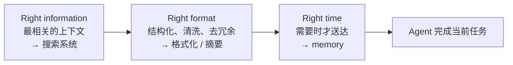
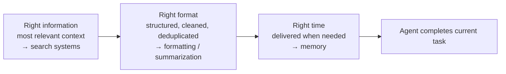

> DeepLearning.AI × Chroma｜Module 1｜
> 总览：[Module 1 Overview](/Context-Engineering-Module-1-Overview/)

## 什么是 context
以在线票务平台的客服 agent 为例：客户要退款，agent 调用工具查订单、查政策。
这些交互产生的所有数据——纯文本、结构化数据、工具输入输出、
推理过程（reasoning trace）——就叫 **context（上下文）**。
这些数据要放进 **context window（上下文窗口）**才能交给模型，
可以把它理解为模型或 agent 的输入。

agent 能力越来越强，任务越来越长：多 agent 系统可以连续工作好几个小时，
几乎不需要人工干预。长任务会产生海量上下文（工具调用、推理、规划步骤……），
不管理就会一团乱。就像人做长期复杂的工作：资料不整理，就找不到几天前做的东西，
别人也很难接手。**整洁的上下文让 AI 工作得更好。**

## 为什么不能把所有东西都塞进 1M 窗口
两个问题：

1. **很快就会塞满。** 假设起始上下文 1,000 token（约一页半单倍行距文字）：

   | 任务类型 | 每轮增长 | 结果 |
   |---|---|---|
   | 简单任务 | 约 10% | 约 7 轮后长度翻倍 |
   | 复杂任务（像 Claude Code / Codex 那样有大量中间步骤） | 约 150% | 7 轮多一点就到 1M 上限 |

2. **更根本的问题：上下文越长，模型越差。** 到几十万 token 时推理能力下降，
   大窗口用不满——这叫 **Context Rot**，见 [Context Rot](/Context-Rot/)。

结论：**长上下文窗口解决不了一切**，需要搭建系统，让上下文保持整洁有序，
这项工作就是 context engineering。

## 定义：right information, right format, right time
> Context engineering 是一门艺术和科学：在 agent 完成当前任务需要的时候，
> 以正确的格式，给它正确的信息。

- **Right information**：保证 agent 拿到完成任务最相关的上下文。
  核心是搭好搜索系统、针对任务选对搜索方法。
- **Right format**：上下文要结构化、有条理、经过清洗，去掉不必要的信息，
  保留任务需要的关键细节。既包括传统意义的格式（加结构、加标题），
  也包括**摘要**这类整合信息的方式。
- **Right time**：在真正需要的那一刻，把相关且格式良好的信息送到 agent 面前。
  例如 memory 可以在之后取回状态，让 agent 能自我改进。

三个维度和后续模块一一对应：

| 模块 | 主题 | 例子 |
|---|---|---|
| Module 2 | Agentic search（right information） | 探索代码库的 coding agent |
| Module 3 | 格式化检索到的上下文（right format） | 回答复杂问题的 research agent |
| Module 4 | 按需存取上下文 / memory（right time） | 处理邮件、日程的多 agent 个人助理 |

## 要点
- Context = agent 工作时产生和使用的所有数据；context window = 模型的输入。
- 大窗口既会被很快塞满，又会因 context rot 而用不好。
- Context engineering 的目标：right information, right format, right time。

> DeepLearning.AI × Chroma | Module 1 |
> Overview: [Module 1 Overview](/Context-Engineering-Module-1-Overview/)

## What Context Is
Take a customer service agent for an online ticket platform: a customer asks for a
refund, and the agent uses tools to look up the order and check policies. All the data
these interactions produce — plain text, structured data, tool inputs and outputs,
reasoning traces — is **context**. To reach the model it must be placed in the
**context window**, which you can think of as the input to the model or agent.

Agents now handle longer and more complex tasks; multi-agent systems can work for hours
with little or no human intervention. Long tasks generate huge amounts of context (tool
calls, reasoning, planning steps), which gets messy if unmanaged. Just as with a person
on a long project, disorganized data makes it hard to find earlier work or for someone
else to help. **Tidy context helps AI work better.**

## Why Not Dump Everything into a 1M Window?
Two issues:

1. **It fills up fast.** Starting from 1,000 tokens (about a page and a half of
   single-spaced text):

   | Task | Growth per turn | Result |
   |---|---|---|
   | Simple | ~10% | Length roughly doubles after 7 turns |
   | Complex (many intermediate steps, like Claude Code / Codex) | ~150% | Hits the 1M limit in a little over 7 turns |

2. **More fundamental: models get worse with long context.** With hundreds of thousands
   of tokens, reasoning degrades, so you can't fully use the window. This is **context
   rot** — see [Context Rot](/Context-Rot/).

Takeaway: **long context windows don't solve everything.** You need systems that keep
context tidy and organized; that work is context engineering.

## Definition: Right Information, Right Format, Right Time
> Context engineering is the art and science of giving your agent the right information,
> in the right format, at the right time that it needs to complete its current task.

- **Right information**: the agent has the most relevant context for the task. At its
  heart, this means good search systems and the right search method for the task.
- **Right format**: context is well structured, organized and cleaned, with unnecessary
  information removed and the important details preserved. This covers formatting in the
  traditional sense (structure, headers) and also **summarization** as a way to
  consolidate information.
- **Right time**: relevant, well-formatted information reaches the agent right when it's
  needed. For example, memory can later retrieve state, making agents self-improving.

Each maps to a later module:

| Module | Topic | Example |
|---|---|---|
| Module 2 | Agentic search (right information) | Coding agent exploring a codebase |
| Module 3 | Formatting retrieved context (right format) | Research agent answering complex questions |
| Module 4 | Storing and loading context just in time / memory (right time) | Multi-agent personal assistant for email and calendar |

## Takeaways
- Context = all the data an agent produces and uses; the context window = the model's
  input.
- Big windows both fill up quickly and degrade through context rot.
- The goal of context engineering: right information, right format, right time.

