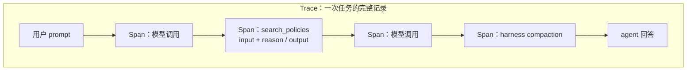
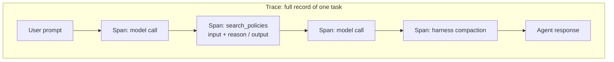

<div class="lang-zh" lang="zh" markdown="1">

> DeepLearning.AI × Chroma｜Module 1｜
> 相关：[Context Failure Modes](/Context-Failure-Modes/)

## 核心观点
要修上下文问题，**先得看见它**。用户一句不满的回复说明 agent 出了问题，
但只看用户输入和 agent 的最终回答，看不出原因——是重复、不一致，还是过时信息？
必须**看数据**，尤其是 **trace**，看清工具实际返回了什么。

例子：客服 agent 多次调用 `search_policies`，
trace 里一眼就能看到**重复的上下文**，以及某一次返回了**旧政策**
（是否合理取决于订单细节）。看数据能快速告诉你下一步该查 harness 还是查数据源。

## Trace 与 Span

- **Trace**：agent 处理一个任务时产生的全部数据，
  即从用户 prompt 到 agent 回答之间发生的一切的记录。包括：
  - 用户输入、agent 回复
  - 工具执行
  - agent 的推理过程
  - 对（一个或多个）模型的每次调用
  - harness 的「内务」动作，比如长上下文的压缩（compaction，Module 3 讲）
- **Span**：trace 中的单个组成部分，例如一次工具执行。
  一次 `search_policies` 调用就是一个 span，里面有**工具输入**和**进入上下文的工具输出**。



trace 是整条链路，span 是可以单独点开查看的一步；
看 trace 是为了发现问题，drill down 到 span 是为了定位是哪一步把坏内容放进了上下文。

## 怎么采集 trace：记录「发生了什么」和「为什么」

采集 span、拼成 trace 需要自己写代码，**这些代码本身就是 harness 的一部分**。

| 要记录的 | 难度 | 做法 |
|---|---|---|
| **What**：发生了什么 | 简单，本质是日志 | 现成日志库，或写 logging hook，在特定事件（如工具调用）触发时记录；写入日志文件或 Arize / LangSmith / Weights & Biases 等平台 |
| **Why**：为什么这么做 | 需要额外设计 | 推理通常不出现在 agent 的回复里，要主动让它进入 trace（见下） |

让「为什么」进入 trace 的两种方式：

1. **System prompt 要求逐步思考**，把思考写在 `<think>` 标签里；
   harness 若检测到就记录下来。
2. **要求为工具调用给出理由**：在工具定义里加一个字符串参数 `reason`，
   要求模型说明目标、为什么选这个工具、为什么参数这样填。
   模型调用工具时会顺带填好 `reason`，它成为工具输入的一部分，
   被 logging hook 一起记录。支持 tool calling 的模型都能用这个模式。

```json
{
  "name": "search_policies",
  "input_schema": {
    "type": "object",
    "properties": {
      "query":  { "type": "string" },
      "reason": {
        "type": "string",
        "description": "State your objective and why you chose this tool and these arguments."
      }
    },
    "required": ["query", "reason"]
  }
}
```

（示意写法，课程只说明了「加一个 `reason` 字段」这个思路。）

## 要点
- 做 agent 时要**养成看 trace 的习惯**：想清楚怎样让正确的信息、
  以正确的格式、在正确的时间进入上下文。
- trace 记录做了什么（哪些工具调用）**以及为什么**；span 让你下钻到单个步骤。
- 要做可靠的 agent，不能只看最终答案，要检查**把内容带进上下文的每一步**。
- 看到的错误可以进一步变成 **evals**，用来衡量 context engineering 改动的效果。

</div>

<div class="lang-en" lang="en" markdown="1">

> DeepLearning.AI × Chroma | Module 1 |
> Related: [Context Failure Modes](/Context-Failure-Modes/)

## Key Idea
Before you can fix a context issue, you have to **spot it**. An annoyed customer message
tells you something is wrong, but the user prompts and final answers alone don't say
whether it was duplicate, inconsistent or stale information. You need to **look at your
data**, especially **traces**, to see what the tools actually returned.

Example: repeated calls to `search_policies` left **duplicate context**, and one call
returned an **old policy** (which may or may not be right, depending on the order). Seeing
this at a glance tells you whether to dig into the harness or the data sources next.

## Traces and Spans

- **Trace**: all the data an agent produces while working on a task — the recording of
  everything between the user prompt and the response. It includes:
  - user inputs and agent responses
  - tool executions
  - the agent's reasoning
  - every call to the model(s) powering the agent
  - housekeeping actions by the harness, e.g. compaction of long context (Module 3)
- **Span**: one component of a trace, e.g. a single tool execution. A `search_policies`
  call is a span holding the **tool input** and the **tool output that entered context**.



The trace is the whole run; a span is one step you can open on its own. You read the
trace to notice a problem and drill down into spans to find which step put bad content
into context.

## Capturing Traces: What Happened and Why

You have to write code to capture spans and build traces, and **that code is part of the
harness**.

| What to capture | Difficulty | How |
|---|---|---|
| **What** happened | Easy — it's basically a log | Logging libraries, or logging hooks fired on events such as a tool call; write to a log file or to Arize / LangSmith / Weights & Biases |
| **Why** it happened | Needs design | Reasoning usually isn't visible in responses, so you must get it into the trace |

Two ways to get the "why" into traces:

1. **Ask for step-by-step thinking in the system prompt**, inside `<think>` tags; log
   those steps when present.
2. **Ask for a justification on each tool call**: add a string field `reason` to the tool
   definition, asking the model to state its objective and why it chose this tool and
   these arguments. The model fills it in with the rest of the call, so it lands in the
   tool input and is recorded by the logging hook. Works with any model that supports tool
   calling (see the JSON sketch above; the course only describes the idea).

## Takeaways
- **Make looking at traces a habit**: think about getting the right information, in the
  right format, at the right time.
- A trace captures what happened (which tool calls) **and why**; spans let you drill down
  into individual steps.
- A reliable agent needs more than a good final answer — inspect every step that put
  content into context.
- The errors you find become the basis for **evals** that measure the impact of your
  context engineering changes.

</div>
