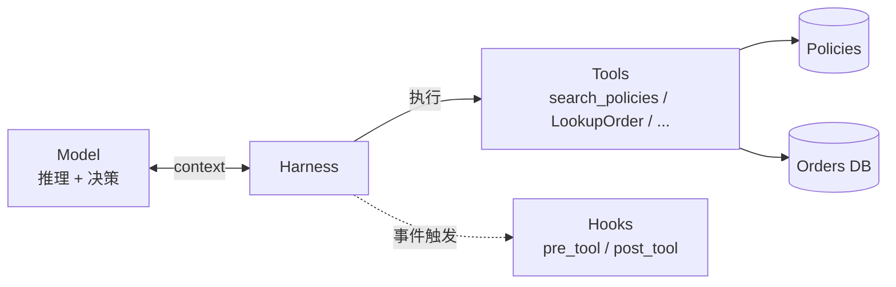
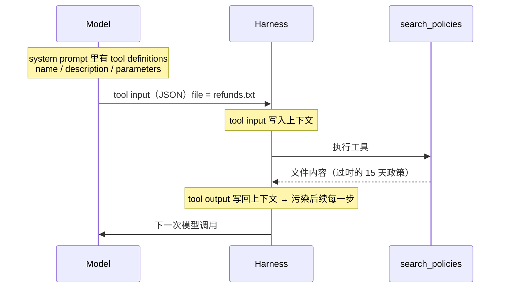
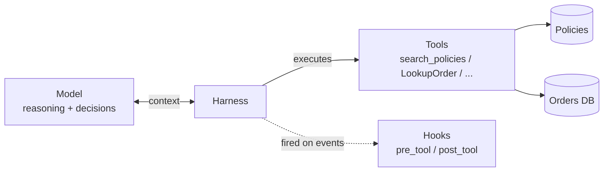
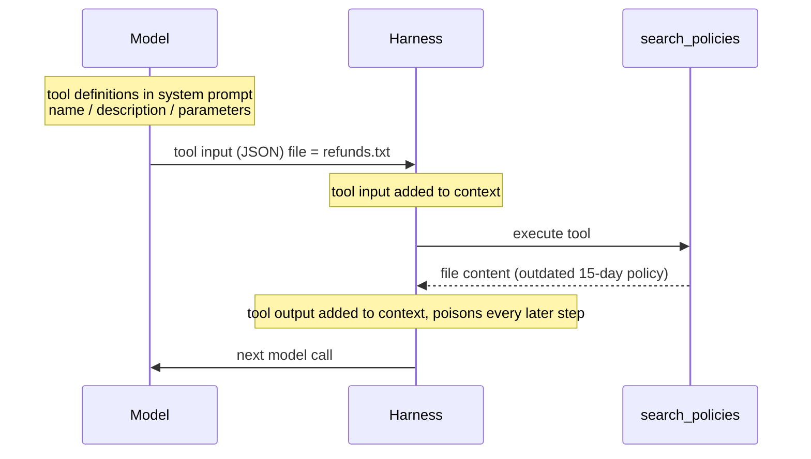

> DeepLearning.AI × Chroma｜Module 1，视频约 8 分钟｜
> 相关：[Context Failure Modes](/Context-Failure-Modes/)

## 核心观点
Agent 由四部分组成：**模型**（大脑，负责推理和决策）、**工具**、**数据源**，
以及把它们连起来的 **harness**——在模型和外部之间来回传递上下文、
并执行 agent 决定使用的工具的那段代码。

**Context engineering** 就是往这个系统里加组件来管理上下文。组件分两类：
- **Tool**：由模型决定调用（例如搜索）
- **Hook**：特定操作发生时，由 harness **确定性地**执行的代码

模型只和 harness 交换上下文，不直接碰数据源；
hook 挂在 harness 上，模型看不到它。

## Tool 调用是怎么走的
回到 Nick 的退款案例：agent 用 `SearchPolicies` 拿到了**过时政策**，拒绝了合理退款，
又误取消了门票。问题就出在这次工具调用。调用前，上下文里已有：
system prompt、Nick 的输入、agent 的第一次回复、`LookupOrder` 的输入输出，
以及一段推理（决定去查退款政策）。

- **Tool definition**：描述工具做什么、需要什么参数。本例放在 system prompt 里，
  也可以放在别处。不同模型格式不同，但都有 name / description / parameters。
- **Tool input**：模型通过专门的生成模式输出结构化数据（通常是 JSON），
  harness 拿它去执行工具。
- **Tool output**：执行结果被加回上下文。

给了 agent 工具，不代表它会按预期使用。常见问题：
- 根本不调用
- 调错工具
- 调对工具但参数错

这些多半出在**工具描述**上，描述要足够详细，让 agent 知道它怎么用、何时用。

但 Nick 的问题更隐蔽：**工具对了，参数 `refunds.txt` 也对，只是文件本身过时**。
如果你没给模型暴露正确的文件，模型也无能为力——这要靠改系统来解决。

## Hook：harness 里的确定性检查
Hook 也是函数，但**不由模型调用**，而是 harness 在特定事件或操作发生时触发。

例子：给政策库加一个 `current` 元数据字段，标记最新版本（旧政策可以保留）。
再写一个 hook `check_current`：文件标记为 current 就返回，否则抛错。
本课和 lab 里它是**直接写死在工具调用里**的，现实中不同系统触发 hook 的方式各不相同。

| 类型 | 时机 | 例子 |
|---|---|---|
| `pre_tool` hook | 工具调用**前** | 检查用户是否有权限使用这个工具 |
| `post_tool` hook | 工具调用**后** | `check_current` 检查返回的政策是否为最新 |

效果：旧政策被拦下、返回错误，agent 重新调用并拿到当前的 45 天政策。
一个 hook 同时避免了两种失败模式：
- **Context Poisoning**：过时结果没进入上下文
- **Context Clash**：上下文里只有一份政策，不再冲突

拿到错误后 agent 怎么做，取决于系统设计；本例是重试。

## Tool vs Hook

| | Tool | Hook |
|---|---|---|
| 谁触发 | 模型根据描述决定 | Harness 在事件/操作发生时触发 |
| 对 agent 可见 | 是，描述通常在 system prompt 里 | 否，不出现在任何 agent 可见的上下文中 |
| 行为 | 模型输出 tool call 结构 → harness 执行 → 输出进上下文 | 确定性执行 |
| 用途 | 让 agent 采取行动 | 给你对系统的控制权，尤其适合管理上下文 |

## 要点
- Harness 的两大组件是 **tool** 和 **hook**，后续课程会大量用它们管理上下文。
- 工具问题先查**描述**；数据本身有问题时，用 **hook + 元数据** 在 harness 层拦截。
- 想知道该改什么，得先看懂 agent 运行时生成的上下文——
  下一节：[Building Intuition About Good Context](/Building-Intuition-About-Good-Context/)。

> DeepLearning.AI × Chroma | Module 1, ~8 min video |
> Related: [Context Failure Modes](/Context-Failure-Modes/)

## Key Idea
An agent has a **model** (the brain that reasons and decides), **tools**, **data
sources**, and a **harness** connecting them — the code that passes context back and
forth to the model(s) and executes the tools the agent decides to use.

**Context engineering** means adding components to this system for context management.
Two kinds:
- **Tools**: invoked when the model decides (e.g. search)
- **Hooks**: code the harness runs **deterministically** when certain operations happen

The model only exchanges context with the harness and never touches the data sources
directly; hooks hang off the harness and are invisible to the model.

## How a Tool Call Flows
Back to Nick: the agent fetched a **stale policy** with `SearchPolicies`, denied a valid
refund, then cancelled his tickets. Before that call, the context held the system prompt,
Nick's input, the agent's first reply, the `LookupOrder` input and output, and a
reasoning step deciding to check the refund policy.

- **Tool definition**: what the tool does and which parameters it needs. Here it lives in
  the system prompt, but it can live elsewhere. Formats vary by model; all have name,
  description and parameters.
- **Tool input**: structured data (usually JSON) the model emits through a special
  generation mode; the harness uses it to run the tool.
- **Tool output**: the result, added back to the context.

Giving an agent a tool doesn't mean it works as expected. It may not call the tool, call
the wrong tool, or call the right tool with wrong inputs. Most of these trace back to the
**tool description**, which must say clearly how the tool works and when to use it.

Nick's case is subtler: **right tool, right input (`refunds.txt`), but the file was
outdated**. The model can't fix that if you don't expose the right files — the system
has to.

## Hooks: Deterministic Checks in the Harness
Hooks are functions too, but **not invoked by the model**; the harness fires them when
specific events or operations take place.

Example: add a `current` metadata field to the policy store marking the latest version
(older policies can stay). A hook `check_current` returns the file if it's current and
raises an error if not. In this lesson and the lab it's hardwired into the tool call;
real systems trigger hooks in various ways.

| Type | When | Example |
|---|---|---|
| `pre_tool` hook | **Before** a tool call | Check the user has permission to use the tool |
| `post_tool` hook | **After** a tool call | `check_current` checks the returned policy is current |

Result: the stale policy is blocked with an error, the agent retries and gets the current
45-day policy. One hook prevents two failure modes:
- **Context Poisoning**: the stale result never enters context
- **Context Clash**: only one policy is in context

What the agent does after the error depends on system design; here it retries.

## Tools vs Hooks

| | Tool | Hook |
|---|---|---|
| Triggered by | The model, based on descriptions | The harness, on events/operations |
| Visible to agent | Yes, usually in the system prompt | No, never in agent-visible context |
| Behavior | Model emits tool call → harness runs it → output enters context | Runs deterministically |
| Purpose | Lets the agent take actions | Gives you control of the system, especially context |

## Takeaways
- **Tools** and **hooks** are the two key harness components; the rest of the course uses
  both to manage context.
- For tool problems, check the **description** first; when the data itself is bad,
  intercept it in the harness with **hooks + metadata**.
- To know what to improve, you must understand the context your agent generates — next:
  [Building Intuition About Good Context](/Building-Intuition-About-Good-Context/).

