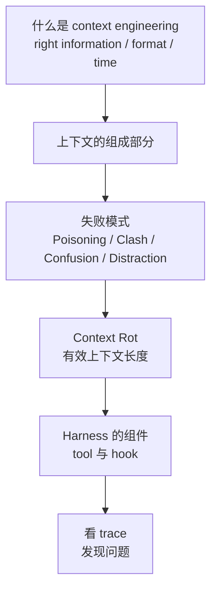
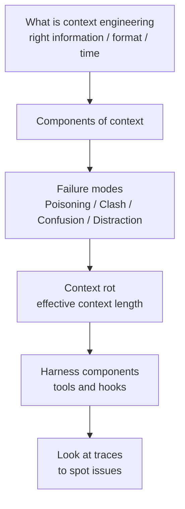

> DeepLearning.AI × Chroma｜Context Engineering 课程 Module 1 的模块介绍、
> 模块总结，以及各节视频笔记索引（不含 lab）

## 为什么需要 context engineering
AI agent 在调试代码、做研究、写邮件等任务上很有用，
但即便能力很强，当手头的数据（即上下文）**不正确、不完整或不一致**时，
也会表现不好。要排查这类问题，光改 prompt 不够，
需要**搭建更好的系统来管理 agent 的上下文**。

## Module 1 学了什么

1. **概念**：context engineering 是什么——让 agent 在正确的时间，
   以正确的格式，拿到正确的信息。
2. **后果**：上下文质量差时会出现哪些可识别的失败模式，以及为什么会发生。
3. **实现**：agent harness 中支撑上下文管理的技术细节——
   tool use 和 hook（确定性动作），以及如何通过日志和推理 trace 看清 agent 实际做了什么。

学完后应该对「context engineering 是什么、要解决什么问题」有直觉，
也知道怎么在自己的 agent 里找这些问题，再用后续模块的技术去修。

## 各节笔记

| # | 视频 | 一句话 |
|---|---|---|
| 1 | [What Is Context Engineering?](/What-Is-Context-Engineering/) | 大窗口会塞满也会腐烂；目标是 right information, right format, right time |
| 2 | [Components of Context](/Components-of-Context/) | system prompt、用户输入、memory、推理过程、工具输出与检索数据 |
| 3 | [Context Failure Modes](/Context-Failure-Modes/) | 中毒、冲突、混淆、干扰四种失败模式 |
| 4 | [Context Rot](/Context-Rot/) | 有效上下文长度远小于标称长度 |
| 5 | [Components of Agent Harnesses](/Components-of-Agent-Harnesses/) | 模型决定调用的 tool，harness 确定性触发的 hook |
| 6 | [Building Intuition About Good Context](/Building-Intuition-About-Good-Context/) | 用 trace 和 span 记录 agent 做了什么、为什么 |
| 7 | [Guest Speaker Drew Breunig (Part 1)](/Drew-Breunig-Part-1/) | 可靠性、prompt debt、让 AI 像软件一样「无聊」 |

## 模块总结
- 更好的 agent 需要更好的数据：靠一个能**检索、管理、存储**数据的 harness，
  让模型在正确的时间，以正确的格式，拿到正确的信息。
  没有它，agent 就会碰到那些可识别的失败模式。
- Tool 和 hook 配合使用：tool 让 agent 采取行动，hook 管理这些行动产生的上下文。
- 编码、研究、邮件这类任务都需要 agent **长时间工作**；没有 context engineering，
  问题会在几分钟、几小时乃至几天里不断叠加。
  这是构建可靠 agent 的重要技能。

## 后续模块

| 模块 | 要构建的 agent | 技术 |
|---|---|---|
| Module 2 | Coding assistant | 解析、切块代码，用多种搜索方法组合检索 |
| Module 3 | Research assistant | 剪枝（pruning）、压缩（compaction）、scratchpad |
| Module 4 | Email assistant | 用 memory 跨时间复用上下文 |

> DeepLearning.AI × Chroma | Context Engineering, Module 1: introduction, conclusion,
> and an index of the video notes (labs not included)

## Why Context Engineering
AI agents are useful for debugging code, research and drafting emails, but even capable
agents struggle when the data they have — their context — is **incorrect, incomplete or
inconsistent**. Better prompts aren't enough to fix that; you need **better systems for
managing the agent's context**.

## What Module 1 Covers

1. **Concept**: what context engineering is — getting agents the right information in
   the right format at the right time.
2. **Consequences**: the failure modes that appear when context quality is poor, and
   why they happen.
3. **Implementation**: the parts of an agent harness that enable context management —
   tool use and hooks (deterministic actions), plus visibility into what an agent
   actually does through logs and reasoning traces.

By the end you should have intuition for what context engineering is and what it fixes,
and know how to look for these problems in your own agents before fixing them with the
techniques in later modules.

## Lesson Notes

| # | Video | In one line |
|---|---|---|
| 1 | [What Is Context Engineering?](/What-Is-Context-Engineering/) | Big windows fill up and rot; aim for right information, format, time |
| 2 | [Components of Context](/Components-of-Context/) | System prompt, user input, memory, reasoning traces, tool outputs and retrieved data |
| 3 | [Context Failure Modes](/Context-Failure-Modes/) | Poisoning, clash, confusion, distraction |
| 4 | [Context Rot](/Context-Rot/) | Effective context length is far below the advertised length |
| 5 | [Components of Agent Harnesses](/Components-of-Agent-Harnesses/) | Tools the model chooses, hooks the harness fires deterministically |
| 6 | [Building Intuition About Good Context](/Building-Intuition-About-Good-Context/) | Traces and spans record what the agent did and why |
| 7 | [Guest Speaker Drew Breunig (Part 1)](/Drew-Breunig-Part-1/) | Reliability, prompt debt, making AI boring like software |

## Module Recap
- Better agents need better data: a harness that can **retrieve, manage and store**
  data so the model gets the right information in the right format at the right time.
  Without it, agents run into recognizable failure modes.
- Tools and hooks work together: tools let agents act, hooks manage the context those
  actions produce.
- Coding, research and email tasks all need agents to **work over long periods**;
  without context engineering, issues compound over minutes, hours or days. That makes
  it a key skill for building reliable agents.

## What's Next

| Module | Agent you build | Techniques |
|---|---|---|
| Module 2 | Coding assistant | Parse and chunk code, retrieve with a combination of search methods |
| Module 3 | Research assistant | Pruning, compaction, scratchpads |
| Module 4 | Email assistant | Reuse context over time through memory |

