<div class="lang-zh" lang="zh" markdown="1">

> DeepLearning.AI × Chroma｜Context Engineering 课程 Module 1 的模块介绍、
> 各节视频笔记和模块总结（不含 lab）

## 为什么需要 context engineering
AI agent 在调试代码、做研究、写邮件等任务上很有用，
但即便能力很强，当手头的数据（即上下文）**不正确、不完整或不一致**时，
也会表现不好。要排查这类问题，光改 prompt 不够，
需要**搭建更好的系统来管理 agent 的上下文**。

## Module 1 学了什么

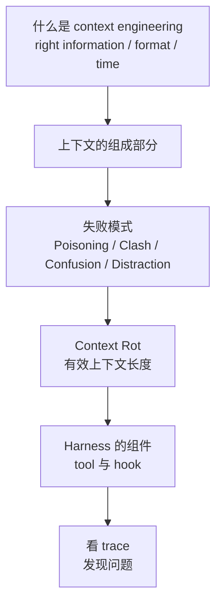

1. **概念**：context engineering 是什么——让 agent 在正确的时间，
   以正确的格式，拿到正确的信息。
2. **后果**：上下文质量差时会出现哪些可识别的失败模式，以及为什么会发生。
3. **实现**：agent harness 中支撑上下文管理的技术细节——
   tool use 和 hook（确定性动作），以及如何通过日志和推理 trace 看清 agent 实际做了什么。

学完后应该对「context engineering 是什么、要解决什么问题」有直觉，
也知道怎么在自己的 agent 里找这些问题，再用后续模块的技术去修。

## 各节笔记

| # | 视频 | 一句话 |
|---|---|---|
| 1 | [What Is Context Engineering?](#m1-zh-01) | 大窗口会塞满也会腐烂；目标是 right information, right format, right time |
| 2 | [Components of Context](#m1-zh-02) | system prompt、用户输入、memory、推理过程、工具输出与检索数据 |
| 3 | [Context Failure Modes](#m1-zh-03) | 中毒、冲突、混淆、干扰四种失败模式 |
| 4 | [Context Rot](#m1-zh-04) | 有效上下文长度远小于标称长度 |
| 5 | [Components of Agent Harnesses](#m1-zh-05) | 模型决定调用的 tool，harness 确定性触发的 hook |
| 6 | [Building Intuition About Good Context](#m1-zh-06) | 用 trace 和 span 记录 agent 做了什么、为什么 |
| 7 | [Guest Speaker Drew Breunig (Part 1)](#m1-zh-07) | 可靠性、prompt debt、让 AI 像软件一样「无聊」 |

<a id="m1-zh-01"></a>

## 01 What Is Context Engineering?

### 什么是 context
以在线票务平台的客服 agent 为例：客户要退款，agent 调用工具查订单、查政策。
这些交互产生的所有数据——纯文本、结构化数据、工具输入输出、
推理过程（reasoning trace）——就叫 **context（上下文）**。
这些数据要放进 **context window（上下文窗口）**才能交给模型，
可以把它理解为模型或 agent 的输入。

agent 能力越来越强，任务越来越长：多 agent 系统可以连续工作好几个小时，
几乎不需要人工干预。长任务会产生海量上下文（工具调用、推理、规划步骤……），
不管理就会一团乱。就像人做长期复杂的工作：资料不整理，就找不到几天前做的东西，
别人也很难接手。**整洁的上下文让 AI 工作得更好。**

### 为什么不能把所有东西都塞进 1M 窗口
两个问题：

1. **很快就会塞满。** 假设起始上下文 1,000 token（约一页半单倍行距文字）：

   | 任务类型 | 每轮增长 | 结果 |
   |---|---|---|
   | 简单任务 | 约 10% | 约 7 轮后长度翻倍 |
   | 复杂任务（像 Claude Code / Codex 那样有大量中间步骤） | 约 150% | 7 轮多一点就到 1M 上限 |

2. **更根本的问题：上下文越长，模型越差。** 到几十万 token 时推理能力下降，
   大窗口用不满——这叫 **Context Rot**，见 [Context Rot](#m1-zh-04)。

结论：**长上下文窗口解决不了一切**，需要搭建系统，让上下文保持整洁有序，
这项工作就是 context engineering。

### 定义：right information, right format, right time
> Context engineering 是一门艺术和科学：在 agent 完成当前任务需要的时候，
> 以正确的格式，给它正确的信息。

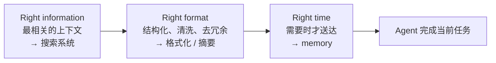

- **Right information**：保证 agent 拿到完成任务最相关的上下文。
  核心是搭好搜索系统、针对任务选对搜索方法。
- **Right format**：上下文要结构化、有条理、经过清洗，去掉不必要的信息，
  保留任务需要的关键细节。既包括传统意义的格式（加结构、加标题），
  也包括**摘要**这类整合信息的方式。
- **Right time**：在真正需要的那一刻，把相关且格式良好的信息送到 agent 面前。
  例如 memory 可以在之后取回状态，让 agent 能自我改进。

三个维度和后续模块一一对应：

| 模块 | 主题 | 例子 |
|---|---|---|
| Module 2 | Agentic search（right information） | 探索代码库的 coding agent |
| Module 3 | 格式化检索到的上下文（right format） | 回答复杂问题的 research agent |
| Module 4 | 按需存取上下文 / memory（right time） | 处理邮件、日程的多 agent 个人助理 |

### 要点
- Context = agent 工作时产生和使用的所有数据；context window = 模型的输入。
- 大窗口既会被很快塞满，又会因 context rot 而用不好。
- Context engineering 的目标：right information, right format, right time。

<a id="m1-zh-02"></a>

## 02 Components of Context

### 核心观点
开始做 context engineering 时，先**看清并给 agent 要处理的各类上下文命名**。

### 从聊天机器人到 agent，上下文怎么变多的
- **早期聊天机器人**：单次调用、单次回复，只需关心三样东西：
  system prompt（行为指令）、用户输入、模型回复。
- **RAG**：为了突破模型训练数据的截止日期，系统被**写死**成固定流程：
  拿到用户 prompt → 用相似度搜索等方法从向量库找相关数据 → 注入上下文 → 交给模型推理。
- **Agent**：模型自己决定调用哪些工具，每一步的结果都加进上下文。

### 一次退款请求里，上下文是怎么累积的
**Harness** 是 AI 工程师对所有支撑代码的统称：数据处理、调用模型、执行工具等。

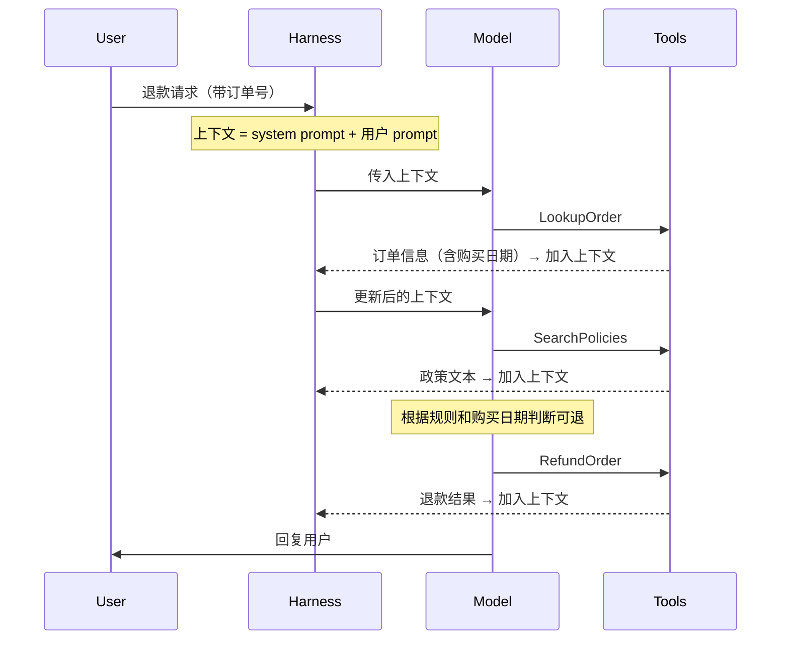

每一步工具调用都会让上下文变长，模型基于**更新后的上下文**决定下一步。

### 上下文的组成部分

| 组成部分 | 说明 |
|---|---|
| **System prompt** | 整体行为指令。理想情况下应**简单、稳定**，因为它始终在 agent 上下文的开头，适合放不随时间变化的信息 |
| **用户输入** | 来自人类用户的输入 |
| **Memory** | 持续管理的信息，用于个性化，或在合适的时候拿到正确的任务指令（Module 4） |
| **Reasoning traces** | agent 内部记录的解题过程 |
| **工具相关上下文** | 工具输出、检索到的数据 |

要管理的数据很多，管不好就会影响系统表现——
下一节：[Context Failure Modes](#m1-zh-03)。

<a id="m1-zh-03"></a>

## 03 Context Failure Modes

### 核心观点
即使模型能力很强，**上下文管理不好**，agent 也会失败。这些失败其实不是模型的问题，而是**送进模型的信息质量**出了问题。

**Context Engineering** = 控制每次模型调用时：
1. **什么信息**进入上下文
2. 信息**表达得是否清晰**
3. 信息**能保持有用多久**

### 案例背景
客服 agent 处理退款：Nick，订单 #8934，Taylor Swift 纽约演唱会门票，4/30 购买，现在 5/30（30 天后）。
- 旧政策：15 天内可退；新政策：45 天内可退
- 问题：**新旧两份政策都在 Policies 文档库里**
- 可用工具：SearchPolicies / LookupOrder / RefundOrder / CancelOrder / WebSearch

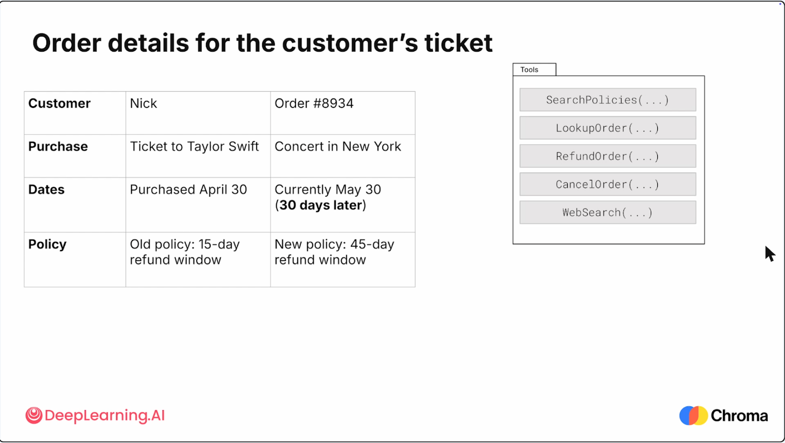

### 四种失败模式

#### 1. Context Poisoning（上下文中毒）— 错误信息
- SearchPolicies 检索到了**过时的 15 天政策**，模型据此告诉 Nick 不能退款。
- 模型推理本身没错，但文档**没有标明自己已过时**，模型就默认它是对的。
- 根因：文档缺少元数据（生效时间）。

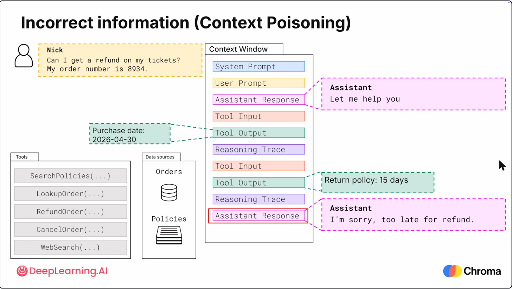

#### 2. Context Clash（上下文冲突）— 不一致信息
- Nick 反驳后，再次检索拿到 45 天政策，上下文里同时有 15 天和 45 天两份政策。
- 两者都看似合理，但**没标明生效时间或哪个是权威版本**。
- 大模型也许能推断出新的取代旧的，但小模型（如为隐私部署在本地的）可能做不到。
- **系统不应依赖模型去推断**；更大的上下文窗口也无法告诉模型哪个是最新的。

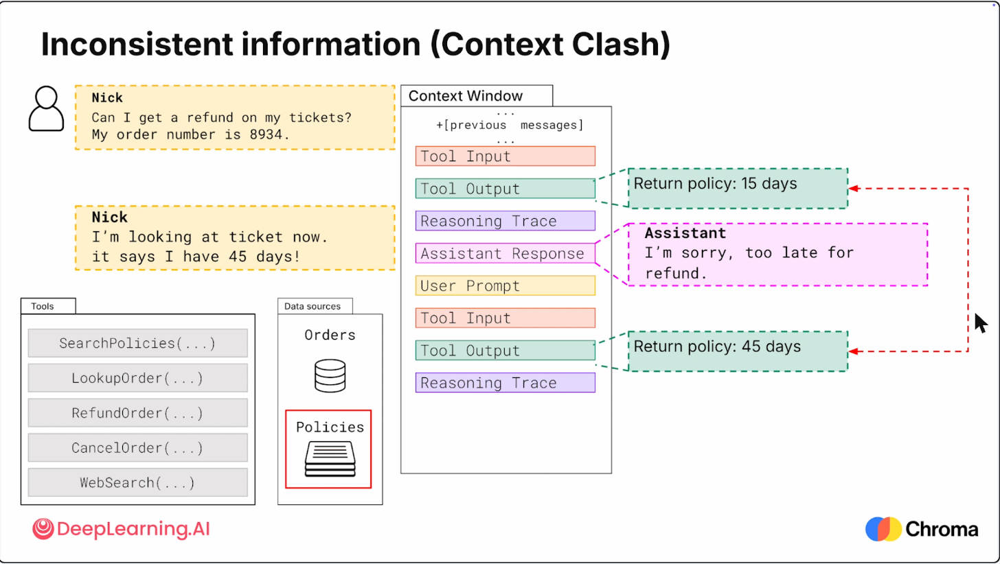

#### 3. Context Confusion（上下文混淆）— 模糊信息
- Nick 说 "please cancel"，本意是要退款。
- RefundOrder 和 CancelOrder 的**工具描述高度重叠**（都写着 "Use when a customer no longer wants a purchase"）。
- 工具描述类似函数的 docstring，决定模型选哪个工具；描述不区分就会选错。
- 结果：调用了 CancelOrder → **票没了，钱也没退**，产生真实后果。

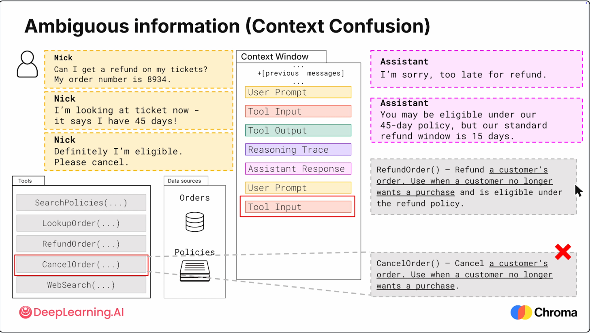

#### 4. Context Distraction（上下文干扰）— 无关信息
- Nick 问起 Taylor Swift 的婚礼，模型调用 WebSearch，返回大量**原始 HTML**，被塞进下一次模型调用。
- 原任务要和大量无关信息竞争注意力（里面可能还恰好包含 refund、policy 等词）。
- agent 变慢、变不可靠——恰恰是在客户已经不耐烦的时候。

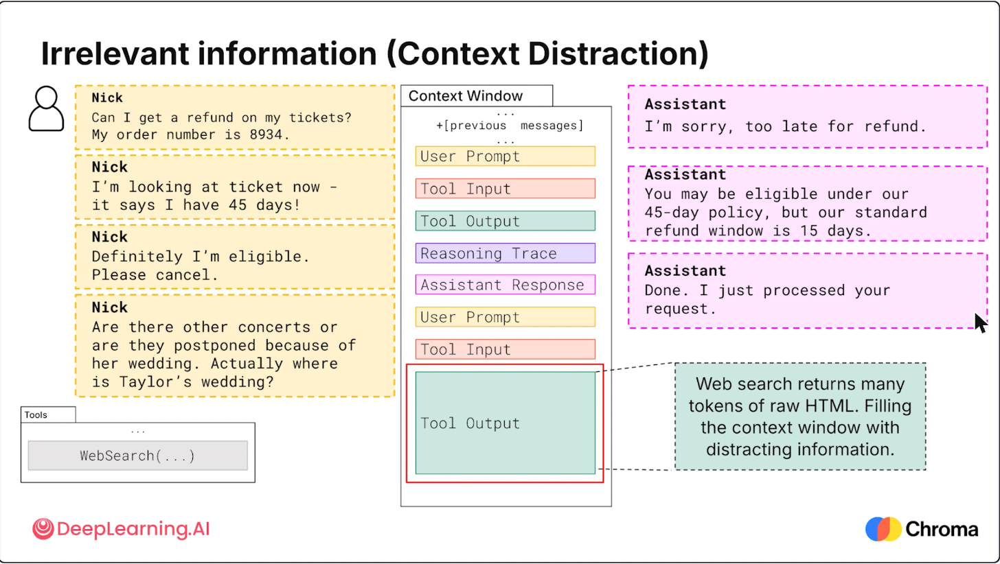

### 总结

| 失败模式 | 信息问题 | 本例原因 |
|---|---|---|
| Poisoning 中毒 | 错误（Incorrect） | 过时政策，无生效时间元数据 |
| Clash 冲突 | 不一致（Inconsistent） | 新旧政策并存，无版本/日期说明 |
| Confusion 混淆 | 模糊（Ambiguous） | 两个工具描述重叠，选错工具 |
| Distraction 干扰 | 无关（Irrelevant） | 无边界的网页搜索结果塞满上下文 |

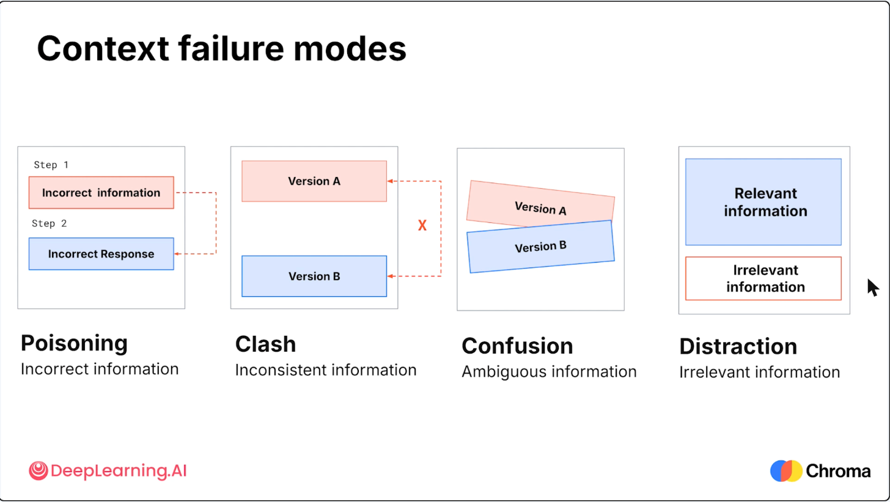

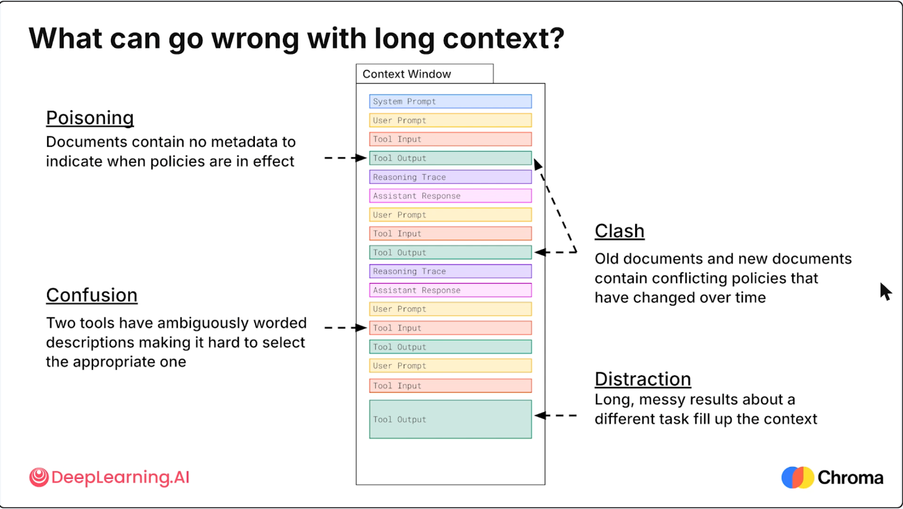

### 要点
- 这些错误在**短任务**中也会发生；在**长任务**中会**叠加放大**。
- 上下文不断变长会带来新问题 → **Context Rot（上下文腐烂）**，见下一节 [Context Rot](#m1-zh-04)。

<a id="m1-zh-04"></a>

## 04 Context Rot

### 核心观点
长任务里，上下文窗口会被逐渐填满——即使窗口本身很大。**上下文越满，模型表现越差**，尤其是：
- 只被提到过**一两次**的细节
- 位于上下文**中间位置**的细节

Chroma 团队在 2025 年的研究里把这个现象命名为 **Context Rot（上下文腐烂）**。
例：客服 agent 在对话开头拿到了订单号，聊了很多轮之后就"忘了"。

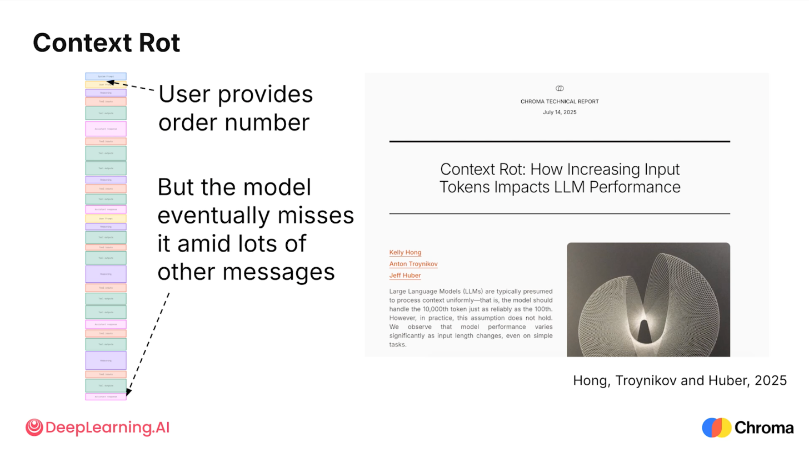

### 上下文长度 ≠ 有效上下文长度
- **Context Length（标称上下文长度）**：模型一次调用**最多能接收**多少 token，比如 1M。
- **Effective Context Length（有效上下文长度）**：在某个具体任务上，模型**能可靠使用**的上下文有多少。
- 没有统一的"超过百分之多少就崩"的阈值，它取决于：模型、任务、周围的信息、信息的排列方式。
- Chroma 的实验显示，有效长度可能**低至标称长度的 20%–40%**（图中 1M 窗口，有效的可能只有约 200K）。
- 结论：**能塞进去 ≠ 能用好**，往上下文里放东西要有意识、有取舍。

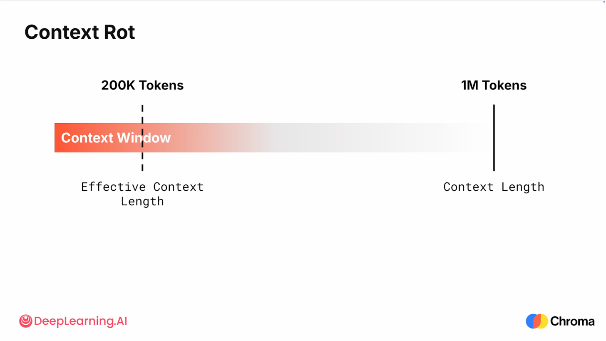

### 实验：LongMemEval，Full vs Focused
任务：给一段用户与聊天机器人的对话，回答一个问题；模型必须找到对话中**特定的那一段**才能答对。

| 版本 | 输入 | 规模 |
|---|---|---|
| **Full** 完整版 | 全部对话历史 | 约 500 条消息，约 120,000 token |
| **Focused** 聚焦版 | 只有回答问题所需的片段 | 3–5 条消息，平均不到 300 token |

两个版本里**都有答案**。区别在于：Focused 只需要对相关证据做推理；Full 要先在几百条消息里**找到**证据，再推理，难度大得多。

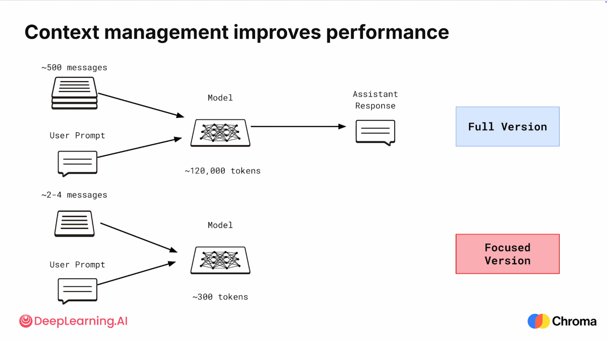

#### 结果
- 所有被测模型上，**Focused 都明显好于 Full**（例：Claude Opus 4 为 0.92 vs 0.38）。
- **推理模式（thinking）在两种条件下都有帮助，但消除不了差距**（Opus 4 thinking：0.95 vs 0.72）。
- 在 GPT、Qwen、Gemini 上也得到了类似结果。
- 如果模型在整个上下文窗口内表现均匀，周围的历史不应造成这么大的差异 → 说明模型**远在达到标称长度之前**就开始吃力了。

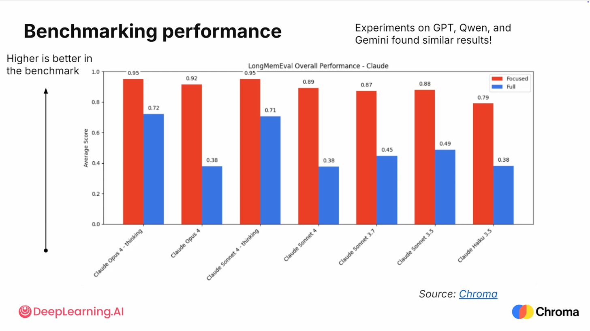

### Context Rot vs 四种失败模式：两个不同的问题

| | 出了什么问题 | 什么时候发生 |
|---|---|---|
| **Context Rot** | 和上下文的**大小**有关：超过有效长度后，模型无法可靠使用这些 token；还带来更高成本、更慢响应 | 有效长度视场景而定，部分任务在标称长度的 20%–40% 就开始退化 |
| **Failure Modes**（中毒/冲突/混淆/干扰） | 和上下文的**质量**有关：信息错误、不一致、模糊或无关 → 错误回答或不想要的动作 | 短上下文里也会发生，但长上下文里更容易发生（比如对话越长，越可能出现互相矛盾的内容 → Clash） |

关键：Context Rot 是**独立的问题**，源于语言模型**注意力机制**的工作方式；即使上下文里的信息全部正确、一致、清晰、相关，填得太满也会腐烂。

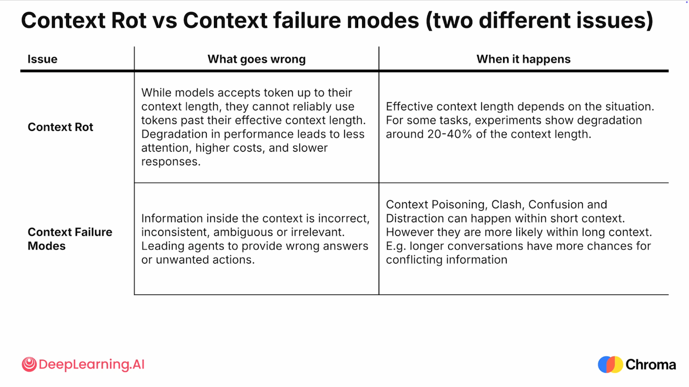

### Context Engineering 怎么应对
目标是把 Full 版本的上下文变成 Focused 版本：
1. **验证信息正确**：比如只传最新的政策（对应 Poisoning / Clash）
2. **只放相关信息**：改进检索工具，让 agent 拿到最相关的上下文（对应 Distraction）
3. **丢弃过时 / 无关信息**：在 agent 里加代码，主动从上下文中清理掉它们
4. **格式化上下文**：加结构、总结关键事实，让重要信息更**显眼（salient）**（对应 Confusion）
5. **盯住上下文长度**：别撞上 Context Rot

做法上就是给 agent 构建工具和功能，用来：改进搜索、清理并格式化工作上下文、**按需（just-in-time）**检索知识或指令。后续模块会逐一展开。

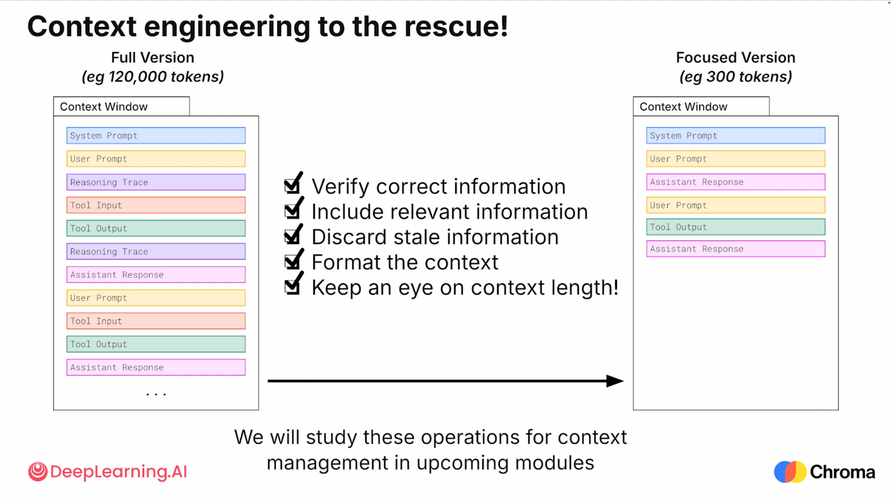

### 要点
- **能塞进去 ≠ 能用好**：设计时按"有效上下文长度"估算，而不是标称长度。
- Rot 管"量"，四种失败模式管"质"；两者独立，但上下文变长会让失败模式更容易出现。
- 上下文管理的这些代码和工具，最终要落在 agent 的整体系统（模型、工具、数据源，以及把它们连起来的 **harness**）里 → 下一节讲 agent 的组成。

**English summary:** A model's advertised context length is not how much it can use well. As the window fills, recall drops — especially for rarely mentioned or mid-context details (Context Rot). Context engineering keeps the window focused: verify, include only what's relevant, discard stale data, format it, and watch the length.

<a id="m1-zh-05"></a>

## 05 Components of Agent Harnesses

### 核心观点
Agent 由四部分组成：**模型**（大脑，负责推理和决策）、**工具**、**数据源**，
以及把它们连起来的 **harness**——在模型和外部之间来回传递上下文、
并执行 agent 决定使用的工具的那段代码。

**Context engineering** 就是往这个系统里加组件来管理上下文。组件分两类：
- **Tool**：由模型决定调用（例如搜索）
- **Hook**：特定操作发生时，由 harness **确定性地**执行的代码

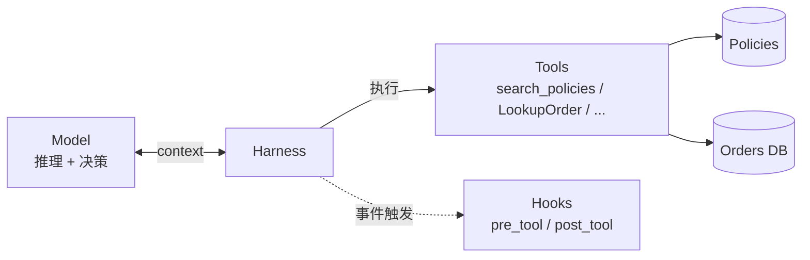

模型只和 harness 交换上下文，不直接碰数据源；
hook 挂在 harness 上，模型看不到它。

### Tool 调用是怎么走的
回到 Nick 的退款案例：agent 用 `SearchPolicies` 拿到了**过时政策**，拒绝了合理退款，
又误取消了门票。问题就出在这次工具调用。调用前，上下文里已有：
system prompt、Nick 的输入、agent 的第一次回复、`LookupOrder` 的输入输出，
以及一段推理（决定去查退款政策）。

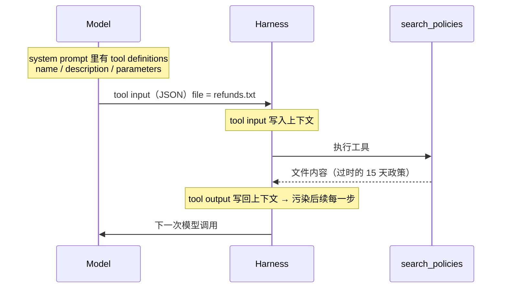

- **Tool definition**：描述工具做什么、需要什么参数。本例放在 system prompt 里，
  也可以放在别处。不同模型格式不同，但都有 name / description / parameters。
- **Tool input**：模型通过专门的生成模式输出结构化数据（通常是 JSON），
  harness 拿它去执行工具。
- **Tool output**：执行结果被加回上下文。

给了 agent 工具，不代表它会按预期使用。常见问题：
- 根本不调用
- 调错工具
- 调对工具但参数错

这些多半出在**工具描述**上，描述要足够详细，让 agent 知道它怎么用、何时用。

但 Nick 的问题更隐蔽：**工具对了，参数 `refunds.txt` 也对，只是文件本身过时**。
如果你没给模型暴露正确的文件，模型也无能为力——这要靠改系统来解决。

### Hook：harness 里的确定性检查
Hook 也是函数，但**不由模型调用**，而是 harness 在特定事件或操作发生时触发。

例子：给政策库加一个 `current` 元数据字段，标记最新版本（旧政策可以保留）。
再写一个 hook `check_current`：文件标记为 current 就返回，否则抛错。
本课和 lab 里它是**直接写死在工具调用里**的，现实中不同系统触发 hook 的方式各不相同。

| 类型 | 时机 | 例子 |
|---|---|---|
| `pre_tool` hook | 工具调用**前** | 检查用户是否有权限使用这个工具 |
| `post_tool` hook | 工具调用**后** | `check_current` 检查返回的政策是否为最新 |

效果：旧政策被拦下、返回错误，agent 重新调用并拿到当前的 45 天政策。
一个 hook 同时避免了两种失败模式：
- **Context Poisoning**：过时结果没进入上下文
- **Context Clash**：上下文里只有一份政策，不再冲突

拿到错误后 agent 怎么做，取决于系统设计；本例是重试。

### Tool vs Hook

| | Tool | Hook |
|---|---|---|
| 谁触发 | 模型根据描述决定 | Harness 在事件/操作发生时触发 |
| 对 agent 可见 | 是，描述通常在 system prompt 里 | 否，不出现在任何 agent 可见的上下文中 |
| 行为 | 模型输出 tool call 结构 → harness 执行 → 输出进上下文 | 确定性执行 |
| 用途 | 让 agent 采取行动 | 给你对系统的控制权，尤其适合管理上下文 |

### 要点
- Harness 的两大组件是 **tool** 和 **hook**，后续课程会大量用它们管理上下文。
- 工具问题先查**描述**；数据本身有问题时，用 **hook + 元数据** 在 harness 层拦截。
- 想知道该改什么，得先看懂 agent 运行时生成的上下文——
  下一节：[Building Intuition About Good Context](#m1-zh-06)。

<a id="m1-zh-06"></a>

## 06 Building Intuition About Good Context

### 核心观点
要修上下文问题，**先得看见它**。用户一句不满的回复说明 agent 出了问题，
但只看用户输入和 agent 的最终回答，看不出原因——是重复、不一致，还是过时信息？
必须**看数据**，尤其是 **trace**，看清工具实际返回了什么。

例子：客服 agent 多次调用 `search_policies`，
trace 里一眼就能看到**重复的上下文**，以及某一次返回了**旧政策**
（是否合理取决于订单细节）。看数据能快速告诉你下一步该查 harness 还是查数据源。

### Trace 与 Span

- **Trace**：agent 处理一个任务时产生的全部数据，
  即从用户 prompt 到 agent 回答之间发生的一切的记录。包括：
  - 用户输入、agent 回复
  - 工具执行
  - agent 的推理过程
  - 对（一个或多个）模型的每次调用
  - harness 的「内务」动作，比如长上下文的压缩（compaction，Module 3 讲）
- **Span**：trace 中的单个组成部分，例如一次工具执行。
  一次 `search_policies` 调用就是一个 span，里面有**工具输入**和**进入上下文的工具输出**。

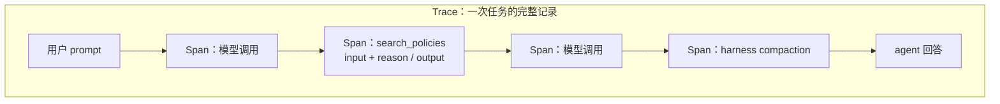

trace 是整条链路，span 是可以单独点开查看的一步；
看 trace 是为了发现问题，drill down 到 span 是为了定位是哪一步把坏内容放进了上下文。

### 怎么采集 trace：记录「发生了什么」和「为什么」

采集 span、拼成 trace 需要自己写代码，**这些代码本身就是 harness 的一部分**。

| 要记录的 | 难度 | 做法 |
|---|---|---|
| **What**：发生了什么 | 简单，本质是日志 | 现成日志库，或写 logging hook，在特定事件（如工具调用）触发时记录；写入日志文件或 Arize / LangSmith / Weights & Biases 等平台 |
| **Why**：为什么这么做 | 需要额外设计 | 推理通常不出现在 agent 的回复里，要主动让它进入 trace（见下） |

让「为什么」进入 trace 的两种方式：

1. **System prompt 要求逐步思考**，把思考写在 `<think>` 标签里；
   harness 若检测到就记录下来。
2. **要求为工具调用给出理由**：在工具定义里加一个字符串参数 `reason`，
   要求模型说明目标、为什么选这个工具、为什么参数这样填。
   模型调用工具时会顺带填好 `reason`，它成为工具输入的一部分，
   被 logging hook 一起记录。支持 tool calling 的模型都能用这个模式。

```json
{
  "name": "search_policies",
  "input_schema": {
    "type": "object",
    "properties": {
      "query":  { "type": "string" },
      "reason": {
        "type": "string",
        "description": "State your objective and why you chose this tool and these arguments."
      }
    },
    "required": ["query", "reason"]
  }
}
```

（示意写法，课程只说明了「加一个 `reason` 字段」这个思路。）

### 要点
- 做 agent 时要**养成看 trace 的习惯**：想清楚怎样让正确的信息、
  以正确的格式、在正确的时间进入上下文。
- trace 记录做了什么（哪些工具调用）**以及为什么**；span 让你下钻到单个步骤。
- 要做可靠的 agent，不能只看最终答案，要检查**把内容带进上下文的每一步**。
- 看到的错误可以进一步变成 **evals**，用来衡量 context engineering 改动的效果。

<a id="m1-zh-07"></a>

## 07 Guest Speaker Drew Breunig (Part 1)

### 嘉宾
**Drew Breunig**：Compound 的 CEO 兼创始人，正在为 O'Reilly 写一本关于
context engineering 的书，活跃于 DSPy 社区。每个模块之后都会有一段他的对谈节选，
这一段的主题是**构建更可靠的 agent**。

### 可靠性才是关键
- 新闻里看到的多是 agent 在 benchmark 上的惊人成绩，
  但在企业里构建可靠的 agent 是**完全不同的任务**。
- 企业关心的不是智能的理论上限，而是：**这件简单的事能不能稳定做对**，
  让组织里不会用这个工具的人也能放心用。
- 企业 agent 死在这里：**错 10% 就过线了**。用户会想，
  反正每次都得检查，不如自己做。

### Prompt debt：不可靠是怎么来的

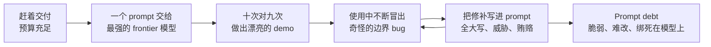

- 典型做法：赶着交付、预算宽松，就把 prompt 丢给最大的 frontier 模型，让它自己摸索路径。
  十次能对九次，做出漂亮的 demo 交差。
- 问题：模型如何得到结果是个黑盒，使用中会不断发现奇怪的边界 bug，
  于是不停往 prompt 里加补丁（例如「这类收据记成 receipt，别记成 invoice」），
  甚至用全大写、威胁、贿赂模型等各种奇招。
- 这些招数都是**针对特定模型的**，相当于对模型过拟合。
  最后得到一个塞满经验和「民间智慧」的**脆弱 prompt**，难以修改；
  换新模型时往往只能推倒重来。
- Drew 把这叫 **prompt debt**，类似技术债。

### 出路：让 AI 更「无聊」，更像软件
DSPy 等项目的使命是让 AI **像软件一样有预期、有契约**。
走出 prompt debt 的团队，最后往往殊途同归，用上 DSPy 一直奉行的理念：
- **有类型的输入和输出**（typed inputs / outputs），可靠的契约
- **重试逻辑**
- **结构化的 prompt**，带一点 schema
- **拆成多个步骤**：别让一次调用做 20 件事，把能拆的拆出来，每一块都更可靠、更好评估

### Human-in-the-loop 还是全自动？
- Andrew 的看法：真实世界的复杂性无穷无尽，
  人持续在环中指导、反馈、把领域知识注入 prompt 和 harness，
  在可预见的未来会胜过纯 AI。
- Drew：这是**两种不同的任务**，设计应用时要先想清楚是不是 human-in-the-loop。
  - 很多企业退回到 human-in-the-loop，是因为**可靠性上不去**：10 次对 9 次，
    就让人来兜底。coding agent 就是这样——放任它一直写，会做出一串坏决定、
    层层叠加，浪费大量 token。
  - 但企业里 AI 创造价值最大的，是**人不在环中的 workflow**：
    任务切得足够小，小到能做可靠并固化下来。
    随着我们越来越会构建 workflow 和 agent，这部分会越来越多。

### 要点
- 企业 agent 的门槛是**可靠性**，不是 benchmark 上的智能。
- 不断给 prompt 打补丁会积累 **prompt debt**；
  解法是类型化输入输出、重试、结构化 prompt、拆分步骤。
- 先判断应用是否 human-in-the-loop；
  全自动的价值来自**足够小、能做可靠**的任务。

## 模块总结
- 更好的 agent 需要更好的数据：靠一个能**检索、管理、存储**数据的 harness，
  让模型在正确的时间，以正确的格式，拿到正确的信息。
  没有它，agent 就会碰到那些可识别的失败模式。
- Tool 和 hook 配合使用：tool 让 agent 采取行动，hook 管理这些行动产生的上下文。
- 编码、研究、邮件这类任务都需要 agent **长时间工作**；没有 context engineering，
  问题会在几分钟、几小时乃至几天里不断叠加。
  这是构建可靠 agent 的重要技能。

## 后续模块

| 模块 | 要构建的 agent | 技术 |
|---|---|---|
| Module 2 | Coding assistant | 解析、切块代码，用多种搜索方法组合检索 |
| Module 3 | Research assistant | 剪枝（pruning）、压缩（compaction）、scratchpad |
| Module 4 | Email assistant | 用 memory 跨时间复用上下文 |

</div>

<div class="lang-en" lang="en" markdown="1">

> DeepLearning.AI × Chroma | Context Engineering, Module 1: introduction, notes for
> each video, and conclusion (labs not included)

## Why Context Engineering
AI agents are useful for debugging code, research and drafting emails, but even capable
agents struggle when the data they have — their context — is **incorrect, incomplete or
inconsistent**. Better prompts aren't enough to fix that; you need **better systems for
managing the agent's context**.

## What Module 1 Covers

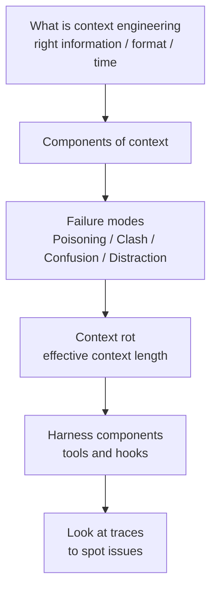

1. **Concept**: what context engineering is — getting agents the right information in
   the right format at the right time.
2. **Consequences**: the failure modes that appear when context quality is poor, and
   why they happen.
3. **Implementation**: the parts of an agent harness that enable context management —
   tool use and hooks (deterministic actions), plus visibility into what an agent
   actually does through logs and reasoning traces.

By the end you should have intuition for what context engineering is and what it fixes,
and know how to look for these problems in your own agents before fixing them with the
techniques in later modules.

## Lesson Notes

| # | Video | In one line |
|---|---|---|
| 1 | [What Is Context Engineering?](#m1-en-01) | Big windows fill up and rot; aim for right information, format, time |
| 2 | [Components of Context](#m1-en-02) | System prompt, user input, memory, reasoning traces, tool outputs and retrieved data |
| 3 | [Context Failure Modes](#m1-en-03) | Poisoning, clash, confusion, distraction |
| 4 | [Context Rot](#m1-en-04) | Effective context length is far below the advertised length |
| 5 | [Components of Agent Harnesses](#m1-en-05) | Tools the model chooses, hooks the harness fires deterministically |
| 6 | [Building Intuition About Good Context](#m1-en-06) | Traces and spans record what the agent did and why |
| 7 | [Guest Speaker Drew Breunig (Part 1)](#m1-en-07) | Reliability, prompt debt, making AI boring like software |

<a id="m1-en-01"></a>

## 01 What Is Context Engineering?

### What Context Is
Take a customer service agent for an online ticket platform: a customer asks for a
refund, and the agent uses tools to look up the order and check policies. All the data
these interactions produce — plain text, structured data, tool inputs and outputs,
reasoning traces — is **context**. To reach the model it must be placed in the
**context window**, which you can think of as the input to the model or agent.

Agents now handle longer and more complex tasks; multi-agent systems can work for hours
with little or no human intervention. Long tasks generate huge amounts of context (tool
calls, reasoning, planning steps), which gets messy if unmanaged. Just as with a person
on a long project, disorganized data makes it hard to find earlier work or for someone
else to help. **Tidy context helps AI work better.**

### Why Not Dump Everything into a 1M Window?
Two issues:

1. **It fills up fast.** Starting from 1,000 tokens (about a page and a half of
   single-spaced text):

   | Task | Growth per turn | Result |
   |---|---|---|
   | Simple | ~10% | Length roughly doubles after 7 turns |
   | Complex (many intermediate steps, like Claude Code / Codex) | ~150% | Hits the 1M limit in a little over 7 turns |

2. **More fundamental: models get worse with long context.** With hundreds of thousands
   of tokens, reasoning degrades, so you can't fully use the window. This is **context
   rot** — see [Context Rot](#m1-en-04).

Takeaway: **long context windows don't solve everything.** You need systems that keep
context tidy and organized; that work is context engineering.

### Definition: Right Information, Right Format, Right Time
> Context engineering is the art and science of giving your agent the right information,
> in the right format, at the right time that it needs to complete its current task.

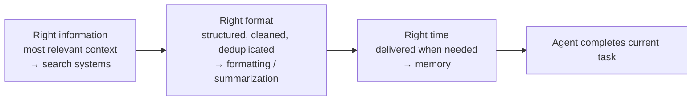

- **Right information**: the agent has the most relevant context for the task. At its
  heart, this means good search systems and the right search method for the task.
- **Right format**: context is well structured, organized and cleaned, with unnecessary
  information removed and the important details preserved. This covers formatting in the
  traditional sense (structure, headers) and also **summarization** as a way to
  consolidate information.
- **Right time**: relevant, well-formatted information reaches the agent right when it's
  needed. For example, memory can later retrieve state, making agents self-improving.

Each maps to a later module:

| Module | Topic | Example |
|---|---|---|
| Module 2 | Agentic search (right information) | Coding agent exploring a codebase |
| Module 3 | Formatting retrieved context (right format) | Research agent answering complex questions |
| Module 4 | Storing and loading context just in time / memory (right time) | Multi-agent personal assistant for email and calendar |

### Takeaways
- Context = all the data an agent produces and uses; the context window = the model's
  input.
- Big windows both fill up quickly and degrade through context rot.
- The goal of context engineering: right information, right format, right time.

<a id="m1-en-02"></a>

## 02 Components of Context

### Key Idea
When you start on context engineering, begin by **looking at and naming the types of
context** your agent has to deal with.

### How Context Grew from Chatbots to Agents
- **Early chatbots**: single calls and responses; the only context was the system prompt
  (instructions), the user input and the model's response.
- **RAG**: to get past the model's training cutoff, systems were **hardwired** to take
  the user prompt → find relevant data in a vector store (e.g. similarity search) →
  inject it into the context → let the model reason over it.
- **Agents**: the model decides which tools to call, and each result is added to the
  context.

### How Context Accumulates in a Refund Request
The **harness** is what AI engineers call all the supporting code: data handling,
calling the models, executing tools, and so on.

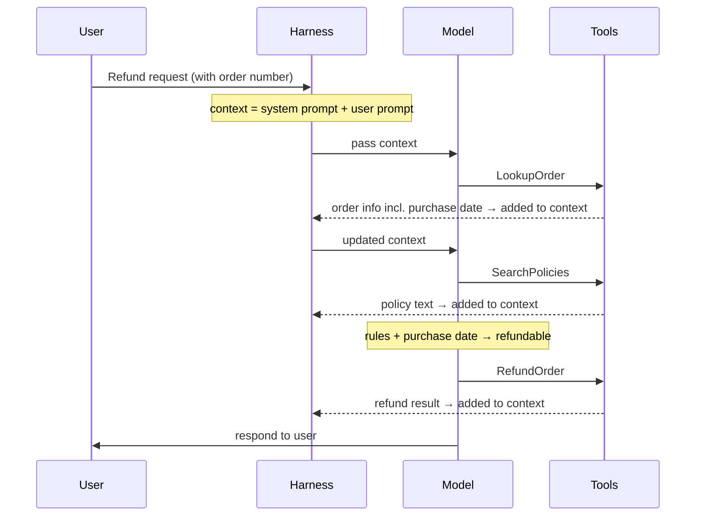

Every tool call makes the context longer, and the model picks its next step from the
**updated context**.

### Components of Context

| Component | What it is |
|---|---|
| **System prompt** | Overall instructions. Ideally **simple and stable**, since it stays at the start of the agent's context; the place for information that doesn't change over time |
| **User input** | Input from human users |
| **Memory** | Ongoing management of information for personalization or getting the right instructions at the right time (Module 4) |
| **Reasoning traces** | The agent's internal record of how it's solving the problem |
| **Tool-related context** | Tool outputs and retrieved data |

That's a lot of data, and managing it poorly hurts performance — next:
[Context Failure Modes](#m1-en-03).

<a id="m1-en-03"></a>

## 03 Context Failure Modes

### Key Idea
Even agents powered by the most capable models can fail when **context is not carefully managed**. These failures are not really the model's fault; they come from the **quality of the information** that reaches it.

**Context Engineering** = controlling, for each model call:
1. **What** information reaches the model
2. **How clearly** that information is represented
3. **How long** it remains useful

### The Scenario
A customer service agent handles a refund: Nick, order #8934, ticket to a Taylor Swift concert in New York, purchased April 30, now May 30 (30 days later).
- Old policy: 15-day refund window; new policy: 45-day refund window
- Problem: **both policies live in the same Policies document store**
- Tools: SearchPolicies / LookupOrder / RefundOrder / CancelOrder / WebSearch


### The Four Failure Modes

#### 1. Context Poisoning — Incorrect information
- SearchPolicies returns the **outdated 15-day policy**, so the model tells Nick he is not eligible.
- The model's reasoning is fine, but the document **doesn't identify itself as outdated**, so the model assumes it's correct.
- Root cause: documents have no metadata saying when a policy is in effect.


#### 2. Context Clash — Inconsistent information
- Nick pushes back; a second search retrieves the 45-day policy. Now the context holds both 15 days and 45 days.
- Both look plausible, and **neither says when it applied or which version is authoritative**.
- A large model might infer the newer one wins, but a small model (e.g., running on-platform for privacy) may not.
- **The system shouldn't depend on that inference**, and a bigger context window won't tell the model which policy is current.


#### 3. Context Confusion — Ambiguous information
- Nick says "please cancel," but he still wants his money back.
- RefundOrder and CancelOrder have **overlapping tool descriptions** (both say "Use when a customer no longer wants a purchase").
- A tool description works like a function's docstring; if it doesn't clearly distinguish outcomes, the word "cancel" pushes the model to the wrong tool.
- Result: CancelOrder runs → **Nick loses the ticket and gets no refund**, a real-world consequence.


#### 4. Context Distraction — Irrelevant information
- Nick asks about Taylor Swift's wedding; the model calls WebSearch, which returns lots of **raw HTML** that gets added to the next model call.
- The original task now competes with irrelevant content (which may even contain words like "refund" or "policy").
- The agent becomes slower and less reliable, right when a frustrated customer needs a clear resolution.


### Recap

| Failure mode | Information issue | Cause in this example |
|---|---|---|
| Poisoning | Incorrect | Outdated policy, no effective-date metadata |
| Clash | Inconsistent | Old and new policies coexist without versions/dates |
| Confusion | Ambiguous | Overlapping tool descriptions → wrong tool chosen |
| Distraction | Irrelevant | Unbounded web search floods the context |


### Takeaways
- These errors can happen even in **short tasks**; in **long-running tasks** they **compound**.
- As the context keeps filling up, a new problem appears → **Context Rot** (next lesson: [Context Rot](#m1-en-04)).

<a id="m1-en-04"></a>

## 04 Context Rot

### Key Idea
Over a long-running task, the context window starts to fill up, even when it's very large. **The fuller the context, the worse the model performs**, especially when recalling:
- details mentioned only **rarely**
- details sitting in the **middle** of the context window

Chroma's 2025 study named this **Context Rot**.
Example: the customer service agent forgets the order number the user gave early on, many turns later.


### Context Length ≠ Effective Context Length
- **Context Length (advertised)**: the maximum number of tokens a model can accept in one call, say 1M.
- **Effective Context Length**: how much context the model can use **reliably** for a particular task.
- There's no universal percentage where performance drops. It depends on the model, the task, the surrounding information, and how it is arranged.
- Chroma showed it can be **as low as 20%–40%** of the advertised length (on the slide, ~200K effective out of 1M).
- Takeaway: **fitting ≠ using well**, so be intentional about what goes into the window.


### Experiment: LongMemEval, Full vs Focused
Task: answer a question about a user–chatbot conversation; the model must find **one particular exchange** to answer correctly.

| Version | Input | Size |
|---|---|---|
| **Full** | The entire message history | ~500 messages, ~120,000 tokens |
| **Focused** | Only the snippets needed to answer | 3–5 messages, under 300 tokens on average |

The answer is present **in both**. With Focused, the model only reasons over the relevant evidence; with Full, it must first **find** that evidence among hundreds of messages, then reason over it, which is much harder.


#### Results
- Across every model tested, **Focused clearly beat Full** (e.g., Claude Opus 4: 0.92 vs 0.38).
- **Reasoning (thinking) modes helped in both conditions but did not close the gap** (Opus 4 thinking: 0.95 vs 0.72).
- GPT, Qwen, and Gemini showed similar results.
- If performance were uniform across the window, the surrounding history shouldn't matter this much → models struggle **well before** their advertised context length.


### Context Rot vs the Four Failure Modes: Two Different Issues

| | What goes wrong | When it happens |
|---|---|---|
| **Context Rot** | About context **size**: past the effective length, tokens can't be used reliably; also higher cost and slower responses | Effective length depends on the situation; some tasks degrade at 20%–40% of the context length |
| **Failure Modes** (Poisoning / Clash / Confusion / Distraction) | About context **quality**: information is incorrect, inconsistent, ambiguous, or irrelevant → wrong answers or unwanted actions | Can happen in short contexts, but more likely in long ones (e.g., longer conversations give more chances for conflicting information → Clash) |

Key point: Context Rot is an **independent issue** rooted in how **attention** works in language models. Even if everything in the context is correct, consistent, clear, and relevant, overfilling the window still causes rot.


### How Context Engineering Helps
The goal is to turn the Full context into a Focused one:
1. **Verify correct information**: e.g., pass only the most up-to-date policy (addresses Poisoning / Clash)
2. **Include relevant information**: improve search tools so the agent retrieves the most relevant context (addresses Distraction)
3. **Discard stale information**: add code that finds and removes irrelevant or out-of-date content from the window
4. **Format the context**: add structure or summarize key facts to make them more **salient** (addresses Confusion)
5. **Keep an eye on context length** so you don't run into Context Rot

In practice, this means building tools and functionality into the agent that improve search, clean up and format the working context, and retrieve knowledge or instructions **just-in-time**. Later modules cover each in detail.


### Takeaways
- **Fitting ≠ using well**: budget for the *effective* context length, not the advertised one.
- Rot is about **quantity**; the four failure modes are about **quality**. They're independent, but longer contexts make failure modes more likely.
- All this context-management code has to live inside the agent's overall system (models, tools, data sources, and the **harness** that connects them) → the next lesson covers the parts of an agent.

<a id="m1-en-05"></a>

## 05 Components of Agent Harnesses

### Key Idea
An agent has a **model** (the brain that reasons and decides), **tools**, **data
sources**, and a **harness** connecting them — the code that passes context back and
forth to the model(s) and executes the tools the agent decides to use.

**Context engineering** means adding components to this system for context management.
Two kinds:
- **Tools**: invoked when the model decides (e.g. search)
- **Hooks**: code the harness runs **deterministically** when certain operations happen

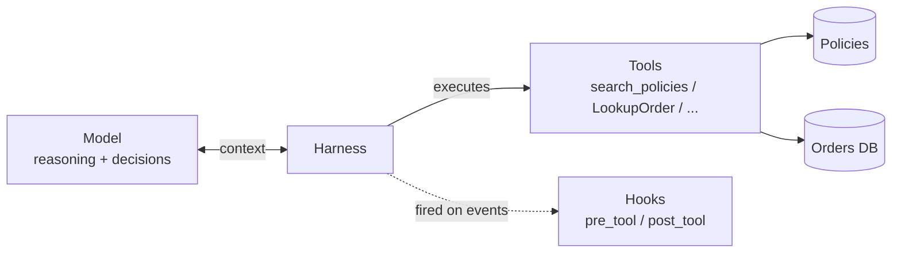

The model only exchanges context with the harness and never touches the data sources
directly; hooks hang off the harness and are invisible to the model.

### How a Tool Call Flows
Back to Nick: the agent fetched a **stale policy** with `SearchPolicies`, denied a valid
refund, then cancelled his tickets. Before that call, the context held the system prompt,
Nick's input, the agent's first reply, the `LookupOrder` input and output, and a
reasoning step deciding to check the refund policy.

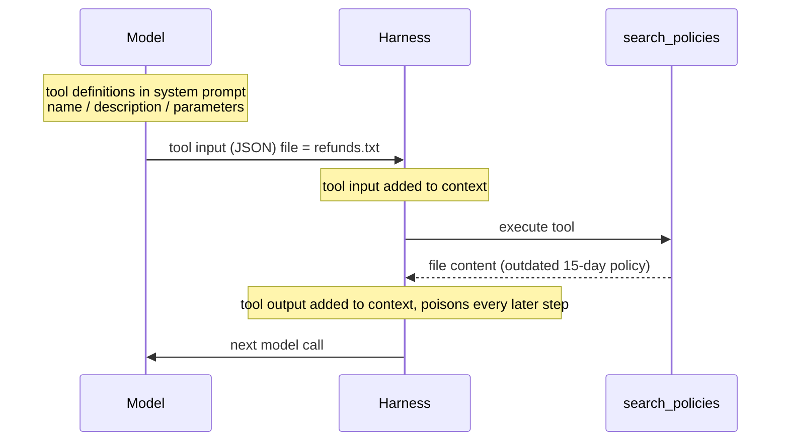

- **Tool definition**: what the tool does and which parameters it needs. Here it lives in
  the system prompt, but it can live elsewhere. Formats vary by model; all have name,
  description and parameters.
- **Tool input**: structured data (usually JSON) the model emits through a special
  generation mode; the harness uses it to run the tool.
- **Tool output**: the result, added back to the context.

Giving an agent a tool doesn't mean it works as expected. It may not call the tool, call
the wrong tool, or call the right tool with wrong inputs. Most of these trace back to the
**tool description**, which must say clearly how the tool works and when to use it.

Nick's case is subtler: **right tool, right input (`refunds.txt`), but the file was
outdated**. The model can't fix that if you don't expose the right files — the system
has to.

### Hooks: Deterministic Checks in the Harness
Hooks are functions too, but **not invoked by the model**; the harness fires them when
specific events or operations take place.

Example: add a `current` metadata field to the policy store marking the latest version
(older policies can stay). A hook `check_current` returns the file if it's current and
raises an error if not. In this lesson and the lab it's hardwired into the tool call;
real systems trigger hooks in various ways.

| Type | When | Example |
|---|---|---|
| `pre_tool` hook | **Before** a tool call | Check the user has permission to use the tool |
| `post_tool` hook | **After** a tool call | `check_current` checks the returned policy is current |

Result: the stale policy is blocked with an error, the agent retries and gets the current
45-day policy. One hook prevents two failure modes:
- **Context Poisoning**: the stale result never enters context
- **Context Clash**: only one policy is in context

What the agent does after the error depends on system design; here it retries.

### Tools vs Hooks

| | Tool | Hook |
|---|---|---|
| Triggered by | The model, based on descriptions | The harness, on events/operations |
| Visible to agent | Yes, usually in the system prompt | No, never in agent-visible context |
| Behavior | Model emits tool call → harness runs it → output enters context | Runs deterministically |
| Purpose | Lets the agent take actions | Gives you control of the system, especially context |

### Takeaways
- **Tools** and **hooks** are the two key harness components; the rest of the course uses
  both to manage context.
- For tool problems, check the **description** first; when the data itself is bad,
  intercept it in the harness with **hooks + metadata**.
- To know what to improve, you must understand the context your agent generates — next:
  [Building Intuition About Good Context](#m1-en-06).

<a id="m1-en-06"></a>

## 06 Building Intuition About Good Context

### Key Idea
Before you can fix a context issue, you have to **spot it**. An annoyed customer message
tells you something is wrong, but the user prompts and final answers alone don't say
whether it was duplicate, inconsistent or stale information. You need to **look at your
data**, especially **traces**, to see what the tools actually returned.

Example: repeated calls to `search_policies` left **duplicate context**, and one call
returned an **old policy** (which may or may not be right, depending on the order). Seeing
this at a glance tells you whether to dig into the harness or the data sources next.

### Traces and Spans

- **Trace**: all the data an agent produces while working on a task — the recording of
  everything between the user prompt and the response. It includes:
  - user inputs and agent responses
  - tool executions
  - the agent's reasoning
  - every call to the model(s) powering the agent
  - housekeeping actions by the harness, e.g. compaction of long context (Module 3)
- **Span**: one component of a trace, e.g. a single tool execution. A `search_policies`
  call is a span holding the **tool input** and the **tool output that entered context**.

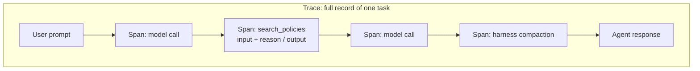

The trace is the whole run; a span is one step you can open on its own. You read the
trace to notice a problem and drill down into spans to find which step put bad content
into context.

### Capturing Traces: What Happened and Why

You have to write code to capture spans and build traces, and **that code is part of the
harness**.

| What to capture | Difficulty | How |
|---|---|---|
| **What** happened | Easy — it's basically a log | Logging libraries, or logging hooks fired on events such as a tool call; write to a log file or to Arize / LangSmith / Weights & Biases |
| **Why** it happened | Needs design | Reasoning usually isn't visible in responses, so you must get it into the trace |

Two ways to get the "why" into traces:

1. **Ask for step-by-step thinking in the system prompt**, inside `<think>` tags; log
   those steps when present.
2. **Ask for a justification on each tool call**: add a string field `reason` to the tool
   definition, asking the model to state its objective and why it chose this tool and
   these arguments. The model fills it in with the rest of the call, so it lands in the
   tool input and is recorded by the logging hook. Works with any model that supports tool
   calling (see the JSON sketch above; the course only describes the idea).

### Takeaways
- **Make looking at traces a habit**: think about getting the right information, in the
  right format, at the right time.
- A trace captures what happened (which tool calls) **and why**; spans let you drill down
  into individual steps.
- A reliable agent needs more than a good final answer — inspect every step that put
  content into context.
- The errors you find become the basis for **evals** that measure the impact of your
  context engineering changes.

<a id="m1-en-07"></a>

## 07 Guest Speaker Drew Breunig (Part 1)

### The Guest
**Drew Breunig**: CEO and founder of Compound, writing a book on context engineering for
O'Reilly, and active in the DSPy community. Each module ends with an excerpt of his
conversation with the instructor; this one is about **building more reliable agents**.

### Reliability Is the Key Word
- The headlines show agents hitting impressive benchmark results, but building a
  reliable agent inside an enterprise is a **completely different task**.
- Enterprises don't care about the theoretical limits of intelligence; they ask: **can
  this one simple thing be done reliably**, so people who don't know the tool can use it
  with confidence?
- That's where enterprise agents die: **wrong 10% of the time is past the threshold**.
  If you have to check all the work, you might as well do it yourself.

### Prompt Debt: How Unreliability Creeps In

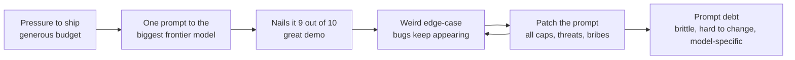

- The usual path: under pressure to ship and with budget to spare, you hand a prompt to
  the biggest frontier model and let it discover the path. It nails it nine times out
  of ten — a great demo for your boss.
- The problem: how the model gets there is a black box. Edge-case bugs keep surfacing,
  so you keep adding fixes to the prompt ("log this kind of receipt as a receipt, not an
  invoice"), maybe in all caps, maybe threatening or bribing the model.
- These hacks are **specific to that model** — you're overfitting to it. You end up with
  a **fragile prompt** full of folk wisdom that's hard to change, and moving to a new
  model often means starting over.
- Drew calls this **prompt debt**, like technical debt.

### The Way Out: Make AI More Boring, More Like Software
The mission of DSPy and similar work is to make AI **behave like software, with
expectations and contracts**. Teams that get through prompt debt tend to arrive at the
same ideas DSPy has long followed:
- **Typed inputs and outputs** with reliable contracts
- **Retry logic**
- **Structured prompts** with a bit of schema
- **Decomposing into multiple steps**: instead of one call doing 20 things, split off
  pieces that are more reliable and easier to evaluate

### Human in the Loop or Not?
- The instructor's view: the real world is fractally messy, so a human continually in
  the loop — coaching, giving feedback, putting subject-matter expertise into prompts and
  harness design — will beat an AI-only approach for the foreseeable future.
- Drew: these are **two different tasks**; decide up front whether your application is
  human-in-the-loop.
  - Enterprises often fall back to human-in-the-loop because **they can't get
    reliability high enough**: 9 out of 10, so a human smooths over the bumps. Coding
    agents work this way — left alone, they stack bad decisions and waste tokens.
  - But most enterprise value comes from **workflows without a human in the loop**: a
    task small enough to make reliable and encode. That will grow as we get better at
    building workflows and agents.

### Takeaways
- The bar for enterprise agents is **reliability**, not benchmark intelligence.
- Patching prompts endlessly builds **prompt debt**; the fix is typed I/O, retries,
  structured prompts and decomposed steps.
- Decide whether the app is human-in-the-loop; fully automated value comes from tasks
  **small enough to make reliable**.

## Module Recap
- Better agents need better data: a harness that can **retrieve, manage and store**
  data so the model gets the right information in the right format at the right time.
  Without it, agents run into recognizable failure modes.
- Tools and hooks work together: tools let agents act, hooks manage the context those
  actions produce.
- Coding, research and email tasks all need agents to **work over long periods**;
  without context engineering, issues compound over minutes, hours or days. That makes
  it a key skill for building reliable agents.

## What's Next

| Module | Agent you build | Techniques |
|---|---|---|
| Module 2 | Coding assistant | Parse and chunk code, retrieve with a combination of search methods |
| Module 3 | Research assistant | Pruning, compaction, scratchpads |
| Module 4 | Email assistant | Reuse context over time through memory |

</div>
