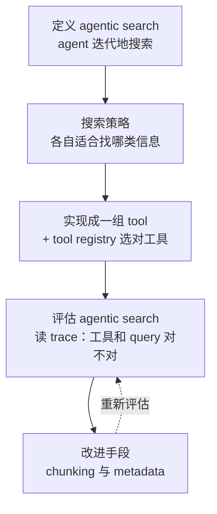
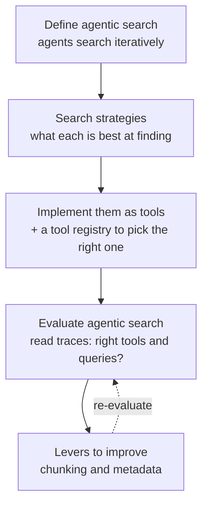

> DeepLearning.AI × Chroma｜Context Engineering 课程 Module 2（Agentic Search）的
> 模块介绍、模块总结，以及各节视频笔记索引（不含 lab）

## 从 Module 1 到 Module 2
Module 1 讲了 context engineering 是「在正确的时间，以正确的格式，给到正确的信息」。
Module 2 只盯其中一项：**right information**——让 agent 拿到完成任务所需的信息。

Module 1 lab 里的客服 agent 虽然能从多个数据源取数据，
但**去哪找、怎么取都是写死在指令里的**，用不着自己搜索。
真实任务往往是复杂的、多步的查询，agent 需要自己判断去哪找、用什么方式找。
这就是本模块的技术：**agentic search**——
让 agent 在数据源上迭代搜索，找到高质量、相关的信息。

## Module 2 学了什么

1. **定义**：什么是 agentic search，agent 如何**迭代地**搜索，补齐完成任务所需的信息。
2. **策略**：回顾 agent 最常用的几种搜索技术，
   建立直觉——每种策略最适合找哪类信息。
3. **实现**：把这些策略做成一组 tool，
   并让 agent 知道**什么情况下该用哪个 tool**（tool registry）。
4. **评估与改进**：通过读 trace 评估 agentic search，
   再用数据准备（chunking、metadata）这些杠杆提升检索质量。

贯穿全模块的例子是一个**coding agent**（类似 Claude Code / Codex），
在一个收集客户反馈的小型 web 应用代码库上帮你探索和改代码。
不同类型的查询需要不同的搜索工具。

## 各节笔记

| # | 视频 | 一句话 |
|---|---|---|
| 1 | [Introduction to Agentic Search](/Introduction-to-Agentic-Search/) | Agent 自己决定找什么、怎么找、要不要再找；检索决策从写死变成运行时 |
| 2 | [Example: Coding Agent](/Example-Coding-Agent/) | 混用 hybrid、lexical、SQL 跨三个数据源，迭代定位工单升级 bug |
| 3 | [Search Strategies](/Search-Strategies/) | 精确词法、BM25、语义、混合（RRF）各自适合找什么 |
| 4 | [Implementing Search Strategies](/Implementing-Search-Strategies/) | 好的 tool description：该不该调、怎么调、结果怎么用 |
| 5 | [Tool Registries](/Tool-Registries/) | 用搜索来找工具，按需加载描述，省 40% 以上 token |
| 6 | [Evaluating Agentic Search](/Evaluating-Agentic-Search/) | 读 trace 定位失败在哪一步，先建小 eval 再一次改一处 |
| 7 | [Improving Retrieval with Data Preparation](/Improving-Retrieval-with-Data-Preparation/) | 切块、AST 解析、metadata，用 Precision@k / Recall@k 衡量 |
| 8 | [Guest Speaker Drew Breunig (Part 2)](/Drew-Breunig-Part-2/) | RLM：把超大上下文放进 REPL 变量，写代码查，递归交给子 agent |

Lab（不单独记笔记）：Lab 1 Building a Search System；
Lab 2 Tool Registries: Searching for the Right Tool。

## 模块总结
- Agent 要完成你交代的任务，需要**高质量、相关**的数据。
- 实现了一组搜索 tool：让 agent 知道在多个数据源里**去哪找**，
  并按查询类型选不同的搜索策略**迭代地取**。
- 通过**读 trace** 评估 agentic search：检查 agent 是否调用了正确的搜索工具、
  query 是否合适，是否符合你对可用策略和数据源的直觉。
- 练习了衡量 agentic search 的效果，
  以及用 **chunking 和 metadata** 提升检索质量的杠杆。

学完后，agent 能用更好的上下文补齐自己的知识缺口。
但复杂任务可能持续数小时甚至数天，所有信息都往后带，
上下文窗口终究会被填满——这是 Module 3（Context Management）要解决的问题。

> DeepLearning.AI × Chroma | Context Engineering, Module 2 (Agentic Search): introduction,
> conclusion, and an index of the video notes (labs not included)

## From Module 1 to Module 2
Module 1 framed context engineering as the right information, in the right format, at the
right time. Module 2 focuses on one part: **the right information** — getting the agent
what it needs to finish the task.

The customer service agent in the Module 1 labs could pull data from several sources, but
**where to look and how to access it were hard-coded** in its instructions, so it never
had to search. Real tasks are often complex, multi-step queries over data sources, and the
agent has to work out where and how to look on its own. That's the technique of this
module: **agentic search** — agents searching iteratively to find high-quality, relevant
information.

## What Module 2 Covers

1. **Definition**: what agentic search is and how agents search **iteratively** to fill
   in the information a task needs.
2. **Strategies**: a recap of the most important search techniques agents use, with
   intuition for the kind of information each one is best suited to find.
3. **Implementation**: turning those strategies into a set of tools, and helping the
   agent know **which tool to use when** (tool registries).
4. **Evaluation and improvement**: evaluating agentic search by reading traces, then
   improving retrieval quality through data preparation (chunking, metadata).

The running example is a **coding agent** (like Claude Code or Codex) that helps you
explore and work on a codebase — a small web app for capturing customer feedback.
Different kinds of queries call for different search tools.

## Lesson Notes

| # | Video | In one line |
|---|---|---|
| 1 | [Introduction to Agentic Search](/Introduction-to-Agentic-Search/) | The agent decides what, how and whether to search again; retrieval decisions move to runtime |
| 2 | [Example: Coding Agent](/Example-Coding-Agent/) | Mixing hybrid, lexical and SQL across three sources to find an escalation bug |
| 3 | [Search Strategies](/Search-Strategies/) | Exact lexical, BM25, semantic, hybrid (RRF) — what each is good for |
| 4 | [Implementing Search Strategies](/Implementing-Search-Strategies/) | Good tool descriptions: should I call it, how, what to do with the result |
| 5 | [Tool Registries](/Tool-Registries/) | Search for tools, load descriptions on demand, 40%+ token savings |
| 6 | [Evaluating Agentic Search](/Evaluating-Agentic-Search/) | Locate failures in traces, build a small eval, change one thing at a time |
| 7 | [Improving Retrieval with Data Preparation](/Improving-Retrieval-with-Data-Preparation/) | Chunking, AST parsing, metadata, measured with Precision@k / Recall@k |
| 8 | [Guest Speaker Drew Breunig (Part 2)](/Drew-Breunig-Part-2/) | RLMs: huge context in REPL variables, queried with code, recursed to sub-agents |

Labs (no separate notes): Lab 1 Building a Search System; Lab 2 Tool Registries: Searching
for the Right Tool.

## Module Recap
- Agents need **high-quality, relevant** data to do the tasks you give them.
- You implemented search tools that let the agent know **where to look** across multiple
  data sources and **retrieve iteratively** with strategies tailored to the query.
- You evaluated agentic search by **reading traces**: checking the agent called the right
  search tools with appropriate queries, matching your intuition about the available
  strategies and data sources.
- You practised measuring agentic search performance, with **chunking and metadata** as
  levers for improving quality.

Agents can now fill their knowledge gaps with better context. But complex tasks can run
for hours or days, and if everything gets carried forward the context window eventually
fills up — that's what Module 3 (Context Management) tackles.

