<div class="lang-zh" lang="zh" markdown="1">

> DeepLearning.AI × Chroma｜Context Engineering 课程 Module 2（Agentic Search）的
> 模块介绍、各节视频笔记和模块总结（不含 lab）

## 从 Module 1 到 Module 2
Module 1 讲了 context engineering 是「在正确的时间，以正确的格式，给到正确的信息」。
Module 2 只盯其中一项：**right information**——让 agent 拿到完成任务所需的信息。

Module 1 lab 里的客服 agent 虽然能从多个数据源取数据，
但**去哪找、怎么取都是写死在指令里的**，用不着自己搜索。
真实任务往往是复杂的、多步的查询，agent 需要自己判断去哪找、用什么方式找。
这就是本模块的技术：**agentic search**——
让 agent 在数据源上迭代搜索，找到高质量、相关的信息。

## Module 2 学了什么

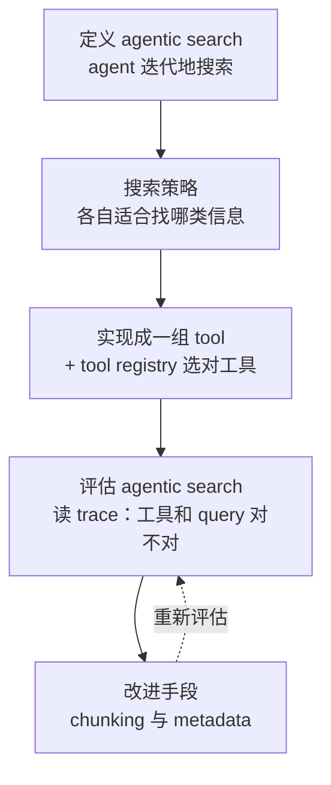

1. **定义**：什么是 agentic search，agent 如何**迭代地**搜索，补齐完成任务所需的信息。
2. **策略**：回顾 agent 最常用的几种搜索技术，
   建立直觉——每种策略最适合找哪类信息。
3. **实现**：把这些策略做成一组 tool，
   并让 agent 知道**什么情况下该用哪个 tool**（tool registry）。
4. **评估与改进**：通过读 trace 评估 agentic search，
   再用数据准备（chunking、metadata）这些杠杆提升检索质量。

贯穿全模块的例子是一个**coding agent**（类似 Claude Code / Codex），
在一个收集客户反馈的小型 web 应用代码库上帮你探索和改代码。
不同类型的查询需要不同的搜索工具。

## 各节笔记

| # | 视频 | 一句话 |
|---|---|---|
| 1 | [Introduction to Agentic Search](#m2-zh-01) | Agent 自己决定找什么、怎么找、要不要再找；检索决策从写死变成运行时 |
| 2 | [Example: Coding Agent](#m2-zh-02) | 混用 hybrid、lexical、SQL 跨三个数据源，迭代定位工单升级 bug |
| 3 | [Search Strategies](#m2-zh-03) | 精确词法、BM25、语义、混合（RRF）各自适合找什么 |
| 4 | [Implementing Search Strategies](#m2-zh-04) | 好的 tool description：该不该调、怎么调、结果怎么用 |
| 5 | [Tool Registries](#m2-zh-05) | 用搜索来找工具，按需加载描述，省 40% 以上 token |
| 6 | [Evaluating Agentic Search](#m2-zh-06) | 读 trace 定位失败在哪一步，先建小 eval 再一次改一处 |
| 7 | [Improving Retrieval with Data Preparation](#m2-zh-07) | 切块、AST 解析、metadata，用 Precision@k / Recall@k 衡量 |
| 8 | [Guest Speaker Drew Breunig (Part 2)](#m2-zh-08) | RLM：把超大上下文放进 REPL 变量，写代码查，递归交给子 agent |

Lab（不单独记笔记）：Lab 1 Building a Search System；
Lab 2 Tool Registries: Searching for the Right Tool。

<a id="m2-zh-01"></a>

## 01 Introduction to Agentic Search

### 从写死的步骤到 agentic search
Module 1 的客服 agent 分几步工作：先查数据库里的订单，再用搜索工具找当前退款政策，
最后基于取回的信息推理、决定动作。但 lab 里这些步骤是**写死的**——
system prompt 规定了先查订单、再查政策、再回复，agent 只是照做。

**Agentic search** 则是：把数据和工具交给 agent，**由它决定需要什么信息、怎么搜**。
比如再给它客户历史交互日志和对应的搜索工具，它可以先查政策，
再用有针对性的 query 只取购买日期；第一次没找到、或发现了新线索，可以再搜。

| | 代价 | 收益 |
|---|---|---|
| 让 agent 自己决定搜什么、怎么搜 | 系统更不可预测，完成任务可能更慢 | 更能取到正确信息，任务表现更好；覆盖更多任务和边界情况 |

### 三个关键点

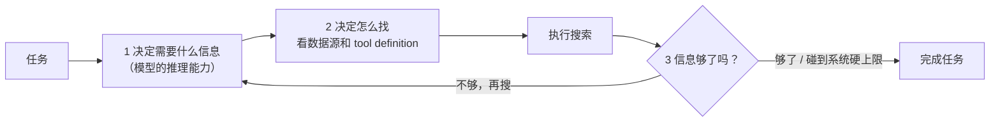

1. **找什么**：agent 自己判断完成任务需要哪些信息——利用语言模型推理、解决问题的能力。
2. **怎么找**：根据可用的数据源和搜索工具决定方法；
   其中一个重要依据是**工具的定义**（后面的视频细讲）。
3. **要不要再找**：信息不够就继续搜，可以迭代多轮，
   直到任务完成或碰到系统的硬上限。

### 和 RAG 有什么不同

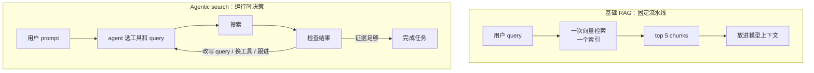

- **基础 RAG**：检索是预先定义好的流水线。用哪个 retriever、搜哪个数据源、
  query 怎么改写、跑几步检索，都由开发者**写死**，不随模型运行时发现的东西改变。
  检索没取到需要的内容，模型也无法自主换策略；重试、兜底都得提前做进流水线里。
- **Agentic search**：关键的检索决策在**运行时**由 agent 做——
  根据 prompt 决定搜什么、用哪个工具，检查初步结果后改写 query、继续追查，
  重复多次直到证据足够，还能针对不同信息选更合适的搜索工具。
  最终结果是 agent 拿到质量更高的信息，也就是 **right information**。

### 对 context engineering 的影响
- **好处：更好的上下文。** 工具和数据源多样，找到真正需要的信息的概率更大；
  可以一直搜到补齐知识缺口为止。
- **风险：上下文膨胀。** 反复调用工具会产生大量 tool output，
  全都带着往后走，最终会填满上下文窗口。
  处理办法在 Module 3；本模块先把 agentic search 当成拿到正确上下文的手段。

### 要点
- Agentic search = agent 自己决定**找什么、怎么找、要不要再找**。
- 与 RAG 的本质区别：检索决策从**开发时写死**变成**运行时由 agent 做**。
- 拿可预测性和速度，换更好的信息；同时要提防 tool output 撑爆上下文。
- 下一节：[Example: Coding Agent](#m2-zh-02)。

<a id="m2-zh-02"></a>

## 02 Example: Coding Agent

### 场景
一家电商的客服团队发现异常：**问题差不多的客户工单，有的被升级（escalate）了，有的没有**。
工程团队用一个 coding agent 去排查这套反馈系统的代码库。
工程师给的只是一个宽泛的请求——「帮忙看看这个问题」，
接下来搜什么、用什么工具，都是 **agent 自己决定**的。

### Agent 能访问的数据源和工具

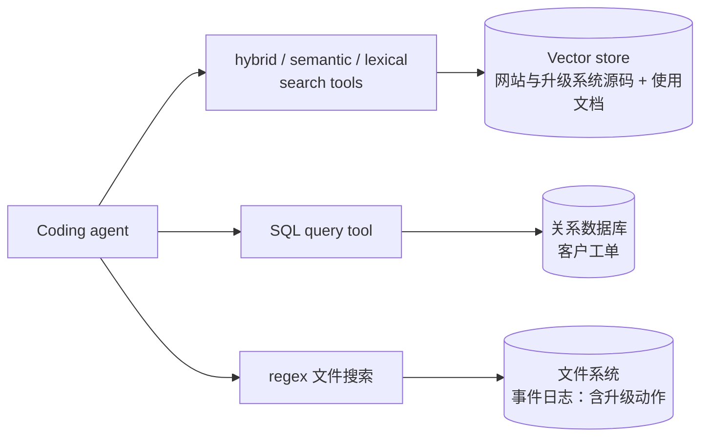

每个工具只搜一个数据源；工具的细节在后面两节展开。

### 排查过程

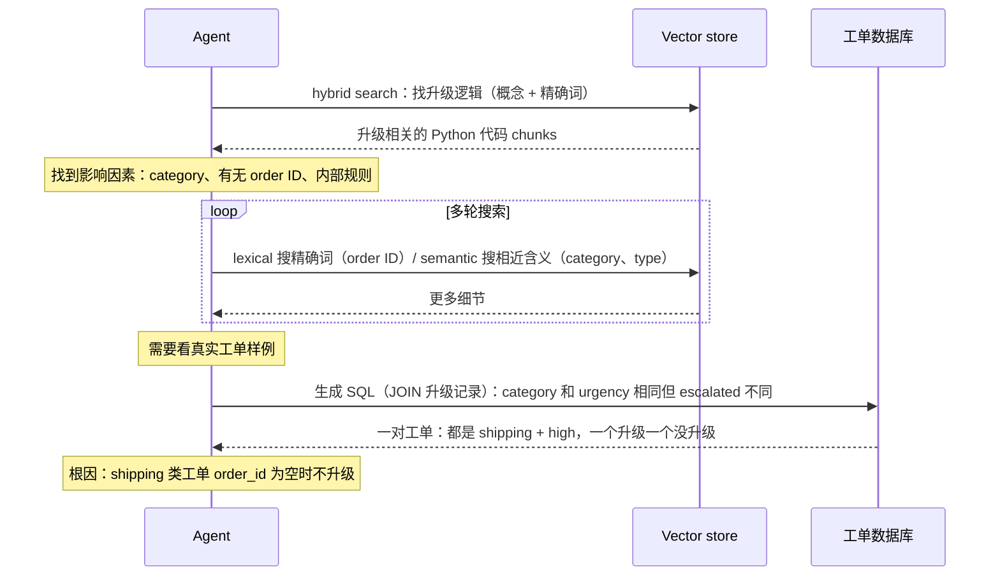

1. 先决定搜代码库找升级逻辑，选 **hybrid search**——它同时覆盖概念和精确词。
   模型生成工具输入，交给 harness 执行，返回升级逻辑的代码 chunk。
2. 从代码里识别出几个影响升级的因素：类别、是否有 order ID、其他内部规则。
3. 再搜几轮，**混用工具**：用 lexical 精确匹配 `order ID` 这类关键词，
   用 semantic 找含义相近的代码或文本（category、type 等）。
4. 决定看真实工单，换成**数据库工具**：生成带 JOIN 的 SQL 查升级记录。
   Agent 自己把「相似」定义为 category 和 urgency 相同、但 escalated 标记不同。
5. 返回一对工单：都是 shipping、urgency 都是 high，一个升级了，一个没有。
   这足以定位根因——**代码没有处理 order ID 为空的工单的升级**。

### 要点
- 这就是 agentic search：agent 决定需要什么信息，用不同工具搜多轮，
  根据结果继续追，信息够了才回答。
- **工具跟着信息走**：要什么信息、信息在哪个数据源，决定了选哪种搜索策略。
- 下一节：[Search Strategies](#m2-zh-03)，建立对各种搜索技术适用场景的直觉。

<a id="m2-zh-03"></a>

## 03 Search Strategies

### 先问三个问题
想 agent 需要哪些工具，可以先想人是怎么找信息的：

1. **我在找什么？** 可以非常具体（「报告产品安全问题的工单按什么规则升级？」），
   也可以很模糊、探索性的（「这个 repo 的代码是干什么的？」）。
   具体程度决定了去哪找、怎么找。
2. **信息可能在哪？**
3. **query 该怎么和文档匹配？**

后两个问题都取决于第一个问题的具体程度。
下面围绕两种成熟的搜索方式来建立直觉：**lexical（词法）** 和 **semantic（语义）**，
以及把两者合起来的 **hybrid（混合）**。

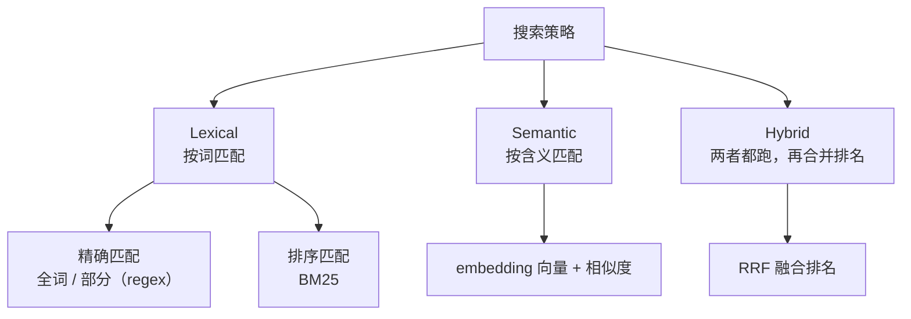

### Lexical search
**精确匹配**：按关键词匹配文档或 chunk，结果只有是 / 否，没有中间状态。
- 全词匹配：query 是 `escalation`，只命中 `escalation` 这个词。
- 部分匹配：去掉词尾只匹配更短的字符模式，`escalation` 和 `escalate` 都能命中。
  **正则（regex）** 就是实现这种模式匹配的一种方式。

**排序匹配（ranked lexical）**：精确匹配一对一、非黑即白，
没法对多个词的匹配好坏排序。比如 query「logs for billing tickets with escalation」，
每篇文档按命中的关键词打分排序：同时命中 billing 和 escalation 的，
一般排在只命中 billing 的前面。
- 常用算法 **BM25**：考虑词在文档里出现的频率、词在整个语料里有多稀有、文档长度。
  分数越高，词法匹配越强。
- 坑：`repeated_billing_failure` 里的 billing 是长序列的一部分，**不会被匹配到**。
  所以对代码这类文本，可能需要预处理才能搜得好。

排序匹配的局限：**同一个意思用了不同的词**，或**同一个词在不同语境含义不同**时，
它就不行了。比如搜「重复扣款」（duplicate charging），
文档里写的是 repeated、twice、billing，
一个词都没对上，但意思显然相关。

### Semantic search
不只看词，而是比较**含义**：
embedding 模型把 query 和每篇文档（或 chunk）都转成高维向量，
含义相近的文本向量也相近，于是按 query 向量和文档向量的相似度排序。

局限：
- embedding 模型一次能处理的文本有限，把很长的文档压成一个向量会丢细节，
  所以长文档要**切块（chunk）**。怎么切很重要，每个 chunk 要保留足够的上下文，能独立成义。
- **精确词本身很重要时不太可靠**：错误码、工单 ID、文件名、少见的专有名词。

### Hybrid search
同一个 query 同时跑 lexical 和 semantic，既有精确词匹配，也有含义相似度。

难点：两种方法的**分数不在一个尺度上**，BM25 分数和语义相似度不是一回事，直接相加没意义。
所以合并的是**排名**而不是分数。常用方法是 **reciprocal rank fusion（RRF）**：
每种方法各出一个排名列表，越靠前的文档权重越大、越靠后越小，
把各列表的贡献加起来得到一个融合排名，再取 top-k（比如前 5 或前 10）。

### 什么时候用哪种

| 你在找什么 | 用什么 | 代价 / 注意 |
|---|---|---|
| 精确的词：名字、ID、错误码，且确定原文里会出现 | 精确 lexical | 词不一样就找不到 |
| 包含多个相关词的文档，匹配有强有弱 | 排序 lexical（BM25） | 同义不同词时失效 |
| 一个想法或概念，原文可能换了说法 | Semantic | embedding 成本、要切块、精确细节匹配弱 |
| 既在乎精确词又在乎含义 | Hybrid（RRF） | 多跑一种检索 |

这是人的直觉——agent 怎么知道该这么选？下一节把这些策略落成工具：
[Implementing Search Strategies](#m2-zh-04)。

<a id="m2-zh-04"></a>

## 04 Implementing Search Strategies

### 数据源决定能用哪种搜索

| 数据源 | 内容 | 搜索方式 | 工具 |
|---|---|---|---|
| Vector store（Chroma collection） | 代码和文档，有文本也有 embedding | lexical / semantic / hybrid，看配置 | semantic search、几个 lexical search、hybrid |
| 日志 | 纯文本文件，没有 embedding 或语义索引 | lexical | 文件系统搜索（regex） |
| 关系数据库 | 客户反馈工单 | SQL 结构化查询 | 数据库查询工具 |

数据库查询严格来说不算「搜索」，但也是**信息检索**。

这门课讲的是 context engineering，不是怎么造搜索工具——
lab 里工具已经搭好（用了 Chroma 的开源工具准备 semantic 和 lexical 搜索的数据集），
重点放在更重要的事上：**把工具接进 agent，并把它们描述清楚**，
让 agent 知道工具做什么、能访问什么数据、什么时候用。

### Tool description 要回答的三个问题
Agent 对数据的了解可以放在 system prompt 里，也可以放在工具描述里。
Module 1 里工具定义写在 system prompt；实际上很多 LLM API 用单独的 `tools` 参数传，
但道理一样：这些上下文交给模型，由模型决定用不用。

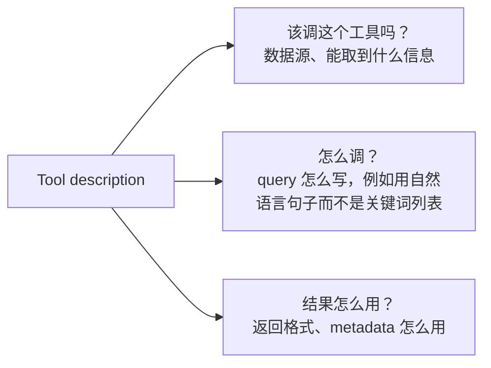

### 坏描述 vs 好描述（SemanticSearch）

| | 初稿 | 改进版 |
|---|---|---|
| 搜什么 | 「搜索代码库」——但实际搜的是 Chroma collection 里的向量表示 | 明确：索引过的代码和文档 |
| 怎么搜 | 没说 | 按概念相似度 |
| 何时用 | 「最适合一般性探索」 | 想弄清代码怎么工作、但不确定确切标识符或术语时 |
| 和其他工具比 | 没说 | 什么时候该选它而不是别的工具 |
| 局限 | 没说 | 说明工具的边界 |

「最适合一般性探索」是**上下文的危险点**：一般性探索几乎涵盖一切，
模型没法判断它是不是对的工具，很可能在不该用的场合也用它。

### 怎么写好 tool description
1. **清楚说明工具做什么**，具体到 agent 能认出它就是当前要用的。
   搜索工具要写明能访问**哪些文档**、用**什么检索方法**。
2. **输入格式**：自然语言 query？关键词列表？精确文本序列？
3. **返回什么**，让 agent 知道这个工具怎么衔接后续步骤。例如：
   「返回 1000 字符的 chunk，metadata 里有父文档和相邻 chunk」。
4. **何时用、何时不用**，帮助决策。
5. **局限**，避免不必要的调用。
6. **能力重叠的工具**，说明替代选项，帮 agent 区分。

这些是通用准则；也可以参考所用模型厂商关于 tool description 的具体指南。

### 要点
- 工具是预先搭好的，context engineering 的活是**把它们描述清楚**。
- 好描述回答三个问题：该不该调、怎么调、结果怎么用。
- 避免「适合一般用途」这种笼统描述——它会让模型滥用工具。
- 但描述越写越长、工具越加越多，又会带来上下文问题——
  下一节：[Tool Registries](#m2-zh-05)。

<a id="m2-zh-05"></a>

## 05 Tool Registries

### 问题：工具描述撑大上下文
工具描述可以看作 system prompt 的一部分，**每次模型调用都会带上**，
这样 agent 想用时才能用。工具越多、描述越长，就越容易出现前面讲过的上下文问题：
窗口被干扰性的文本填满，agent 表现下降。

热门 coding agent 的 harness（Claude Code、OpenAI Codex）的 system prompt 很大。
按 Drew Breunig 的图，Codex 在你开始用之前上下文里就已有约 **5,500 tokens**，
其中大约**四分之一**是工具描述。而很多工具和当前任务无关——
coding agent 在用 regex 搜日志时，不需要知道怎么生成 PDF。

### 解法：只在需要时加载工具描述
**Tool registry** 本质上是一个**用来搜工具的搜索工具**，由两部分组成：
1. 可搜索的工具清单，通常是一个存工具描述的 vector store；
2. 一个搜索这份清单的工具（registry search tool），**始终对 agent 可用**。

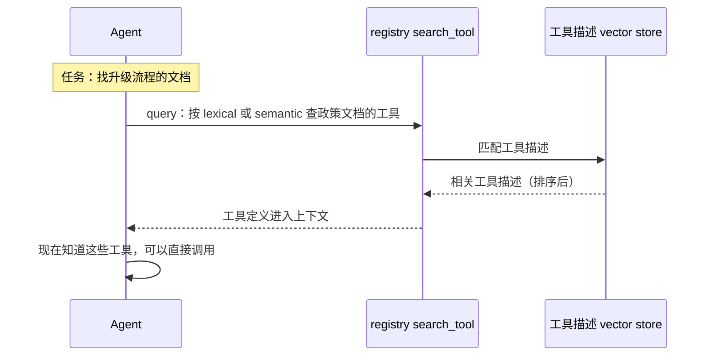

模型能发现并调用 harness 里的任何工具，但不用在消息历史里一直带着所有工具定义。

### 收益与取舍

| | |
|---|---|
| 省 token | lab 里把大部分工具定义从 system prompt 挪进 registry，token 用量减少 **40% 以上** |
| 减少 context confusion | 工具选择更准，少选错工具 |
| 代价 | harness 更复杂——相当于又多了一个数据源 |
| 适用 | 工具多、而且不是每个都常用 |
| 不适用 | 工具少，或几乎每个任务都要用到大部分工具——直接放 system prompt 更好 |

### 要点
- 工具描述是每次调用都带的固定开销，工具一多就会挤占上下文、干扰选择。
- Tool registry = 把工具描述也当成要检索的数据，**按需加载**。
- 工具少时别上 registry，复杂度不值得。
- 下一节：[Evaluating Agentic Search](#m2-zh-06)。

<a id="m2-zh-06"></a>

## 06 Evaluating Agentic Search

### 从 trace 里找失败案例
起点：看 trace，找出 agent 搜得**不如一个熟悉系统的人**的情况。
这里你对自己系统的了解非常关键。两个例子：
- **问告警怎么处理**：agent 找到一段通知相关的代码，基于代码作答。
  但你知道有一份政策文档直接讲了告警该怎么处理。
- **问 Feedback 模型里 `created_at` 字段的数据格式**：agent 说「Feedback 模型没有
  `created_at` 字段」。你知道这个字段明明存在。

找到这类失败是构建有用 eval 的第一步。但修之前，先弄清**失败发生在搜索的哪一步**。

### 失败可能出在哪

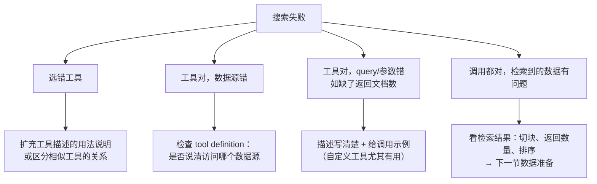

- **选错工具**：第一个例子里，trace 显示 agent 选了 lexical search，
  最匹配的都是代码文件；而你认为该用 semantic search。
  多看一些 trace，估计这种情况有多频繁；频繁的话值得花时间诊断，
  可能是工具定义不够详细，也可能是几个工具定义太像、需要说明彼此关系。
- **工具对、数据源错**：工具描述没说清它访问的是哪个数据源。
- **工具对、query 错**：比如缺了必填参数（要取多少文档）。
  检查 tool definition 有没有错、描述是否清楚详细；
  给一个带建议参数的调用示例也很有用，尤其是模型训练时没见过的自定义工具。
- **调用都对，数据有问题**：见下文。

### 改之前，先建一个小 eval
在改工具描述之前，先建一个小 eval 来衡量系统表现，好量化改动的影响。
不必复杂，从零用 Python 写或用现成的 eval 方案都行。关键：**一次只改一处**，
才知道是什么带来了改进。

1. 准备一组**已知应该选哪个工具**的搜索，包括观察到的失败案例，
   也包括表现良好的成功案例。
2. 每改一次工具描述，跑一遍这组参考搜索，看表现变化，**包括成功案例有没有退化**。

评估哪一层，取决于对「正确」的要求：

| 评估对象 | 什么时候用 |
|---|---|
| Tool input | 你确定 agent 必须调用某个工具 / 用某个 query |
| Tool output 或最终回答 | 不同工具或 query 都能拿到相关数据和正确答案时，避免过度约束 |

**找错误 → 建 eval 衡量参考案例 → 用 eval 结果驱动改动**，
这个习惯是严谨改进 agent 的关键。

### 工具调用都对，还是答错了
这时要看**检索到的数据**。回到 `created_at` 的例子：trace 显示 agent 取到了正确的
model class，但这个 class **在中间被切断了**；目标字段落在另一个 chunk 里，
而搜索结果被其他得分更高的 chunk 占满，agent 找不到它，也就没有回答所需的上下文。

同样，先在更多 trace 里看这种情况有多常见，再建 eval 衡量改进。
这个例子要看数据是怎么切块的、有没有更好的切法。
其他检索问题还包括：返回的文档不够多、排序表现不好。
如果确定工具调用没问题，**数据准备和检索**就是改进系统的重要杠杆——下一节：
[Improving Retrieval with Data Preparation](#m2-zh-07)。

<a id="m2-zh-07"></a>

## 07 Improving Retrieval with Data Preparation

### 为什么数据准备也算 context engineering
上一节的 eval 能改进工具调用，但还有数据源本身的问题，比如 chunk 把一段代码从中间切开。
有时数据源是现成的，我们只能用指定的工具去访问，对切块这类准备工作没有发言权。
但当数据源由你来搭建时，**数据准备就是改进搜索的重要杠杆**，
听起来像数据工程，其实是 context engineering 的一部分。

本节三种技术：**切块（chunking）、解析（parsing）、metadata**；
再用 **precision 和 recall** 衡量它们对搜索的改进。

### Chunking
Embedding 模型的输入有限，长文本或代码要切成小块，**chunk size** 由你定。

- **重叠（overlap）**：相邻 chunk 不重叠的话，边界可能把一句话甚至一个词切断。
  用滑动窗口让相邻 chunk 共享一部分内容（重叠量也是按字符数自定义的），
  即使边界切得生硬，缺掉的词或句子也会保留在相邻 chunk 里，帮模型把上下文接起来。
  但重叠是另一个需要衡量的工程选择：**重叠太多会重复存储、重复检索同样的信息**。
- **Recursive text splitting**：利用文本本身的结构找自然边界，从大到小逐级尝试——
  段落（`\n\n`）→ 行（`\n`）→ 句末标点（句号、问号、感叹号）→ 词间空白。
  还太大就降一级继续切。
- **按格式切**：文本结构更强时用格式专属的边界。Markdown 的 H1/H2/H3 标题
  体现了章节层级，标题下的文字属于该章节，子标题把它放进更细的部分；
  沿结构切比只看换行和标点更有意义。

### Parsing：代码要按语法切
函数、类是代码天然的块，但它们会**嵌套、相互关联**：一个类包含多个方法，
一个函数可能引用文件别处的全局变量。只按字符数切，会把类切成两半，
或把属于同一个类的函数分开。

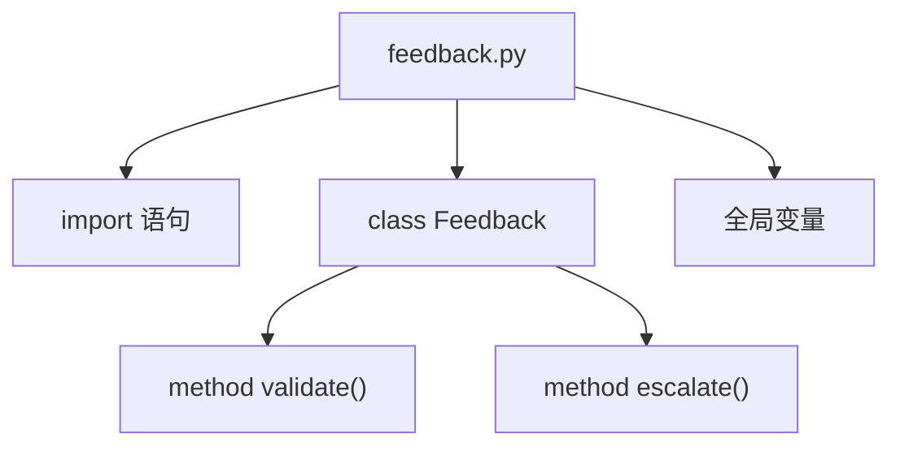

用 **parser**：它理解编程语言（比如 Python）的语法，生成**抽象语法树（AST）**，
自上而下表达代码的嵌套关系——import、类、函数以及它们之间的关系，
类作为父节点，方法嵌在下面。和 recursive splitting 一样，从大结构往小结构切，
直到每块都在字符上限内，但边界是**已知的代码边界**。
Parser 还能给出每个结构的起止位置等源码信息——这就是 metadata。

### Metadata
Chunk 要小，检索才精准、不夹杂干扰信息；但太小就不知道它在文件里、在文件之间的位置了。
**文件路径、行号**这类 metadata 能补上这一点。上一节 `created_at` 的例子说明，
没有 metadata，chunk 很难重新拼回去。

- **过滤**：metadata 可以用来过滤，在 lexical / semantic 排序**之前**缩小候选集，
  去掉大量无关数据，在更小、更相关的子集上搜，结果更有针对性。
  Module 3 还会用 document ID 做去重。
- **放在哪**：可以作为 chunk 外的标签，
  也可以写进 chunk 文本里（常见做法是 front matter）。
- **增强小 chunk**：除了直接重叠，还可以给 chunk 加上前一块、后一块乃至整个文件的
  简短摘要，让它携带周围的信息，内容更充分，也更容易被相关 query 检索到。

### 用 Precision@k 和 Recall@k 衡量
**建评估集**：先看数据，挑出能代表用户真实用法的任务，尤其是常见又重要的。
每个任务写一个代表性 query，人工找出系统必须检索到的源材料——这就是 **ground truth**。
数据准备好之后，把这些材料映射到搜索应返回的那部分 chunk。

**例子**：任务是理解反馈表单的一个功能——表单处理提交数据、显示确认页之前的
那个加载动画（spinner）有没有超时？人工标出 10 个 ground truth chunk，
来自多个文件，既有文档也有代码。Agent 检索时自己决定取多少个 chunk，
但评估时要**固定 k**，这里 k = 12，所以指标记作 Precision@12 和 Recall@12。

| 指标 | 问的是 | 例子：取回 12 个，其中 8 个在 ground truth 里 |
|---|---|---|
| Precision@k | 取回的 chunk 里，有多少是相关的 | 8 / 12 ≈ 67% |
| Recall@k | ground truth 里，有多少被取回了 | 8 / 10 = 80% |

两者都是越高越好，但同时提高很难，因为它们之间有取舍。

### 怎么调

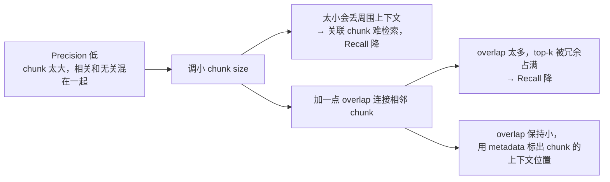

- Precision@k 低：可能 chunk 太大，相关信息和无关信息混在一起 → 调小 chunk size。
- 但不能太小：小 chunk 会丢失周围上下文，
  ground truth 中关联的 chunk 更难检索，Recall 会降。
- 加一点 overlap 能把前后相连的 chunk 接起来；
  但太多会让 top-k 被冗余信息占满，Recall 也会降。
- 所以 **overlap 保持小，改用 metadata** 标识 chunk 在上下文中的位置。

Precision 和 Recall 之间有取舍，看场景决定更看重哪个。
要做出有依据的决定，关键还是那个习惯：
**找错误 → 建 eval 衡量参考案例 → 用 eval 结果驱动改动**。

下一节：[Guest Speaker: Drew Breunig (Part 2)](#m2-zh-08)，
聊怎么在 context engineering 中处理海量数据。

<a id="m2-zh-08"></a>

## 08 Guest Speaker Drew Breunig (Part 2)

### RLM 是一种 test-time strategy
**Recursive Language Models（RLM）** 名字有点绕。核心上，它是一种新的
**test-time strategy**——推理时（prompt 模型、生成 token 的阶段）完成任务的策略。

最早的 test-time strategy 例子是「think step by step」：对 GPT-3.5 这类早期模型，
在问题末尾加这一句就能逼它推理。这个简单的 hack 效果惊人，
Drew 认为它带动了 2025 年模型在推理上的进步——推理本质上就是一步步想，
再用这种更长的推理过程训练模型。它是一种**通用策略**，能提升 LLM 在一大批问题上的表现。

RLM 也是通用策略。不同的是：问题照问、所需上下文也都给，
但**不把这些信息作为 token 塞进上下文窗口**，而是放进一个 **REPL** 交给 LLM。

### 怎么工作
REPL 在这里就是一个 Python notebook（类似 Jupyter、marimo），也可以是别的，
本质是一个**代码 scratchpad**，模型可以把它当工具来查询你给的信息——
一个预先装好变量的 Python 环境。

这能绕开 context rot 和放不进窗口的问题。比如你有一个 **800 MB 的 agent trace 文件**，
想分析其中的常见模式——800 MB 不可能塞进 token 空间。
但可以把它作为变量加载进 Python 环境，再给模型探索这个变量的说明和工具：

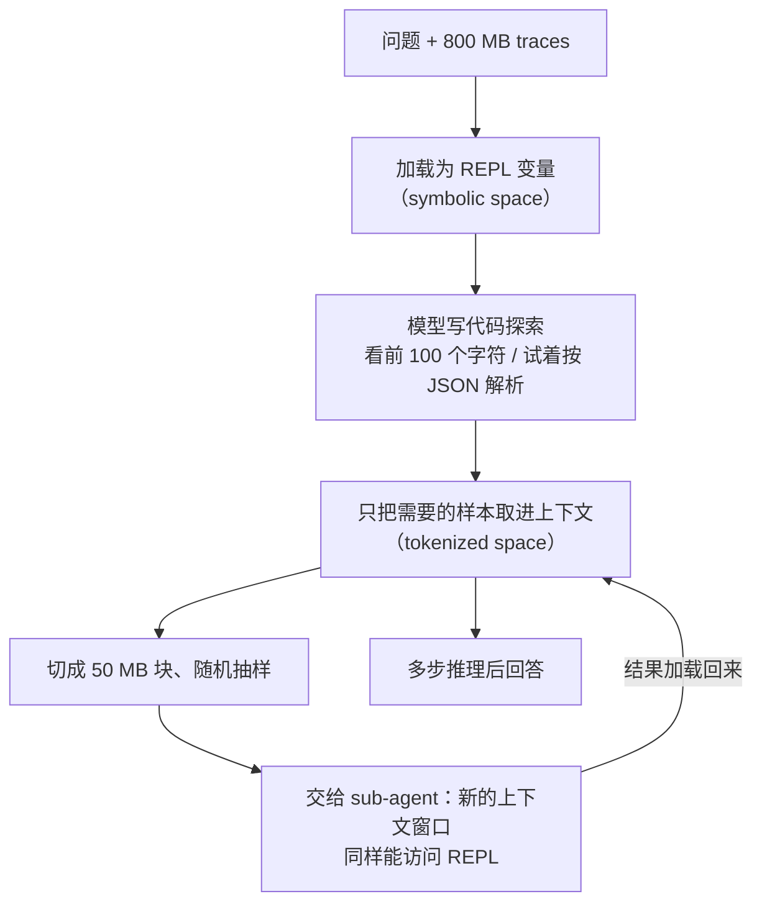

- 模型可能先看前 100 个字符，发现像 JSON 就试着解析；
  用 REPL 探索上下文、按需取样，把东西从**变量空间（symbolic space）**
  取到 **token 空间**，在多步中逐步花掉上下文窗口的预算来回答问题。
- **「递归」在哪**：模型还能调用一个 **sub-agent**，它有全新的上下文窗口。
  比如发现文件是换行分隔的大 JSONL，抽样前 10 条摸清 JSON 结构；
  整个 800 MB 太大没法分析，就切成 50 MB 的块、随机抽样，
  每块连同 prompt 和变量交给一个 sub-agent，它也能访问同一个 REPL，结果再加载回来。

所以 RLM 就是给模型一个**上下文之外的 scratchpad** 来管理信息。

### 为什么有效
**Jagged frontier**（Ethan Mollick、Karpathy 都讲过）：模型在某些事上很强（比如写代码），
在另一些事上一般（比如数 strawberry 里有几个 r）。

RLM 把问题**转成模型擅长的形式**——推理和写代码。
模型不擅长长上下文，但变成推理 + 编码问题后，就能从中得到更多价值。

### 要点
- RLM 是通用的 test-time strategy，像当年的「think step by step」。
- 海量上下文放在 REPL 变量里，模型写代码按需取样，只把需要的部分拉进上下文。
- 递归 = 把切好的子任务交给有全新上下文窗口的 sub-agent。
- 本质是避开模型的弱项（长上下文），利用强项（推理、编码）。

## 模块总结
- Agent 要完成你交代的任务，需要**高质量、相关**的数据。
- 实现了一组搜索 tool：让 agent 知道在多个数据源里**去哪找**，
  并按查询类型选不同的搜索策略**迭代地取**。
- 通过**读 trace** 评估 agentic search：检查 agent 是否调用了正确的搜索工具、
  query 是否合适，是否符合你对可用策略和数据源的直觉。
- 练习了衡量 agentic search 的效果，
  以及用 **chunking 和 metadata** 提升检索质量的杠杆。

学完后，agent 能用更好的上下文补齐自己的知识缺口。
但复杂任务可能持续数小时甚至数天，所有信息都往后带，
上下文窗口终究会被填满——这是 [Module 3（Context Management）](/Context-Engineering-Module-3/)要解决的问题。

</div>

<div class="lang-en" lang="en" markdown="1">

> DeepLearning.AI × Chroma | Context Engineering, Module 2 (Agentic Search): introduction,
> notes for each video, and conclusion (labs not included)

## From Module 1 to Module 2
Module 1 framed context engineering as the right information, in the right format, at the
right time. Module 2 focuses on one part: **the right information** — getting the agent
what it needs to finish the task.

The customer service agent in the Module 1 labs could pull data from several sources, but
**where to look and how to access it were hard-coded** in its instructions, so it never
had to search. Real tasks are often complex, multi-step queries over data sources, and the
agent has to work out where and how to look on its own. That's the technique of this
module: **agentic search** — agents searching iteratively to find high-quality, relevant
information.

## What Module 2 Covers

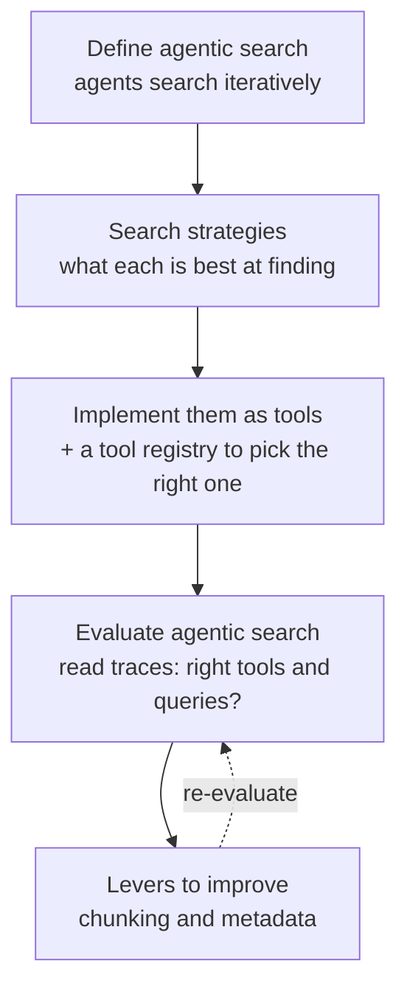

1. **Definition**: what agentic search is and how agents search **iteratively** to fill
   in the information a task needs.
2. **Strategies**: a recap of the most important search techniques agents use, with
   intuition for the kind of information each one is best suited to find.
3. **Implementation**: turning those strategies into a set of tools, and helping the
   agent know **which tool to use when** (tool registries).
4. **Evaluation and improvement**: evaluating agentic search by reading traces, then
   improving retrieval quality through data preparation (chunking, metadata).

The running example is a **coding agent** (like Claude Code or Codex) that helps you
explore and work on a codebase — a small web app for capturing customer feedback.
Different kinds of queries call for different search tools.

## Lesson Notes

| # | Video | In one line |
|---|---|---|
| 1 | [Introduction to Agentic Search](#m2-en-01) | The agent decides what, how and whether to search again; retrieval decisions move to runtime |
| 2 | [Example: Coding Agent](#m2-en-02) | Mixing hybrid, lexical and SQL across three sources to find an escalation bug |
| 3 | [Search Strategies](#m2-en-03) | Exact lexical, BM25, semantic, hybrid (RRF) — what each is good for |
| 4 | [Implementing Search Strategies](#m2-en-04) | Good tool descriptions: should I call it, how, what to do with the result |
| 5 | [Tool Registries](#m2-en-05) | Search for tools, load descriptions on demand, 40%+ token savings |
| 6 | [Evaluating Agentic Search](#m2-en-06) | Locate failures in traces, build a small eval, change one thing at a time |
| 7 | [Improving Retrieval with Data Preparation](#m2-en-07) | Chunking, AST parsing, metadata, measured with Precision@k / Recall@k |
| 8 | [Guest Speaker Drew Breunig (Part 2)](#m2-en-08) | RLMs: huge context in REPL variables, queried with code, recursed to sub-agents |

Labs (no separate notes): Lab 1 Building a Search System; Lab 2 Tool Registries: Searching
for the Right Tool.

<a id="m2-en-01"></a>

## 01 Introduction to Agentic Search

### From Hard-Coded Steps to Agentic Search
The Module 1 customer service agent worked in steps: look up the order in a database,
search for the current refund policy, then reason over what it retrieved to decide what
to do. In the lab those steps were **hard-coded** — the system prompt told it to look up
orders, then policies, then reply, and it just followed along.

With **agentic search** you give the agent data and tools and **let it decide what
information it needs and how to search for it**. Give it customer interaction logs and
tools to search them, and it might check the policy first, then run a targeted query
that returns only the purchase date — and search again if the first try misses or it
finds a new lead.

| | Cost | Payoff |
|---|---|---|
| Letting the agent decide what and how to search | Less predictable, may take longer | Better at retrieving the right information; handles more tasks and edge cases |

### Three Key Aspects

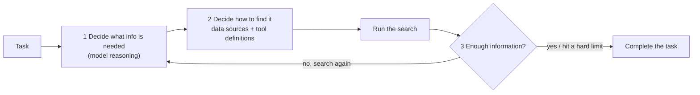

1. **What**: the agent decides what information the task needs, using the model's
   ability to reason and problem-solve.
2. **How**: it picks a method based on the data sources and search tools it has; the
   **tool definitions** are a key input (covered later).
3. **Again?**: if it needs more, it searches again, over several iterations, until the
   task is done or it hits a hard limit of the system.

### How Is This Different from RAG?

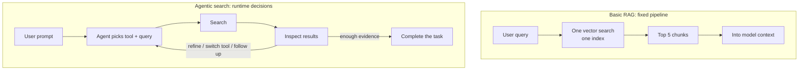

- **Basic RAG**: retrieval is a predefined pipeline. The developer **hard-codes** which
  retriever, which data source, how queries are transformed and how many retrieval steps
  run; none of it changes with what the model discovers at runtime. If retrieval misses,
  the model can't change strategy on its own — any retry or fallback must be built in.
- **Agentic search**: key retrieval decisions happen **at runtime**. The agent chooses
  what to search and which tool to use, inspects results, refines queries, follows up,
  and repeats until it has enough evidence — using whichever tools suit the information
  it's after. The result is higher-quality information: **the right information**.

### Implications for Context Engineering
- **Upside: better context.** More tools and data sources raise the odds of finding what
  the task really needs, and the agent can keep searching to fill knowledge gaps.
- **Risk: a lot of additional context.** Repeated tool calls produce lots of tool output;
  carried forward, it eventually fills the context window. Module 3 covers the fixes —
  here, treat agentic search as a way to get the right context.

### Takeaways
- Agentic search = the agent decides **what to find, how to find it, and whether to
  search again**.
- The key difference from RAG: retrieval decisions move from **build time** to
  **runtime**.
- You trade predictability and speed for better information — and must watch for tool
  output bloating the context.
- Next: [Example: Coding Agent](#m2-en-02).

<a id="m2-en-02"></a>

## 02 Example: Coding Agent

### The Scenario
An e-commerce support team notices something odd: **tickets reporting similar issues are
sometimes escalated and sometimes not**. Engineering investigates the feedback system's
codebase with a coding agent. The engineer's prompt is only a broad request to look into
the problem — what to search and which tools to use is **the agent's decision**.

### Data Sources and Tools

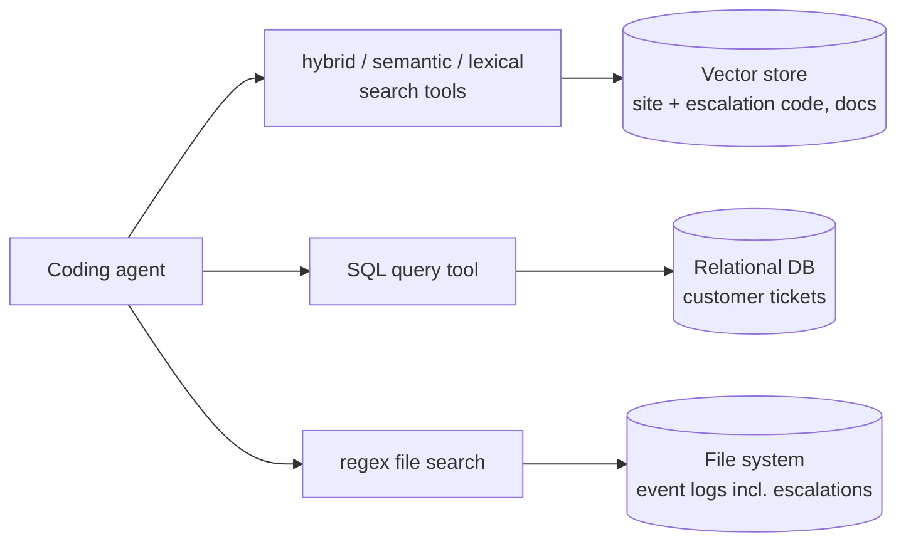

Each tool searches one data source; the next two videos cover the tools in detail.

### How the Investigation Unfolds

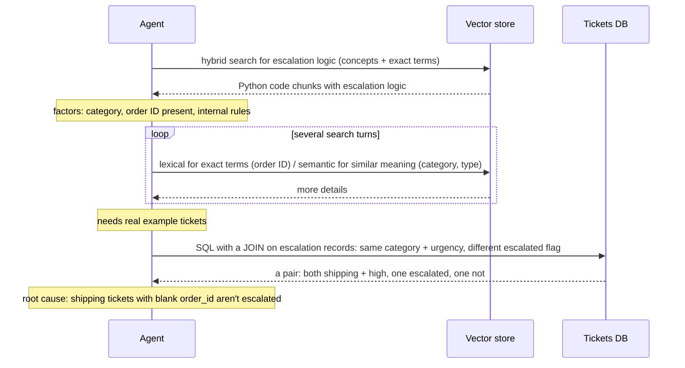

1. It decides to search the codebase for escalation logic with **hybrid search**, which
   covers both concepts and exact terms. The model produces the tool input, the harness
   runs the tool, and escalation code chunks come back.
2. From that code it identifies factors: category, whether there's an order ID, and
   other internal rules.
3. Over more turns it **mixes tools**: lexical for exact matches like `order ID`,
   semantic for code or text with similar meaning (category, type, etc.).
4. It decides it needs example tickets and switches to the **database tool**, writing SQL
   with a JOIN on escalation records. It defines "similar" itself: same category and
   urgency, different escalated flag.
5. Back comes a pair of tickets — both shipping, both high urgency, only one escalated.
   That's the root cause: **the code doesn't escalate tickets with a blank order ID**.

### Takeaways
- This is agentic search: the agent decides what it needs, searches over several turns
  with different tools, follows the results, and answers once it has enough.
- **The tool follows the information**: what the agent needs, and which source holds it,
  determines the search strategy.
- Next: [Search Strategies](#m2-en-03) — intuition for when each technique fits.

<a id="m2-en-03"></a>

## 03 Search Strategies

### Three Questions First
To think about which tools an agent needs, think about how people search:

1. **What am I looking for?** Anything from highly specific ("the escalation rule for a
   ticket reporting a product safety issue") to vague and exploratory ("what does the
   code in this repo do?"). How specific you can be dictates where and how to look.
2. **Where is that information likely to live?**
3. **How should I match the query against the documents?**

The last two both depend on how specific the first answer is. The video builds intuition
around two mature approaches — **lexical** and **semantic** — plus **hybrid**, which
combines them.

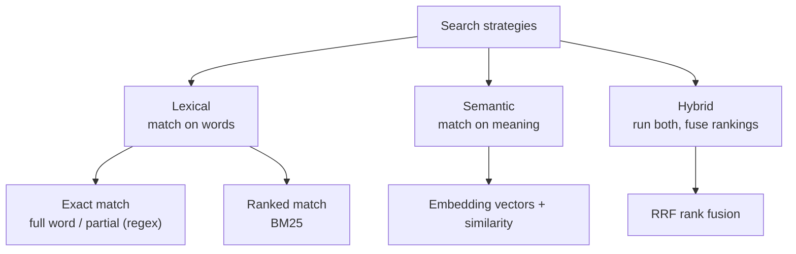

### Lexical Search
**Exact match**: match documents or chunks by keyword; it's yes or no, nothing between.
- Full match: the query `escalation` matches only `escalation`.
- Partial match: drop the word ending and match a shorter pattern, so both `escalation`
  and `escalate` hit. **Regular expressions** are one way to do this.

**Ranked lexical search**: exact match is one-to-one and all-or-nothing, so it can't rank
multi-term matches. For "logs for billing tickets with escalation", each document is
scored on the keywords it contains — one matching both billing and escalation usually
ranks above one matching only billing.
- A popular algorithm is **BM25**: it weighs how often a term appears in a document, how
  rare the term is across the collection, and document length. Higher means a stronger
  lexical match.
- Gotcha: `repeated_billing_failure` **won't match** billing, since it's part of a longer
  sequence. Code may need preprocessing to search well.

Its limit: it struggles when **different words express the same idea** or **one word
means different things in different contexts**. A query about duplicate charging misses a
document that says repeated, twice and billing — clearly related, no shared words.

### Semantic Search
Compare **meaning**, not just terms. An embedding model turns the query and each document
(or chunk) into a high-dimensional vector; similar meanings give similar vectors, so
documents are ranked by similarity to the query vector.

Limits:
- Embedding models take limited input, and squeezing a long document into one vector
  loses detail — so long documents get **chunked**. How you chunk matters: each chunk
  needs enough surrounding context to stand on its own.
- **Less reliable when the exact term matters**: error codes, ticket IDs, file names,
  unusual proper nouns.

### Hybrid Search
Run the query through both lexical and semantic search to get exact-term matching and
meaning-based similarity together.

The catch: **the scores are on different scales** — a BM25 score and a similarity score
don't mean the same thing, so adding them is meaningless. Combine **rankings** instead.
A common method is **reciprocal rank fusion (RRF)**: each method produces a ranked list,
documents near the top of each list get more weight, and the contributions are summed
into one fused ranking, from which you take the top-k (say 5 or 10).

### When to Use Which

| You're looking for | Use | Cost / caveat |
|---|---|---|
| A precise term — name, ID, error code — that will appear verbatim | Exact lexical | Misses different wording |
| Documents with several relevant terms, some matching more strongly | Ranked lexical (BM25) | Fails on synonyms |
| An idea or concept the source may phrase differently | Semantic | Embedding cost, chunking, weaker on exact details |
| Both exact terms and meaning | Hybrid (RRF) | Runs more than one retriever |

That's human intuition — how does an agent know to do this? Next, the strategies become
tools: [Implementing Search Strategies](#m2-en-04).

<a id="m2-en-04"></a>

## 04 Implementing Search Strategies

### The Data Source Decides the Search Method

| Data source | Contents | Search method | Tools |
|---|---|---|---|
| Vector store (Chroma collection) | Code and docs, text plus embeddings | Lexical / semantic / hybrid, depending on config | Semantic search, several lexical tools, hybrid |
| Logs | Plain text files, no embeddings or semantic index | Lexical | File-system search (regex) |
| Relational database | Customer feedback tickets | Structured SQL queries | Database query tool |

A database query isn't really search, but it is **information retrieval**.

The course is about context engineering, not building search tools, so the labs set the
tools up for you (using open-source Chroma tooling to prepare collections for semantic and
lexical search). The focus is the part that matters more: **integrating the tools into the
agent and describing them** so it knows what each does, what data it reaches, and when to
use it.

### Three Questions a Tool Description Answers
What the agent knows about its data can live in the system prompt or in tool
descriptions. Module 1 put tool definitions in the system prompt; many LLM APIs actually
take them in a separate `tools` parameter, but the idea is the same — the model gets this
context and decides whether to use the tool.

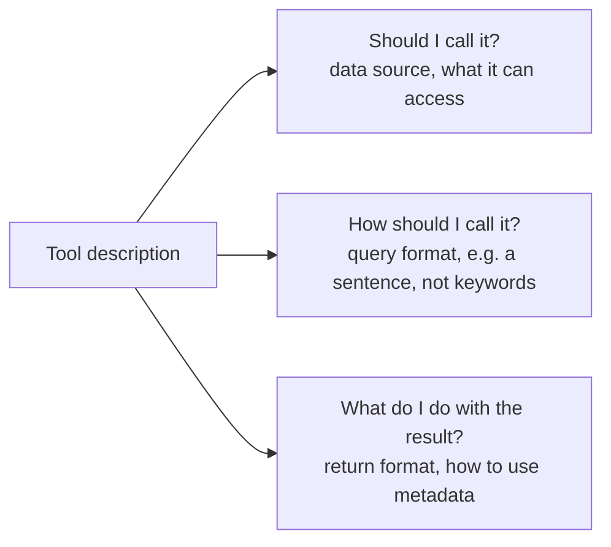

### Weak vs Strong Description (SemanticSearch)

| | First draft | Improved |
|---|---|---|
| What it searches | "Searches the codebase" — really a vector store in a Chroma collection | The indexed code and documentation |
| How | Not said | By conceptual similarity |
| When | "Best for general exploration" | Exploring how code works without knowing exact identifiers or terms |
| vs other tools | Not said | When to pick it over the alternatives |
| Limits | Not said | Describes its boundaries |

"Best for general exploration" is **a danger point for context**: general exploration
covers almost everything, so the model can't tell whether it's the right tool and may use
it far more than it should.

### Writing a Good Tool Description
1. **A clear statement of what it does**, specific enough for the agent to recognize it
   as the right tool. For search: which **corpus** it reaches and which **retrieval
   method** it uses.
2. **Input format**: a natural-language query, a keyword list, exact text sequences?
3. **What it returns**, so the agent knows how the call sets up later steps — e.g.
   "returns 1,000-character chunks with metadata giving the parent document and
   neighboring chunks".
4. **When to use it, and when not to.**
5. **Limitations**, to avoid unnecessary calls.
6. **Alternatives**, where tools overlap, so the agent can tell them apart.

These are broad guidelines; frontier model providers also publish tool-description
guidance for their models.

### Takeaways
- The tools are prebuilt; the context engineering work is **describing them well**.
- A good description answers: should I call it, how, and what to do with the result.
- Avoid catch-all phrases like "general exploration" — they invite tool misuse.
- But longer descriptions and more tools create context problems of their own — next:
  [Tool Registries](#m2-en-05).

<a id="m2-en-05"></a>

## 05 Tool Registries

### The Problem: Tool Descriptions Bloat Context
Tool descriptions are effectively part of the system prompt — **sent with every model
call** so the agent can use a tool when it decides to. More tools and longer descriptions
bring back the context problems from earlier: the window fills with distracting text and
agent performance drops.

Popular coding-agent harnesses like Claude Code and OpenAI Codex have huge system
prompts. In Drew Breunig's diagram, Codex already holds about **5,500 tokens** before you
start, roughly **a quarter** of it tool descriptions. Many of those tools are irrelevant
to the task at hand — a coding agent searching logs with regex doesn't need to know how
to create a PDF.

### The Fix: Load Tool Descriptions Only When Needed
A **tool registry** is basically **a search tool for searching tools**. Two parts:
1. A searchable list of available tools, commonly a vector store of tool descriptions;
2. A tool that searches that list (the registry search tool), **always available** to
   the agent.

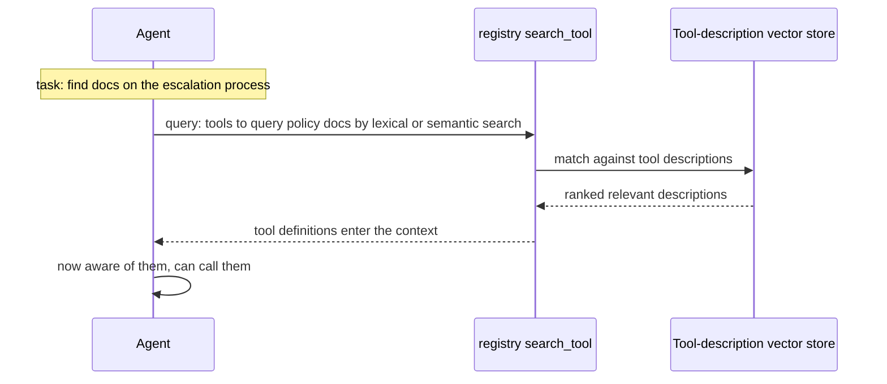

The model can discover and call any tool in the harness without carrying every tool
definition in its message history.

### Benefits and Trade-offs

| | |
|---|---|
| Token savings | In the lab, moving most definitions out of the system prompt into a registry cuts token usage by **more than 40%** |
| Less context confusion | Better tool selection, fewer wrong-tool picks |
| Cost | A more complex harness — effectively another data source |
| Good fit | Many tools, not all used often |
| Poor fit | Few tools, or most tools used on most tasks — keep them in the system prompt |

### Takeaways
- Tool descriptions are a fixed per-call cost; with many tools they crowd the context and
  confuse selection.
- A tool registry treats tool descriptions as data to retrieve, **loaded on demand**.
- With only a few tools, the added complexity isn't worth it.
- Next: [Evaluating Agentic Search](#m2-en-06).

<a id="m2-en-06"></a>

## 06 Evaluating Agentic Search

### Find Failures in the Traces
Start by reading traces for cases where the agent searches **worse than a knowledgeable
human would**. Your own knowledge of the system matters here. Two examples:
- **How should alerts be handled?** The agent finds notification-related code and answers
  from that — but you know a policy document explains alert handling directly.
- **What's the data format of `created_at` in the Feedback model?** The agent says the
  model has no `created_at` field. You know it does.

Finding failures like these is the first step toward useful evals. Before fixing, find
**where in the search process** the failure happens.

### Where Search Can Go Wrong

```mermaid
flowchart TB
    F["Search failure"] --> A["Wrong tool"]
    F --> B["Right tool, wrong data source"]
    F --> C["Right tool, wrong query/params<br/>e.g. missing number of docs"]
    F --> D["Calls fine, retrieved data is the problem"]
    A --> A1["Expand usage info in descriptions<br/>or disambiguate similar tools"]
    B --> B1["Check the tool definition<br/>names the data source clearly"]
    C --> C1["Clear description + a usage example<br/>(esp. custom tools)"]
    D --> D1["Inspect results: chunking, count, ranking<br/>→ data preparation, next video"]
```

- **Wrong tool**: in the first example the trace shows the agent chose lexical search,
  whose best matches were code files, when you think semantic search was right. Check
  more traces to see how often this happens; if it's often, diagnose it — descriptions
  may lack usage detail, or tools may be too similar and need their relationships spelled
  out.
- **Right tool, wrong data source**: the description doesn't say which source it reaches.
- **Right tool, wrong query**: e.g. a required parameter like the number of documents is
  missing. Check the definition for errors and make the text clear and detailed; an
  example call with suggested parameters helps, especially for custom tools the model
  never saw in training.
- **Calls are fine, data is wrong**: see below.

### Build a Small Eval Before Changing Anything
Before editing tool descriptions, build a small eval so you can quantify each change. It
needn't be complicated — plain Python or an off-the-shelf eval tool both work. The key:
**change one thing at a time** so you know what drove an improvement.

1. Collect searches where you know which tool should be chosen — the failures you saw,
   plus searches that already succeed.
2. After each description change, rerun the set and compare, **including regressions on
   the successful cases**.

What to evaluate depends on how strict "correct" is:

| Evaluate | When |
|---|---|
| Tool input | You know the agent must call a particular tool or query |
| Tool output or final response | Different tools or queries could reach the same data and answer — avoid being too prescriptive |

**Find errors → build evals on reference cases → let eval results drive changes** — this
habit is critical to improving agents rigorously.

### Right Calls, Still Wrong
Then look at **the data it retrieved**. In the `created_at` example, the trace shows the
agent found the right model class, but the class **was cut off mid-way**. The field was
in another chunk that never surfaced, because higher-scoring chunks filled the results —
so the agent lacked the context to answer.

Again: check other traces for how often it happens, then build an eval to measure fixes.
Here, look at how the data was chunked and whether there's a better way. Other retrieval
problems include returning too few documents or poor ranking. Once tool calling is
working, **data preparation and retrieval** are an important lever — next:
[Improving Retrieval with Data Preparation](#m2-en-07).

<a id="m2-en-07"></a>

## 07 Improving Retrieval with Data Preparation

### Why Data Preparation Is Context Engineering
Evals can make tool calling more reliable, but some problems sit in the data sources —
like chunks that split a block of code in half. Sometimes sources are ready-made and you
reach them with prescribed tools, with no say over chunking. When you build the sources
yourself, though, **data preparation is a key lever for better search** — it sounds like
data engineering, but it's part of context engineering.

Three techniques: **chunking, parsing, metadata** — then **precision and recall** to
measure their effect on search.

### Chunking
Embedding models take limited input, so long text or code is split into chunks; you set
the **chunk size**.

- **Overlap**: with no overlap, a boundary can split a sentence or even a word. A rolling
  window makes neighbors share some text (overlap is also set in characters), so a word or
  sentence cut at a hard boundary survives in the neighbor and the model can connect the
  pieces. But overlap is another choice to measure: **too much stores and retrieves the
  same information repeatedly**.
- **Recursive text splitting**: use the text's own structure, from large to small —
  paragraphs (`\n\n`) → lines (`\n`) → sentence-ending punctuation → whitespace between
  words — dropping a level whenever a piece is still too big.
- **Format-aware splitting**: when text has more structure, use its boundaries. Markdown
  headings (H1/H2/H3) show section hierarchy — text under a heading belongs to that
  section, a subheading narrows it — so splitting along them gives more meaningful chunks
  than newlines or punctuation alone.

### Parsing: Split Code by Syntax
Functions and classes are natural code chunks, but they **nest and link**: a class holds
several methods, a function may reference a global variable elsewhere in the file.
Chunking by character count ignores that — splitting a class in half, or separating
methods of the same class.

```mermaid
flowchart TB
    F["feedback.py"] --> I["import statements"]
    F --> C["class Feedback"]
    F --> G["global variable"]
    C --> M1["method validate()"]
    C --> M2["method escalate()"]
```

Use a **parser**. It understands a language's syntax (say Python) and produces an
**abstract syntax tree (AST)** capturing nesting from top to bottom — imports, classes,
functions and how they relate, with a class as parent and its methods beneath. As with
recursive splitting, chunking moves from larger constructs to smaller ones until each
fits the limit, but now along **known code boundaries**. A parser also exposes source
information like each construct's start and end position — metadata.

### Metadata
Small chunks keep retrieval targeted and free of distraction, but too small and you lose
where a chunk sits within or across files. Metadata like **file path and line number**
restores that; as the `created_at` example showed, chunks are hard to reassemble without
it.

- **Filtering**: metadata can narrow the candidate set **before** lexical or semantic
  ranking, removing large amounts of unrelated data so search runs over a smaller, more
  relevant subset. Module 3 also uses document IDs for deduplication.
- **Where it lives**: as tags outside the chunk, or inside the chunk text, often as front
  matter.
- **Augmenting small chunks**: beyond overlap, add a short summary of the previous chunk,
  the next chunk, or the whole file, so the chunk carries its surroundings — more
  informative and easier to retrieve for a relevant query.

### Measuring with Precision@k and Recall@k
**Build an evaluation set**: look at the data and pick tasks representative of real use,
especially common and impactful ones. For each, write a representative query and identify
the source material the system must retrieve — the **ground truth** — then map it to the
chunks search should return once the data is prepared.

**Example**: the task is understanding a feature of the feedback form — does the spinner
shown while it processes submitted data, before the confirmation page, have a timeout?
You mark 10 ground-truth chunks from several files, docs and code alike. The agent picks
how many chunks to retrieve, but for evaluation you **fix k** — here 12, so the metrics
are Precision@12 and Recall@12.

| Metric | Asks | Example: 12 retrieved, 8 in ground truth |
|---|---|---|
| Precision@k | Of what we retrieved, how much is relevant? | 8 / 12 ≈ 67% |
| Recall@k | Of the ground truth, how much did we retrieve? | 8 / 10 = 80% |

Higher is better for both, but raising both is hard — they trade off.

### Tuning

```mermaid
flowchart LR
    P["Low precision<br/>big chunks mix relevant + irrelevant"] --> S["Smaller chunk size"]
    S --> R1["Too small loses surrounding context<br/>→ related chunks missed, recall drops"]
    S --> O["Add a little overlap"]
    O --> R2["Too much fills top-k with duplicates<br/>→ recall drops"]
    O --> MD["Keep overlap small,<br/>use metadata to locate chunks"]
```

- Low Precision@k: chunks may be too large, mixing relevant and irrelevant text → use a
  smaller chunk size.
- Not too small: small chunks lose surrounding context, making related ground-truth chunks
  harder to retrieve — recall drops.
- A little overlap connects consecutive chunks; too much fills the top-k with redundant
  text — recall drops again.
- So **keep overlap small and use metadata** to place chunks in their surrounding context.

Precision and recall trade off, and the situation decides which matters more. To decide
with evidence, keep the habit: **find errors → build evals on reference cases → let eval
results drive changes**.

Next: [Guest Speaker: Drew Breunig (Part 2)](#m2-en-08) on handling huge
amounts of data in context engineering.

<a id="m2-en-08"></a>

## 08 Guest Speaker Drew Breunig (Part 2)

### RLMs Are a Test-Time Strategy
**Recursive Language Models (RLMs)** are a confusing name. At their core they're a new
**test-time strategy** — a way of accomplishing a task at inference time, while you
prompt the model and generate tokens.

An early example was "think step by step": adding it to the end of a question made models
like GPT-3.5 reason, and did much better. That simple hack proved remarkably effective —
Drew credits it with kick-starting the reasoning gains through 2025, since reasoning is
essentially thinking step by step, and models were then trained on those longer traces.
It was a **general-purpose strategy** that lifted LLMs across a whole cascade of problems.

RLMs are general-purpose too. You still ask the question and supply all the context, but
**instead of presenting it as tokens in the context window**, you give it to the LLM in a
**REPL**.

### How It Works
The REPL here is a Python notebook (think Jupyter or marimo), though it could be anything
— a **code scratchpad** the model uses as a tool to interrogate the information you gave
it: a Python environment with variables already loaded.

This gets around context rot and problems that don't fit the window. Say you have an
**800 MB file of agent traces** and want the common patterns. You can't put 800 MB into
token space, but you can load it as a variable and give the model instructions and tools
for exploring it:

```mermaid
flowchart TB
    Q["Question + 800 MB traces"] --> V["Loaded as a REPL variable<br/>(symbolic space)"]
    V --> E["Model writes code to explore<br/>first 100 chars / try parsing as JSON"]
    E --> T["Pull only needed samples into context<br/>(tokenized space)"]
    T --> S["Chop into 50 MB chunks, sample"]
    S --> SA["Hand to a sub-agent: fresh context window<br/>same REPL access"]
    SA -->|"results loaded back"| T
    T --> A["Answer over multiple steps"]
```

- The model might look at the first 100 characters, notice JSON and try parsing it. It
  explores and samples through the REPL, moving things from **symbolic (variable) space**
  into **token space**, spending its context budget over multiple steps toward an answer.
- **What makes it recursive**: the model can also call a **sub-agent** with a completely
  new context window. Having found a huge newline-separated JSONL file and learned the
  JSON shape from the first 10 records, it can chop the 800 MB into 50 MB chunks, sample
  them, and hand each to a sub-agent with a prompt and a variable — the sub-agent shares
  the same REPL — then load the results back.

So an RLM gives the model an **out-of-context scratchpad** for managing information.

### Why It Works
The **jagged frontier** (Ethan Mollick and Karpathy both describe it): models are great at
some things, like coding, and meh at others, like counting the R's in strawberry.

RLMs **turn the problem into the model's strong suits** — reasoning and coding. Models
struggle with long context, but recast as a reasoning-and-coding problem, you get much
more out of them.

### Takeaways
- An RLM is a general test-time strategy, like "think step by step" was.
- Huge context lives in REPL variables; the model writes code to sample it and pulls only
  what it needs into context.
- Recursion = handing chunked sub-tasks to sub-agents with fresh context windows.
- It sidesteps a model weakness (long context) by leaning on its strengths (reasoning,
  coding).

## Module Recap
- Agents need **high-quality, relevant** data to do the tasks you give them.
- You implemented search tools that let the agent know **where to look** across multiple
  data sources and **retrieve iteratively** with strategies tailored to the query.
- You evaluated agentic search by **reading traces**: checking the agent called the right
  search tools with appropriate queries, matching your intuition about the available
  strategies and data sources.
- You practised measuring agentic search performance, with **chunking and metadata** as
  levers for improving quality.

Agents can now fill their knowledge gaps with better context. But complex tasks can run
for hours or days, and if everything gets carried forward the context window eventually
fills up — that's what [Module 3 (Context Management)](/Context-Engineering-Module-3/) tackles.

</div>
