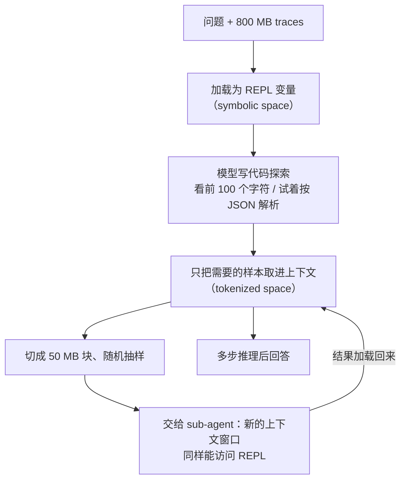
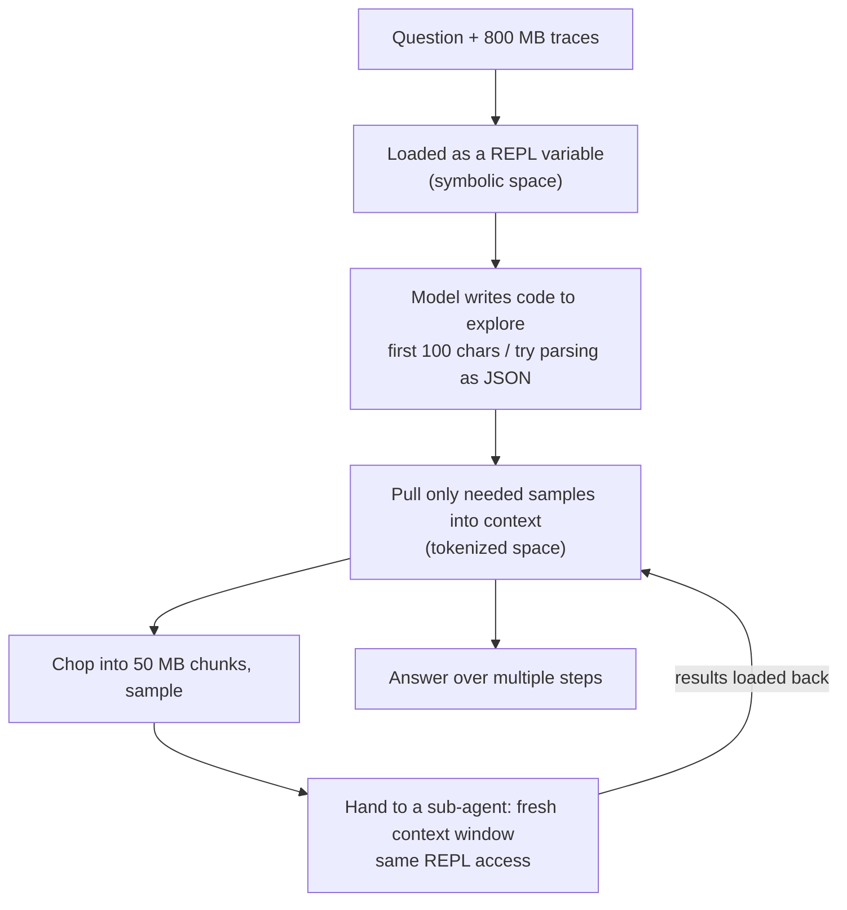

> DeepLearning.AI × Chroma｜Module 2，视频约 5 分钟｜
> 上集：[Guest Speaker Drew Breunig (Part 1)](/Drew-Breunig-Part-1/)

## RLM 是一种 test-time strategy
**Recursive Language Models（RLM）** 名字有点绕。核心上，它是一种新的
**test-time strategy**——推理时（prompt 模型、生成 token 的阶段）完成任务的策略。

最早的 test-time strategy 例子是「think step by step」：对 GPT-3.5 这类早期模型，
在问题末尾加这一句就能逼它推理。这个简单的 hack 效果惊人，
Drew 认为它带动了 2025 年模型在推理上的进步——推理本质上就是一步步想，
再用这种更长的推理过程训练模型。它是一种**通用策略**，能提升 LLM 在一大批问题上的表现。

RLM 也是通用策略。不同的是：问题照问、所需上下文也都给，
但**不把这些信息作为 token 塞进上下文窗口**，而是放进一个 **REPL** 交给 LLM。

## 怎么工作
REPL 在这里就是一个 Python notebook（类似 Jupyter、marimo），也可以是别的，
本质是一个**代码 scratchpad**，模型可以把它当工具来查询你给的信息——
一个预先装好变量的 Python 环境。

这能绕开 context rot 和放不进窗口的问题。比如你有一个 **800 MB 的 agent trace 文件**，
想分析其中的常见模式——800 MB 不可能塞进 token 空间。
但可以把它作为变量加载进 Python 环境，再给模型探索这个变量的说明和工具：

- 模型可能先看前 100 个字符，发现像 JSON 就试着解析；
  用 REPL 探索上下文、按需取样，把东西从**变量空间（symbolic space）**
  取到 **token 空间**，在多步中逐步花掉上下文窗口的预算来回答问题。
- **「递归」在哪**：模型还能调用一个 **sub-agent**，它有全新的上下文窗口。
  比如发现文件是换行分隔的大 JSONL，抽样前 10 条摸清 JSON 结构；
  整个 800 MB 太大没法分析，就切成 50 MB 的块、随机抽样，
  每块连同 prompt 和变量交给一个 sub-agent，它也能访问同一个 REPL，结果再加载回来。

所以 RLM 就是给模型一个**上下文之外的 scratchpad** 来管理信息。

## 为什么有效
**Jagged frontier**（Ethan Mollick、Karpathy 都讲过）：模型在某些事上很强（比如写代码），
在另一些事上一般（比如数 strawberry 里有几个 r）。

RLM 把问题**转成模型擅长的形式**——推理和写代码。
模型不擅长长上下文，但变成推理 + 编码问题后，就能从中得到更多价值。

## 要点
- RLM 是通用的 test-time strategy，像当年的「think step by step」。
- 海量上下文放在 REPL 变量里，模型写代码按需取样，只把需要的部分拉进上下文。
- 递归 = 把切好的子任务交给有全新上下文窗口的 sub-agent。
- 本质是避开模型的弱项（长上下文），利用强项（推理、编码）。

> DeepLearning.AI × Chroma | Module 2, ~5 min video |
> Part 1: [Guest Speaker Drew Breunig (Part 1)](/Drew-Breunig-Part-1/)

## RLMs Are a Test-Time Strategy
**Recursive Language Models (RLMs)** are a confusing name. At their core they're a new
**test-time strategy** — a way of accomplishing a task at inference time, while you
prompt the model and generate tokens.

An early example was "think step by step": adding it to the end of a question made models
like GPT-3.5 reason, and did much better. That simple hack proved remarkably effective —
Drew credits it with kick-starting the reasoning gains through 2025, since reasoning is
essentially thinking step by step, and models were then trained on those longer traces.
It was a **general-purpose strategy** that lifted LLMs across a whole cascade of problems.

RLMs are general-purpose too. You still ask the question and supply all the context, but
**instead of presenting it as tokens in the context window**, you give it to the LLM in a
**REPL**.

## How It Works
The REPL here is a Python notebook (think Jupyter or marimo), though it could be anything
— a **code scratchpad** the model uses as a tool to interrogate the information you gave
it: a Python environment with variables already loaded.

This gets around context rot and problems that don't fit the window. Say you have an
**800 MB file of agent traces** and want the common patterns. You can't put 800 MB into
token space, but you can load it as a variable and give the model instructions and tools
for exploring it:

- The model might look at the first 100 characters, notice JSON and try parsing it. It
  explores and samples through the REPL, moving things from **symbolic (variable) space**
  into **token space**, spending its context budget over multiple steps toward an answer.
- **What makes it recursive**: the model can also call a **sub-agent** with a completely
  new context window. Having found a huge newline-separated JSONL file and learned the
  JSON shape from the first 10 records, it can chop the 800 MB into 50 MB chunks, sample
  them, and hand each to a sub-agent with a prompt and a variable — the sub-agent shares
  the same REPL — then load the results back.

So an RLM gives the model an **out-of-context scratchpad** for managing information.

## Why It Works
The **jagged frontier** (Ethan Mollick and Karpathy both describe it): models are great at
some things, like coding, and meh at others, like counting the R's in strawberry.

RLMs **turn the problem into the model's strong suits** — reasoning and coding. Models
struggle with long context, but recast as a reasoning-and-coding problem, you get much
more out of them.

## Takeaways
- An RLM is a general test-time strategy, like "think step by step" was.
- Huge context lives in REPL variables; the model writes code to sample it and pulls only
  what it needs into context.
- Recursion = handing chunked sub-tasks to sub-agents with fresh context windows.
- It sidesteps a model weakness (long context) by leaning on its strengths (reasoning,
  coding).

