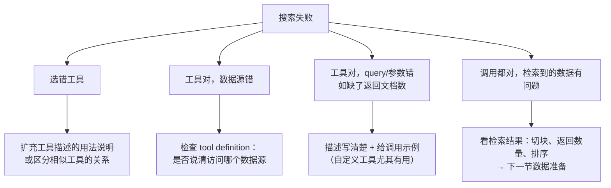
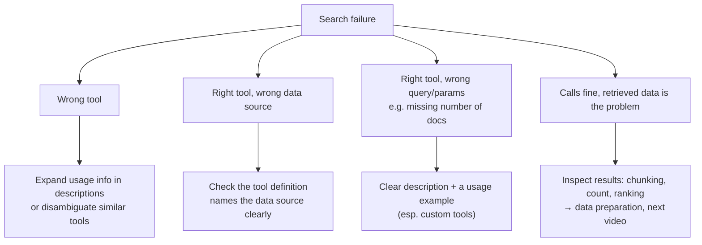

> DeepLearning.AI × Chroma｜Module 2，视频约 6 分钟｜
> 上一节：[Tool Registries](/Tool-Registries/)

## 从 trace 里找失败案例
起点：看 trace，找出 agent 搜得**不如一个熟悉系统的人**的情况。
这里你对自己系统的了解非常关键。两个例子：
- **问告警怎么处理**：agent 找到一段通知相关的代码，基于代码作答。
  但你知道有一份政策文档直接讲了告警该怎么处理。
- **问 Feedback 模型里 `created_at` 字段的数据格式**：agent 说「Feedback 模型没有
  `created_at` 字段」。你知道这个字段明明存在。

找到这类失败是构建有用 eval 的第一步。但修之前，先弄清**失败发生在搜索的哪一步**。

## 失败可能出在哪

- **选错工具**：第一个例子里，trace 显示 agent 选了 lexical search，
  最匹配的都是代码文件；而你认为该用 semantic search。
  多看一些 trace，估计这种情况有多频繁；频繁的话值得花时间诊断，
  可能是工具定义不够详细，也可能是几个工具定义太像、需要说明彼此关系。
- **工具对、数据源错**：工具描述没说清它访问的是哪个数据源。
- **工具对、query 错**：比如缺了必填参数（要取多少文档）。
  检查 tool definition 有没有错、描述是否清楚详细；
  给一个带建议参数的调用示例也很有用，尤其是模型训练时没见过的自定义工具。
- **调用都对，数据有问题**：见下文。

## 改之前，先建一个小 eval
在改工具描述之前，先建一个小 eval 来衡量系统表现，好量化改动的影响。
不必复杂，从零用 Python 写或用现成的 eval 方案都行。关键：**一次只改一处**，
才知道是什么带来了改进。

1. 准备一组**已知应该选哪个工具**的搜索，包括观察到的失败案例，
   也包括表现良好的成功案例。
2. 每改一次工具描述，跑一遍这组参考搜索，看表现变化，**包括成功案例有没有退化**。

评估哪一层，取决于对「正确」的要求：

| 评估对象 | 什么时候用 |
|---|---|
| Tool input | 你确定 agent 必须调用某个工具 / 用某个 query |
| Tool output 或最终回答 | 不同工具或 query 都能拿到相关数据和正确答案时，避免过度约束 |

**找错误 → 建 eval 衡量参考案例 → 用 eval 结果驱动改动**，
这个习惯是严谨改进 agent 的关键。

## 工具调用都对，还是答错了
这时要看**检索到的数据**。回到 `created_at` 的例子：trace 显示 agent 取到了正确的
model class，但这个 class **在中间被切断了**；目标字段落在另一个 chunk 里，
而搜索结果被其他得分更高的 chunk 占满，agent 找不到它，也就没有回答所需的上下文。

同样，先在更多 trace 里看这种情况有多常见，再建 eval 衡量改进。
这个例子要看数据是怎么切块的、有没有更好的切法。
其他检索问题还包括：返回的文档不够多、排序表现不好。
如果确定工具调用没问题，**数据准备和检索**就是改进系统的重要杠杆——下一节：
[Improving Retrieval with Data Preparation](/Improving-Retrieval-with-Data-Preparation/)。

> DeepLearning.AI × Chroma | Module 2, ~6 min video |
> Previous: [Tool Registries](/Tool-Registries/)

## Find Failures in the Traces
Start by reading traces for cases where the agent searches **worse than a knowledgeable
human would**. Your own knowledge of the system matters here. Two examples:
- **How should alerts be handled?** The agent finds notification-related code and answers
  from that — but you know a policy document explains alert handling directly.
- **What's the data format of `created_at` in the Feedback model?** The agent says the
  model has no `created_at` field. You know it does.

Finding failures like these is the first step toward useful evals. Before fixing, find
**where in the search process** the failure happens.

## Where Search Can Go Wrong

- **Wrong tool**: in the first example the trace shows the agent chose lexical search,
  whose best matches were code files, when you think semantic search was right. Check
  more traces to see how often this happens; if it's often, diagnose it — descriptions
  may lack usage detail, or tools may be too similar and need their relationships spelled
  out.
- **Right tool, wrong data source**: the description doesn't say which source it reaches.
- **Right tool, wrong query**: e.g. a required parameter like the number of documents is
  missing. Check the definition for errors and make the text clear and detailed; an
  example call with suggested parameters helps, especially for custom tools the model
  never saw in training.
- **Calls are fine, data is wrong**: see below.

## Build a Small Eval Before Changing Anything
Before editing tool descriptions, build a small eval so you can quantify each change. It
needn't be complicated — plain Python or an off-the-shelf eval tool both work. The key:
**change one thing at a time** so you know what drove an improvement.

1. Collect searches where you know which tool should be chosen — the failures you saw,
   plus searches that already succeed.
2. After each description change, rerun the set and compare, **including regressions on
   the successful cases**.

What to evaluate depends on how strict "correct" is:

| Evaluate | When |
|---|---|
| Tool input | You know the agent must call a particular tool or query |
| Tool output or final response | Different tools or queries could reach the same data and answer — avoid being too prescriptive |

**Find errors → build evals on reference cases → let eval results drive changes** — this
habit is critical to improving agents rigorously.

## Right Calls, Still Wrong
Then look at **the data it retrieved**. In the `created_at` example, the trace shows the
agent found the right model class, but the class **was cut off mid-way**. The field was
in another chunk that never surfaced, because higher-scoring chunks filled the results —
so the agent lacked the context to answer.

Again: check other traces for how often it happens, then build an eval to measure fixes.
Here, look at how the data was chunked and whether there's a better way. Other retrieval
problems include returning too few documents or poor ranking. Once tool calling is
working, **data preparation and retrieval** are an important lever — next:
[Improving Retrieval with Data Preparation](/Improving-Retrieval-with-Data-Preparation/).

