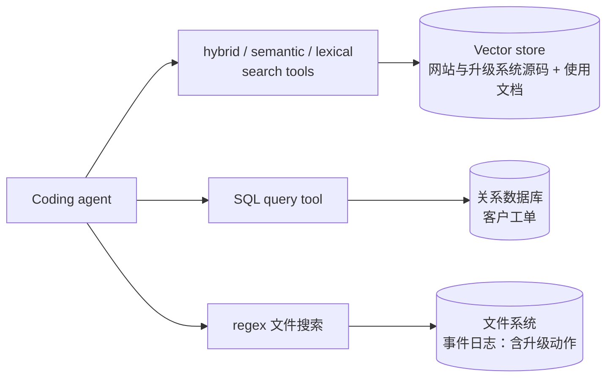
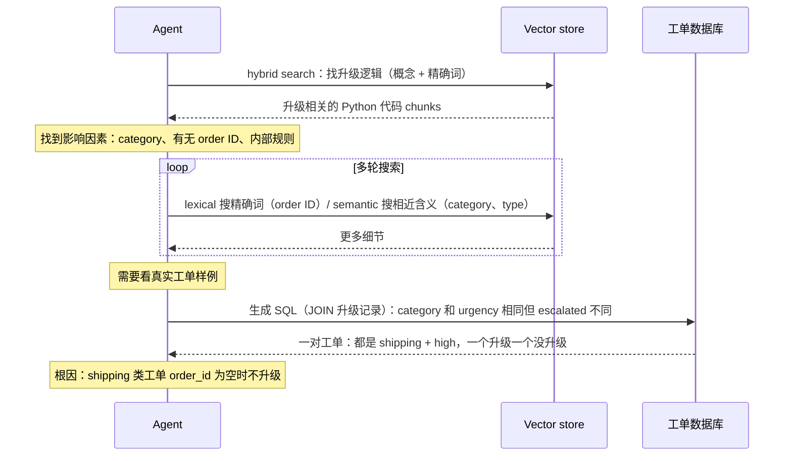
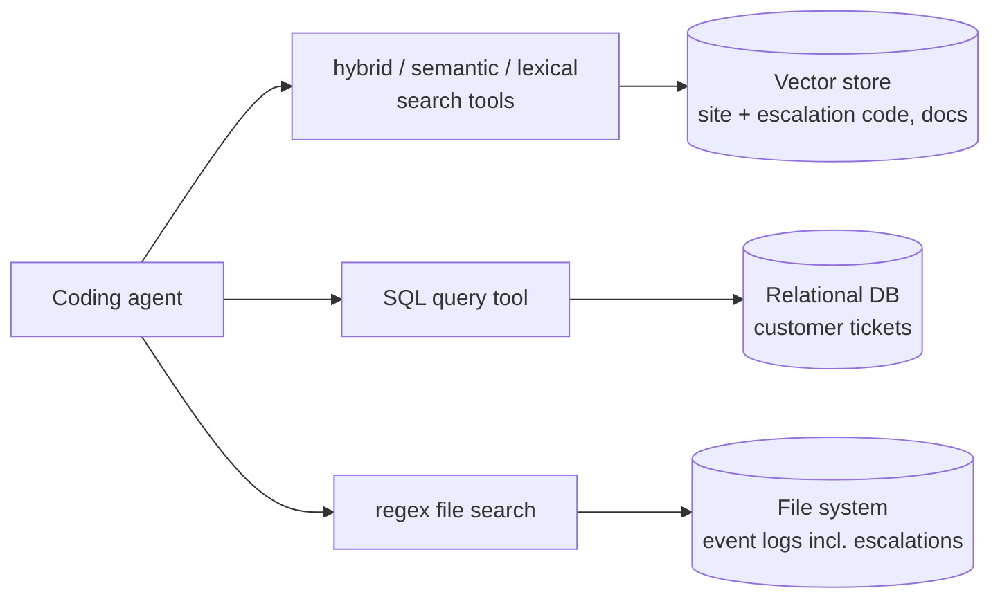
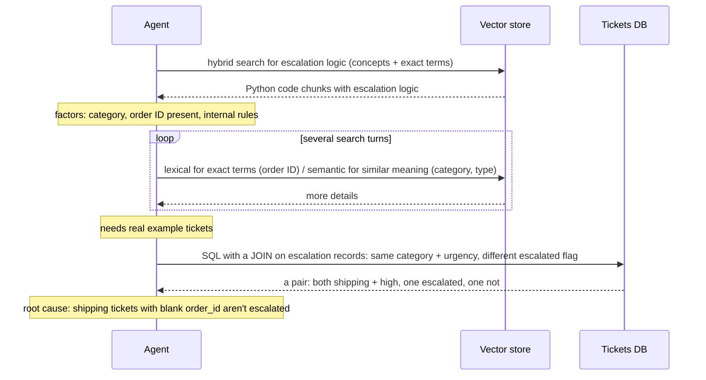

> DeepLearning.AI × Chroma｜Module 2，视频约 4 分钟｜
> 上一节：[Introduction to Agentic Search](/Introduction-to-Agentic-Search/)

## 场景
一家电商的客服团队发现异常：**问题差不多的客户工单，有的被升级（escalate）了，有的没有**。
工程团队用一个 coding agent 去排查这套反馈系统的代码库。
工程师给的只是一个宽泛的请求——「帮忙看看这个问题」，
接下来搜什么、用什么工具，都是 **agent 自己决定**的。

## Agent 能访问的数据源和工具

每个工具只搜一个数据源；工具的细节在后面两节展开。

## 排查过程

1. 先决定搜代码库找升级逻辑，选 **hybrid search**——它同时覆盖概念和精确词。
   模型生成工具输入，交给 harness 执行，返回升级逻辑的代码 chunk。
2. 从代码里识别出几个影响升级的因素：类别、是否有 order ID、其他内部规则。
3. 再搜几轮，**混用工具**：用 lexical 精确匹配 `order ID` 这类关键词，
   用 semantic 找含义相近的代码或文本（category、type 等）。
4. 决定看真实工单，换成**数据库工具**：生成带 JOIN 的 SQL 查升级记录。
   Agent 自己把「相似」定义为 category 和 urgency 相同、但 escalated 标记不同。
5. 返回一对工单：都是 shipping、urgency 都是 high，一个升级了，一个没有。
   这足以定位根因——**代码没有处理 order ID 为空的工单的升级**。

## 要点
- 这就是 agentic search：agent 决定需要什么信息，用不同工具搜多轮，
  根据结果继续追，信息够了才回答。
- **工具跟着信息走**：要什么信息、信息在哪个数据源，决定了选哪种搜索策略。
- 下一节：[Search Strategies](/Search-Strategies/)，建立对各种搜索技术适用场景的直觉。

> DeepLearning.AI × Chroma | Module 2, ~4 min video |
> Previous: [Introduction to Agentic Search](/Introduction-to-Agentic-Search/)

## The Scenario
An e-commerce support team notices something odd: **tickets reporting similar issues are
sometimes escalated and sometimes not**. Engineering investigates the feedback system's
codebase with a coding agent. The engineer's prompt is only a broad request to look into
the problem — what to search and which tools to use is **the agent's decision**.

## Data Sources and Tools

Each tool searches one data source; the next two videos cover the tools in detail.

## How the Investigation Unfolds

1. It decides to search the codebase for escalation logic with **hybrid search**, which
   covers both concepts and exact terms. The model produces the tool input, the harness
   runs the tool, and escalation code chunks come back.
2. From that code it identifies factors: category, whether there's an order ID, and
   other internal rules.
3. Over more turns it **mixes tools**: lexical for exact matches like `order ID`,
   semantic for code or text with similar meaning (category, type, etc.).
4. It decides it needs example tickets and switches to the **database tool**, writing SQL
   with a JOIN on escalation records. It defines "similar" itself: same category and
   urgency, different escalated flag.
5. Back comes a pair of tickets — both shipping, both high urgency, only one escalated.
   That's the root cause: **the code doesn't escalate tickets with a blank order ID**.

## Takeaways
- This is agentic search: the agent decides what it needs, searches over several turns
  with different tools, follows the results, and answers once it has enough.
- **The tool follows the information**: what the agent needs, and which source holds it,
  determines the search strategy.
- Next: [Search Strategies](/Search-Strategies/) — intuition for when each technique fits.

