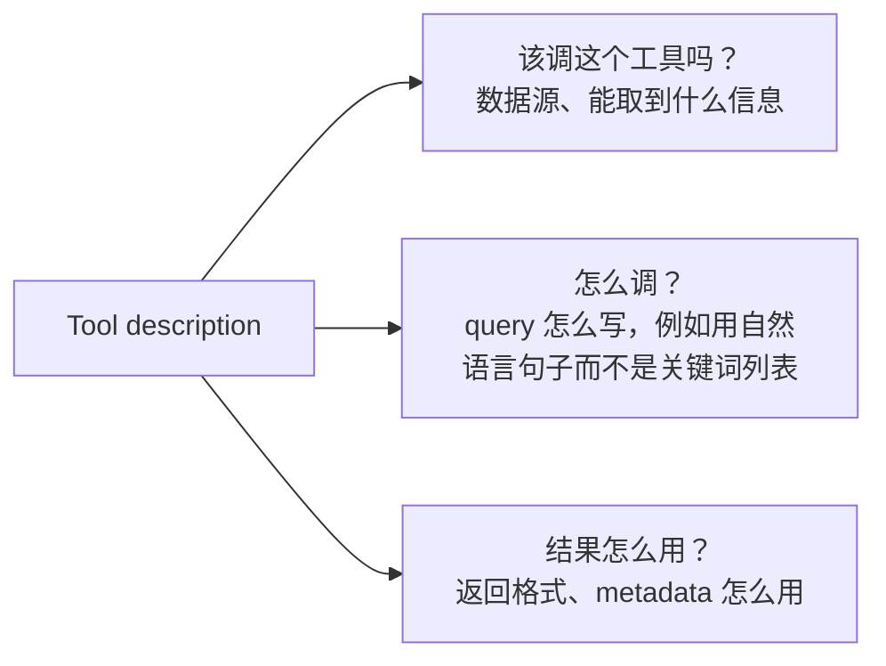
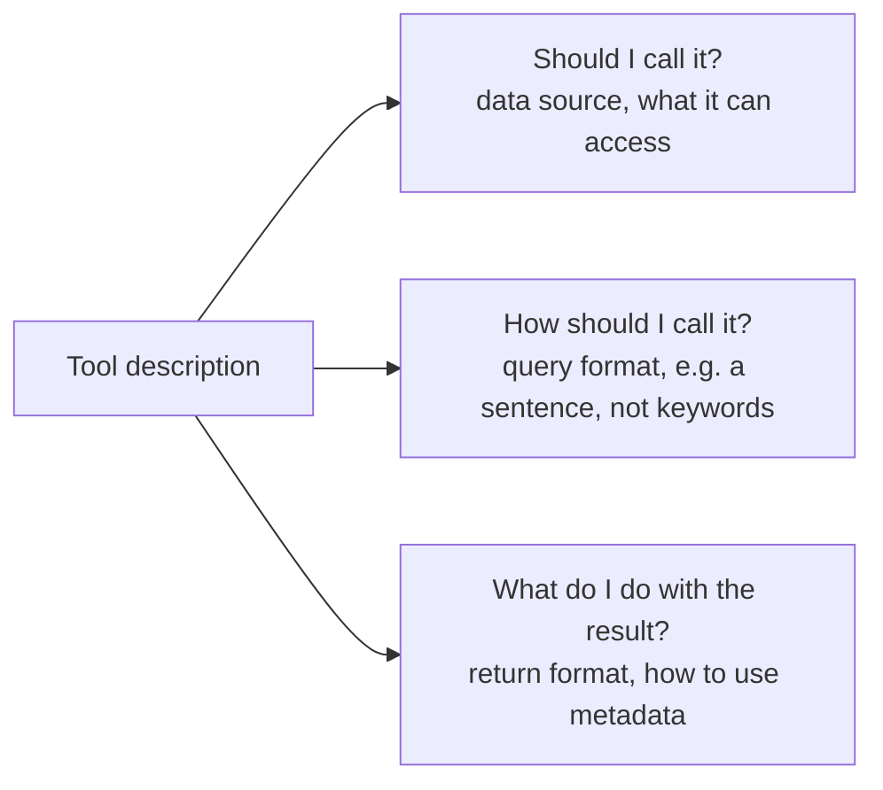

> DeepLearning.AI × Chroma｜Module 2，视频约 7 分钟｜
> 上一节：[Search Strategies](/Search-Strategies/)

## 数据源决定能用哪种搜索

| 数据源 | 内容 | 搜索方式 | 工具 |
|---|---|---|---|
| Vector store（Chroma collection） | 代码和文档，有文本也有 embedding | lexical / semantic / hybrid，看配置 | semantic search、几个 lexical search、hybrid |
| 日志 | 纯文本文件，没有 embedding 或语义索引 | lexical | 文件系统搜索（regex） |
| 关系数据库 | 客户反馈工单 | SQL 结构化查询 | 数据库查询工具 |

数据库查询严格来说不算「搜索」，但也是**信息检索**。

这门课讲的是 context engineering，不是怎么造搜索工具——
lab 里工具已经搭好（用了 Chroma 的开源工具准备 semantic 和 lexical 搜索的数据集），
重点放在更重要的事上：**把工具接进 agent，并把它们描述清楚**，
让 agent 知道工具做什么、能访问什么数据、什么时候用。

## Tool description 要回答的三个问题
Agent 对数据的了解可以放在 system prompt 里，也可以放在工具描述里。
Module 1 里工具定义写在 system prompt；实际上很多 LLM API 用单独的 `tools` 参数传，
但道理一样：这些上下文交给模型，由模型决定用不用。

## 坏描述 vs 好描述（SemanticSearch）

| | 初稿 | 改进版 |
|---|---|---|
| 搜什么 | 「搜索代码库」——但实际搜的是 Chroma collection 里的向量表示 | 明确：索引过的代码和文档 |
| 怎么搜 | 没说 | 按概念相似度 |
| 何时用 | 「最适合一般性探索」 | 想弄清代码怎么工作、但不确定确切标识符或术语时 |
| 和其他工具比 | 没说 | 什么时候该选它而不是别的工具 |
| 局限 | 没说 | 说明工具的边界 |

「最适合一般性探索」是**上下文的危险点**：一般性探索几乎涵盖一切，
模型没法判断它是不是对的工具，很可能在不该用的场合也用它。

## 怎么写好 tool description
1. **清楚说明工具做什么**，具体到 agent 能认出它就是当前要用的。
   搜索工具要写明能访问**哪些文档**、用**什么检索方法**。
2. **输入格式**：自然语言 query？关键词列表？精确文本序列？
3. **返回什么**，让 agent 知道这个工具怎么衔接后续步骤。例如：
   「返回 1000 字符的 chunk，metadata 里有父文档和相邻 chunk」。
4. **何时用、何时不用**，帮助决策。
5. **局限**，避免不必要的调用。
6. **能力重叠的工具**，说明替代选项，帮 agent 区分。

这些是通用准则；也可以参考所用模型厂商关于 tool description 的具体指南。

## 要点
- 工具是预先搭好的，context engineering 的活是**把它们描述清楚**。
- 好描述回答三个问题：该不该调、怎么调、结果怎么用。
- 避免「适合一般用途」这种笼统描述——它会让模型滥用工具。
- 但描述越写越长、工具越加越多，又会带来上下文问题——
  下一节：[Tool Registries](/Tool-Registries/)。

> DeepLearning.AI × Chroma | Module 2, ~7 min video |
> Previous: [Search Strategies](/Search-Strategies/)

## The Data Source Decides the Search Method

| Data source | Contents | Search method | Tools |
|---|---|---|---|
| Vector store (Chroma collection) | Code and docs, text plus embeddings | Lexical / semantic / hybrid, depending on config | Semantic search, several lexical tools, hybrid |
| Logs | Plain text files, no embeddings or semantic index | Lexical | File-system search (regex) |
| Relational database | Customer feedback tickets | Structured SQL queries | Database query tool |

A database query isn't really search, but it is **information retrieval**.

The course is about context engineering, not building search tools, so the labs set the
tools up for you (using open-source Chroma tooling to prepare collections for semantic and
lexical search). The focus is the part that matters more: **integrating the tools into the
agent and describing them** so it knows what each does, what data it reaches, and when to
use it.

## Three Questions a Tool Description Answers
What the agent knows about its data can live in the system prompt or in tool
descriptions. Module 1 put tool definitions in the system prompt; many LLM APIs actually
take them in a separate `tools` parameter, but the idea is the same — the model gets this
context and decides whether to use the tool.

## Weak vs Strong Description (SemanticSearch)

| | First draft | Improved |
|---|---|---|
| What it searches | "Searches the codebase" — really a vector store in a Chroma collection | The indexed code and documentation |
| How | Not said | By conceptual similarity |
| When | "Best for general exploration" | Exploring how code works without knowing exact identifiers or terms |
| vs other tools | Not said | When to pick it over the alternatives |
| Limits | Not said | Describes its boundaries |

"Best for general exploration" is **a danger point for context**: general exploration
covers almost everything, so the model can't tell whether it's the right tool and may use
it far more than it should.

## Writing a Good Tool Description
1. **A clear statement of what it does**, specific enough for the agent to recognize it
   as the right tool. For search: which **corpus** it reaches and which **retrieval
   method** it uses.
2. **Input format**: a natural-language query, a keyword list, exact text sequences?
3. **What it returns**, so the agent knows how the call sets up later steps — e.g.
   "returns 1,000-character chunks with metadata giving the parent document and
   neighboring chunks".
4. **When to use it, and when not to.**
5. **Limitations**, to avoid unnecessary calls.
6. **Alternatives**, where tools overlap, so the agent can tell them apart.

These are broad guidelines; frontier model providers also publish tool-description
guidance for their models.

## Takeaways
- The tools are prebuilt; the context engineering work is **describing them well**.
- A good description answers: should I call it, how, and what to do with the result.
- Avoid catch-all phrases like "general exploration" — they invite tool misuse.
- But longer descriptions and more tools create context problems of their own — next:
  [Tool Registries](/Tool-Registries/).

