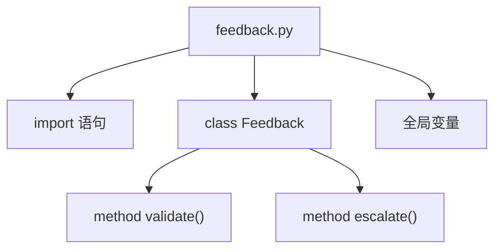
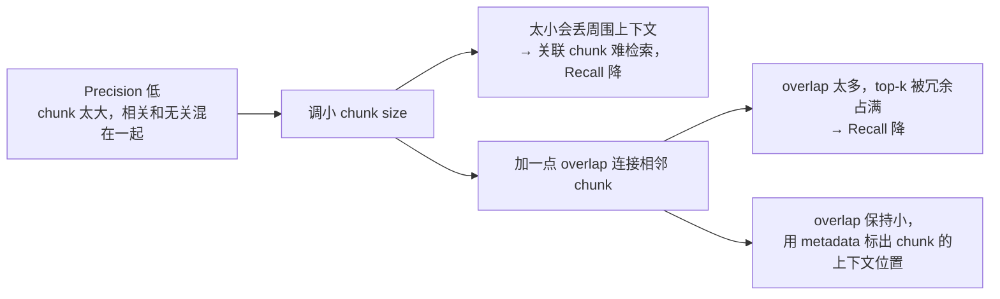
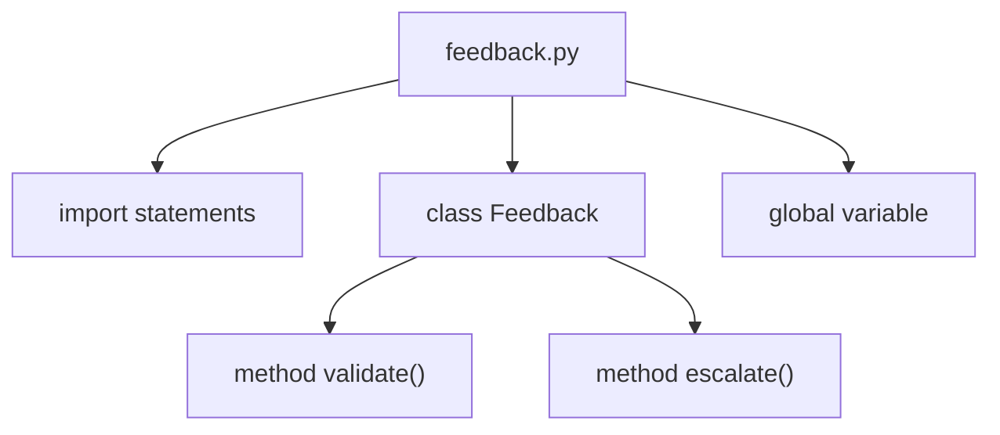
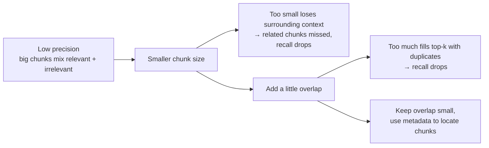

> DeepLearning.AI × Chroma｜Module 2，视频约 9 分钟｜
> 上一节：[Evaluating Agentic Search](/Evaluating-Agentic-Search/)

## 为什么数据准备也算 context engineering
上一节的 eval 能改进工具调用，但还有数据源本身的问题，比如 chunk 把一段代码从中间切开。
有时数据源是现成的，我们只能用指定的工具去访问，对切块这类准备工作没有发言权。
但当数据源由你来搭建时，**数据准备就是改进搜索的重要杠杆**，
听起来像数据工程，其实是 context engineering 的一部分。

本节三种技术：**切块（chunking）、解析（parsing）、metadata**；
再用 **precision 和 recall** 衡量它们对搜索的改进。

## Chunking
Embedding 模型的输入有限，长文本或代码要切成小块，**chunk size** 由你定。

- **重叠（overlap）**：相邻 chunk 不重叠的话，边界可能把一句话甚至一个词切断。
  用滑动窗口让相邻 chunk 共享一部分内容（重叠量也是按字符数自定义的），
  即使边界切得生硬，缺掉的词或句子也会保留在相邻 chunk 里，帮模型把上下文接起来。
  但重叠是另一个需要衡量的工程选择：**重叠太多会重复存储、重复检索同样的信息**。
- **Recursive text splitting**：利用文本本身的结构找自然边界，从大到小逐级尝试——
  段落（`\n\n`）→ 行（`\n`）→ 句末标点（句号、问号、感叹号）→ 词间空白。
  还太大就降一级继续切。
- **按格式切**：文本结构更强时用格式专属的边界。Markdown 的 H1/H2/H3 标题
  体现了章节层级，标题下的文字属于该章节，子标题把它放进更细的部分；
  沿结构切比只看换行和标点更有意义。

## Parsing：代码要按语法切
函数、类是代码天然的块，但它们会**嵌套、相互关联**：一个类包含多个方法，
一个函数可能引用文件别处的全局变量。只按字符数切，会把类切成两半，
或把属于同一个类的函数分开。

用 **parser**：它理解编程语言（比如 Python）的语法，生成**抽象语法树（AST）**，
自上而下表达代码的嵌套关系——import、类、函数以及它们之间的关系，
类作为父节点，方法嵌在下面。和 recursive splitting 一样，从大结构往小结构切，
直到每块都在字符上限内，但边界是**已知的代码边界**。
Parser 还能给出每个结构的起止位置等源码信息——这就是 metadata。

## Metadata
Chunk 要小，检索才精准、不夹杂干扰信息；但太小就不知道它在文件里、在文件之间的位置了。
**文件路径、行号**这类 metadata 能补上这一点。上一节 `created_at` 的例子说明，
没有 metadata，chunk 很难重新拼回去。

- **过滤**：metadata 可以用来过滤，在 lexical / semantic 排序**之前**缩小候选集，
  去掉大量无关数据，在更小、更相关的子集上搜，结果更有针对性。
  Module 3 还会用 document ID 做去重。
- **放在哪**：可以作为 chunk 外的标签，
  也可以写进 chunk 文本里（常见做法是 front matter）。
- **增强小 chunk**：除了直接重叠，还可以给 chunk 加上前一块、后一块乃至整个文件的
  简短摘要，让它携带周围的信息，内容更充分，也更容易被相关 query 检索到。

## 用 Precision@k 和 Recall@k 衡量
**建评估集**：先看数据，挑出能代表用户真实用法的任务，尤其是常见又重要的。
每个任务写一个代表性 query，人工找出系统必须检索到的源材料——这就是 **ground truth**。
数据准备好之后，把这些材料映射到搜索应返回的那部分 chunk。

**例子**：任务是理解反馈表单的一个功能——表单处理提交数据、显示确认页之前的
那个加载动画（spinner）有没有超时？人工标出 10 个 ground truth chunk，
来自多个文件，既有文档也有代码。Agent 检索时自己决定取多少个 chunk，
但评估时要**固定 k**，这里 k = 12，所以指标记作 Precision@12 和 Recall@12。

| 指标 | 问的是 | 例子：取回 12 个，其中 8 个在 ground truth 里 |
|---|---|---|
| Precision@k | 取回的 chunk 里，有多少是相关的 | 8 / 12 ≈ 67% |
| Recall@k | ground truth 里，有多少被取回了 | 8 / 10 = 80% |

两者都是越高越好，但同时提高很难，因为它们之间有取舍。

## 怎么调

- Precision@k 低：可能 chunk 太大，相关信息和无关信息混在一起 → 调小 chunk size。
- 但不能太小：小 chunk 会丢失周围上下文，
  ground truth 中关联的 chunk 更难检索，Recall 会降。
- 加一点 overlap 能把前后相连的 chunk 接起来；
  但太多会让 top-k 被冗余信息占满，Recall 也会降。
- 所以 **overlap 保持小，改用 metadata** 标识 chunk 在上下文中的位置。

Precision 和 Recall 之间有取舍，看场景决定更看重哪个。
要做出有依据的决定，关键还是那个习惯：
**找错误 → 建 eval 衡量参考案例 → 用 eval 结果驱动改动**。

下一节：[Guest Speaker: Drew Breunig (Part 2)](/Drew-Breunig-Part-2/)，
聊怎么在 context engineering 中处理海量数据。

> DeepLearning.AI × Chroma | Module 2, ~9 min video |
> Previous: [Evaluating Agentic Search](/Evaluating-Agentic-Search/)

## Why Data Preparation Is Context Engineering
Evals can make tool calling more reliable, but some problems sit in the data sources —
like chunks that split a block of code in half. Sometimes sources are ready-made and you
reach them with prescribed tools, with no say over chunking. When you build the sources
yourself, though, **data preparation is a key lever for better search** — it sounds like
data engineering, but it's part of context engineering.

Three techniques: **chunking, parsing, metadata** — then **precision and recall** to
measure their effect on search.

## Chunking
Embedding models take limited input, so long text or code is split into chunks; you set
the **chunk size**.

- **Overlap**: with no overlap, a boundary can split a sentence or even a word. A rolling
  window makes neighbors share some text (overlap is also set in characters), so a word or
  sentence cut at a hard boundary survives in the neighbor and the model can connect the
  pieces. But overlap is another choice to measure: **too much stores and retrieves the
  same information repeatedly**.
- **Recursive text splitting**: use the text's own structure, from large to small —
  paragraphs (`\n\n`) → lines (`\n`) → sentence-ending punctuation → whitespace between
  words — dropping a level whenever a piece is still too big.
- **Format-aware splitting**: when text has more structure, use its boundaries. Markdown
  headings (H1/H2/H3) show section hierarchy — text under a heading belongs to that
  section, a subheading narrows it — so splitting along them gives more meaningful chunks
  than newlines or punctuation alone.

## Parsing: Split Code by Syntax
Functions and classes are natural code chunks, but they **nest and link**: a class holds
several methods, a function may reference a global variable elsewhere in the file.
Chunking by character count ignores that — splitting a class in half, or separating
methods of the same class.

Use a **parser**. It understands a language's syntax (say Python) and produces an
**abstract syntax tree (AST)** capturing nesting from top to bottom — imports, classes,
functions and how they relate, with a class as parent and its methods beneath. As with
recursive splitting, chunking moves from larger constructs to smaller ones until each
fits the limit, but now along **known code boundaries**. A parser also exposes source
information like each construct's start and end position — metadata.

## Metadata
Small chunks keep retrieval targeted and free of distraction, but too small and you lose
where a chunk sits within or across files. Metadata like **file path and line number**
restores that; as the `created_at` example showed, chunks are hard to reassemble without
it.

- **Filtering**: metadata can narrow the candidate set **before** lexical or semantic
  ranking, removing large amounts of unrelated data so search runs over a smaller, more
  relevant subset. Module 3 also uses document IDs for deduplication.
- **Where it lives**: as tags outside the chunk, or inside the chunk text, often as front
  matter.
- **Augmenting small chunks**: beyond overlap, add a short summary of the previous chunk,
  the next chunk, or the whole file, so the chunk carries its surroundings — more
  informative and easier to retrieve for a relevant query.

## Measuring with Precision@k and Recall@k
**Build an evaluation set**: look at the data and pick tasks representative of real use,
especially common and impactful ones. For each, write a representative query and identify
the source material the system must retrieve — the **ground truth** — then map it to the
chunks search should return once the data is prepared.

**Example**: the task is understanding a feature of the feedback form — does the spinner
shown while it processes submitted data, before the confirmation page, have a timeout?
You mark 10 ground-truth chunks from several files, docs and code alike. The agent picks
how many chunks to retrieve, but for evaluation you **fix k** — here 12, so the metrics
are Precision@12 and Recall@12.

| Metric | Asks | Example: 12 retrieved, 8 in ground truth |
|---|---|---|
| Precision@k | Of what we retrieved, how much is relevant? | 8 / 12 ≈ 67% |
| Recall@k | Of the ground truth, how much did we retrieve? | 8 / 10 = 80% |

Higher is better for both, but raising both is hard — they trade off.

## Tuning

- Low Precision@k: chunks may be too large, mixing relevant and irrelevant text → use a
  smaller chunk size.
- Not too small: small chunks lose surrounding context, making related ground-truth chunks
  harder to retrieve — recall drops.
- A little overlap connects consecutive chunks; too much fills the top-k with redundant
  text — recall drops again.
- So **keep overlap small and use metadata** to place chunks in their surrounding context.

Precision and recall trade off, and the situation decides which matters more. To decide
with evidence, keep the habit: **find errors → build evals on reference cases → let eval
results drive changes**.

Next: [Guest Speaker: Drew Breunig (Part 2)](/Drew-Breunig-Part-2/) on handling huge
amounts of data in context engineering.

