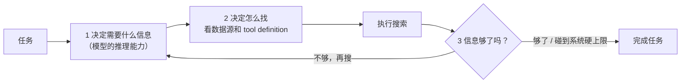
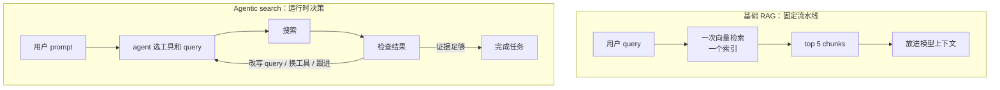
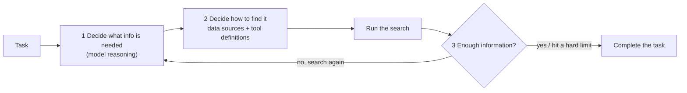
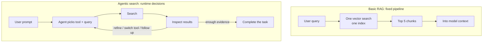

> DeepLearning.AI × Chroma｜Module 2，视频约 5 分钟｜
> 相关：[Module 2 Overview](/Context-Engineering-Module-2-Overview/)

## 从写死的步骤到 agentic search
Module 1 的客服 agent 分几步工作：先查数据库里的订单，再用搜索工具找当前退款政策，
最后基于取回的信息推理、决定动作。但 lab 里这些步骤是**写死的**——
system prompt 规定了先查订单、再查政策、再回复，agent 只是照做。

**Agentic search** 则是：把数据和工具交给 agent，**由它决定需要什么信息、怎么搜**。
比如再给它客户历史交互日志和对应的搜索工具，它可以先查政策，
再用有针对性的 query 只取购买日期；第一次没找到、或发现了新线索，可以再搜。

| | 代价 | 收益 |
|---|---|---|
| 让 agent 自己决定搜什么、怎么搜 | 系统更不可预测，完成任务可能更慢 | 更能取到正确信息，任务表现更好；覆盖更多任务和边界情况 |

## 三个关键点

1. **找什么**：agent 自己判断完成任务需要哪些信息——利用语言模型推理、解决问题的能力。
2. **怎么找**：根据可用的数据源和搜索工具决定方法；
   其中一个重要依据是**工具的定义**（后面的视频细讲）。
3. **要不要再找**：信息不够就继续搜，可以迭代多轮，
   直到任务完成或碰到系统的硬上限。

## 和 RAG 有什么不同

- **基础 RAG**：检索是预先定义好的流水线。用哪个 retriever、搜哪个数据源、
  query 怎么改写、跑几步检索，都由开发者**写死**，不随模型运行时发现的东西改变。
  检索没取到需要的内容，模型也无法自主换策略；重试、兜底都得提前做进流水线里。
- **Agentic search**：关键的检索决策在**运行时**由 agent 做——
  根据 prompt 决定搜什么、用哪个工具，检查初步结果后改写 query、继续追查，
  重复多次直到证据足够，还能针对不同信息选更合适的搜索工具。
  最终结果是 agent 拿到质量更高的信息，也就是 **right information**。

## 对 context engineering 的影响
- **好处：更好的上下文。** 工具和数据源多样，找到真正需要的信息的概率更大；
  可以一直搜到补齐知识缺口为止。
- **风险：上下文膨胀。** 反复调用工具会产生大量 tool output，
  全都带着往后走，最终会填满上下文窗口。
  处理办法在 Module 3；本模块先把 agentic search 当成拿到正确上下文的手段。

## 要点
- Agentic search = agent 自己决定**找什么、怎么找、要不要再找**。
- 与 RAG 的本质区别：检索决策从**开发时写死**变成**运行时由 agent 做**。
- 拿可预测性和速度，换更好的信息；同时要提防 tool output 撑爆上下文。
- 下一节：[Example: Coding Agent](/Example-Coding-Agent/)。

> DeepLearning.AI × Chroma | Module 2, ~5 min video |
> Related: [Module 2 Overview](/Context-Engineering-Module-2-Overview/)

## From Hard-Coded Steps to Agentic Search
The Module 1 customer service agent worked in steps: look up the order in a database,
search for the current refund policy, then reason over what it retrieved to decide what
to do. In the lab those steps were **hard-coded** — the system prompt told it to look up
orders, then policies, then reply, and it just followed along.

With **agentic search** you give the agent data and tools and **let it decide what
information it needs and how to search for it**. Give it customer interaction logs and
tools to search them, and it might check the policy first, then run a targeted query
that returns only the purchase date — and search again if the first try misses or it
finds a new lead.

| | Cost | Payoff |
|---|---|---|
| Letting the agent decide what and how to search | Less predictable, may take longer | Better at retrieving the right information; handles more tasks and edge cases |

## Three Key Aspects

1. **What**: the agent decides what information the task needs, using the model's
   ability to reason and problem-solve.
2. **How**: it picks a method based on the data sources and search tools it has; the
   **tool definitions** are a key input (covered later).
3. **Again?**: if it needs more, it searches again, over several iterations, until the
   task is done or it hits a hard limit of the system.

## How Is This Different from RAG?

- **Basic RAG**: retrieval is a predefined pipeline. The developer **hard-codes** which
  retriever, which data source, how queries are transformed and how many retrieval steps
  run; none of it changes with what the model discovers at runtime. If retrieval misses,
  the model can't change strategy on its own — any retry or fallback must be built in.
- **Agentic search**: key retrieval decisions happen **at runtime**. The agent chooses
  what to search and which tool to use, inspects results, refines queries, follows up,
  and repeats until it has enough evidence — using whichever tools suit the information
  it's after. The result is higher-quality information: **the right information**.

## Implications for Context Engineering
- **Upside: better context.** More tools and data sources raise the odds of finding what
  the task really needs, and the agent can keep searching to fill knowledge gaps.
- **Risk: a lot of additional context.** Repeated tool calls produce lots of tool output;
  carried forward, it eventually fills the context window. Module 3 covers the fixes —
  here, treat agentic search as a way to get the right context.

## Takeaways
- Agentic search = the agent decides **what to find, how to find it, and whether to
  search again**.
- The key difference from RAG: retrieval decisions move from **build time** to
  **runtime**.
- You trade predictability and speed for better information — and must watch for tool
  output bloating the context.
- Next: [Example: Coding Agent](/Example-Coding-Agent/).

