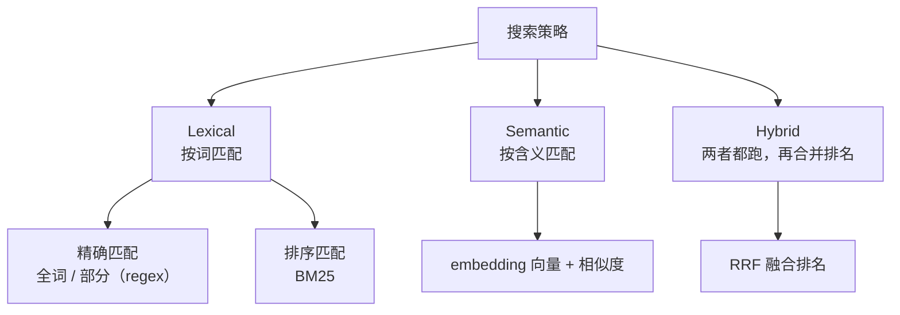
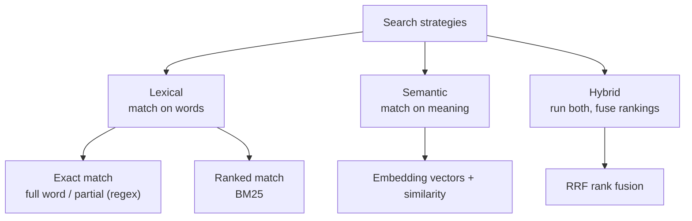

> DeepLearning.AI × Chroma｜Module 2，视频约 8 分钟｜
> 上一节：[Example: Coding Agent](/Example-Coding-Agent/)

## 先问三个问题
想 agent 需要哪些工具，可以先想人是怎么找信息的：

1. **我在找什么？** 可以非常具体（「报告产品安全问题的工单按什么规则升级？」），
   也可以很模糊、探索性的（「这个 repo 的代码是干什么的？」）。
   具体程度决定了去哪找、怎么找。
2. **信息可能在哪？**
3. **query 该怎么和文档匹配？**

后两个问题都取决于第一个问题的具体程度。
下面围绕两种成熟的搜索方式来建立直觉：**lexical（词法）** 和 **semantic（语义）**，
以及把两者合起来的 **hybrid（混合）**。

## Lexical search
**精确匹配**：按关键词匹配文档或 chunk，结果只有是 / 否，没有中间状态。
- 全词匹配：query 是 `escalation`，只命中 `escalation` 这个词。
- 部分匹配：去掉词尾只匹配更短的字符模式，`escalation` 和 `escalate` 都能命中。
  **正则（regex）** 就是实现这种模式匹配的一种方式。

**排序匹配（ranked lexical）**：精确匹配一对一、非黑即白，
没法对多个词的匹配好坏排序。比如 query「logs for billing tickets with escalation」，
每篇文档按命中的关键词打分排序：同时命中 billing 和 escalation 的，
一般排在只命中 billing 的前面。
- 常用算法 **BM25**：考虑词在文档里出现的频率、词在整个语料里有多稀有、文档长度。
  分数越高，词法匹配越强。
- 坑：`repeated_billing_failure` 里的 billing 是长序列的一部分，**不会被匹配到**。
  所以对代码这类文本，可能需要预处理才能搜得好。

排序匹配的局限：**同一个意思用了不同的词**，或**同一个词在不同语境含义不同**时，
它就不行了。比如搜「重复扣款」（duplicate charging），
文档里写的是 repeated、twice、billing，
一个词都没对上，但意思显然相关。

## Semantic search
不只看词，而是比较**含义**：
embedding 模型把 query 和每篇文档（或 chunk）都转成高维向量，
含义相近的文本向量也相近，于是按 query 向量和文档向量的相似度排序。

局限：
- embedding 模型一次能处理的文本有限，把很长的文档压成一个向量会丢细节，
  所以长文档要**切块（chunk）**。怎么切很重要，每个 chunk 要保留足够的上下文，能独立成义。
- **精确词本身很重要时不太可靠**：错误码、工单 ID、文件名、少见的专有名词。

## Hybrid search
同一个 query 同时跑 lexical 和 semantic，既有精确词匹配，也有含义相似度。

难点：两种方法的**分数不在一个尺度上**，BM25 分数和语义相似度不是一回事，直接相加没意义。
所以合并的是**排名**而不是分数。常用方法是 **reciprocal rank fusion（RRF）**：
每种方法各出一个排名列表，越靠前的文档权重越大、越靠后越小，
把各列表的贡献加起来得到一个融合排名，再取 top-k（比如前 5 或前 10）。

## 什么时候用哪种

| 你在找什么 | 用什么 | 代价 / 注意 |
|---|---|---|
| 精确的词：名字、ID、错误码，且确定原文里会出现 | 精确 lexical | 词不一样就找不到 |
| 包含多个相关词的文档，匹配有强有弱 | 排序 lexical（BM25） | 同义不同词时失效 |
| 一个想法或概念，原文可能换了说法 | Semantic | embedding 成本、要切块、精确细节匹配弱 |
| 既在乎精确词又在乎含义 | Hybrid（RRF） | 多跑一种检索 |

这是人的直觉——agent 怎么知道该这么选？下一节把这些策略落成工具：
[Implementing Search Strategies](/Implementing-Search-Strategies/)。

> DeepLearning.AI × Chroma | Module 2, ~8 min video |
> Previous: [Example: Coding Agent](/Example-Coding-Agent/)

## Three Questions First
To think about which tools an agent needs, think about how people search:

1. **What am I looking for?** Anything from highly specific ("the escalation rule for a
   ticket reporting a product safety issue") to vague and exploratory ("what does the
   code in this repo do?"). How specific you can be dictates where and how to look.
2. **Where is that information likely to live?**
3. **How should I match the query against the documents?**

The last two both depend on how specific the first answer is. The video builds intuition
around two mature approaches — **lexical** and **semantic** — plus **hybrid**, which
combines them.

## Lexical Search
**Exact match**: match documents or chunks by keyword; it's yes or no, nothing between.
- Full match: the query `escalation` matches only `escalation`.
- Partial match: drop the word ending and match a shorter pattern, so both `escalation`
  and `escalate` hit. **Regular expressions** are one way to do this.

**Ranked lexical search**: exact match is one-to-one and all-or-nothing, so it can't rank
multi-term matches. For "logs for billing tickets with escalation", each document is
scored on the keywords it contains — one matching both billing and escalation usually
ranks above one matching only billing.
- A popular algorithm is **BM25**: it weighs how often a term appears in a document, how
  rare the term is across the collection, and document length. Higher means a stronger
  lexical match.
- Gotcha: `repeated_billing_failure` **won't match** billing, since it's part of a longer
  sequence. Code may need preprocessing to search well.

Its limit: it struggles when **different words express the same idea** or **one word
means different things in different contexts**. A query about duplicate charging misses a
document that says repeated, twice and billing — clearly related, no shared words.

## Semantic Search
Compare **meaning**, not just terms. An embedding model turns the query and each document
(or chunk) into a high-dimensional vector; similar meanings give similar vectors, so
documents are ranked by similarity to the query vector.

Limits:
- Embedding models take limited input, and squeezing a long document into one vector
  loses detail — so long documents get **chunked**. How you chunk matters: each chunk
  needs enough surrounding context to stand on its own.
- **Less reliable when the exact term matters**: error codes, ticket IDs, file names,
  unusual proper nouns.

## Hybrid Search
Run the query through both lexical and semantic search to get exact-term matching and
meaning-based similarity together.

The catch: **the scores are on different scales** — a BM25 score and a similarity score
don't mean the same thing, so adding them is meaningless. Combine **rankings** instead.
A common method is **reciprocal rank fusion (RRF)**: each method produces a ranked list,
documents near the top of each list get more weight, and the contributions are summed
into one fused ranking, from which you take the top-k (say 5 or 10).

## When to Use Which

| You're looking for | Use | Cost / caveat |
|---|---|---|
| A precise term — name, ID, error code — that will appear verbatim | Exact lexical | Misses different wording |
| Documents with several relevant terms, some matching more strongly | Ranked lexical (BM25) | Fails on synonyms |
| An idea or concept the source may phrase differently | Semantic | Embedding cost, chunking, weaker on exact details |
| Both exact terms and meaning | Hybrid (RRF) | Runs more than one retriever |

That's human intuition — how does an agent know to do this? Next, the strategies become
tools: [Implementing Search Strategies](/Implementing-Search-Strategies/).

