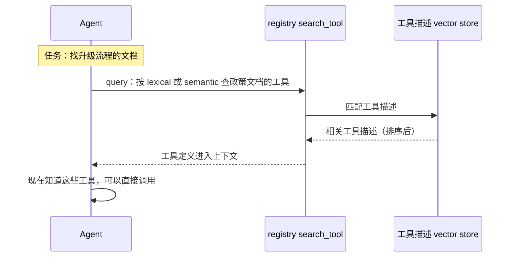
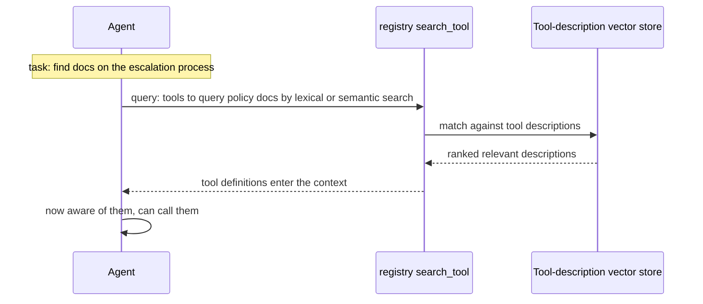

> DeepLearning.AI × Chroma｜Module 2，视频约 3 分钟｜
> 上一节：[Implementing Search Strategies](/Implementing-Search-Strategies/)

## 问题：工具描述撑大上下文
工具描述可以看作 system prompt 的一部分，**每次模型调用都会带上**，
这样 agent 想用时才能用。工具越多、描述越长，就越容易出现前面讲过的上下文问题：
窗口被干扰性的文本填满，agent 表现下降。

热门 coding agent 的 harness（Claude Code、OpenAI Codex）的 system prompt 很大。
按 Drew Breunig 的图，Codex 在你开始用之前上下文里就已有约 **5,500 tokens**，
其中大约**四分之一**是工具描述。而很多工具和当前任务无关——
coding agent 在用 regex 搜日志时，不需要知道怎么生成 PDF。

## 解法：只在需要时加载工具描述
**Tool registry** 本质上是一个**用来搜工具的搜索工具**，由两部分组成：
1. 可搜索的工具清单，通常是一个存工具描述的 vector store；
2. 一个搜索这份清单的工具（registry search tool），**始终对 agent 可用**。

模型能发现并调用 harness 里的任何工具，但不用在消息历史里一直带着所有工具定义。

## 收益与取舍

| | |
|---|---|
| 省 token | lab 里把大部分工具定义从 system prompt 挪进 registry，token 用量减少 **40% 以上** |
| 减少 context confusion | 工具选择更准，少选错工具 |
| 代价 | harness 更复杂——相当于又多了一个数据源 |
| 适用 | 工具多、而且不是每个都常用 |
| 不适用 | 工具少，或几乎每个任务都要用到大部分工具——直接放 system prompt 更好 |

## 要点
- 工具描述是每次调用都带的固定开销，工具一多就会挤占上下文、干扰选择。
- Tool registry = 把工具描述也当成要检索的数据，**按需加载**。
- 工具少时别上 registry，复杂度不值得。
- 下一节：[Evaluating Agentic Search](/Evaluating-Agentic-Search/)。

> DeepLearning.AI × Chroma | Module 2, ~3 min video |
> Previous: [Implementing Search Strategies](/Implementing-Search-Strategies/)

## The Problem: Tool Descriptions Bloat Context
Tool descriptions are effectively part of the system prompt — **sent with every model
call** so the agent can use a tool when it decides to. More tools and longer descriptions
bring back the context problems from earlier: the window fills with distracting text and
agent performance drops.

Popular coding-agent harnesses like Claude Code and OpenAI Codex have huge system
prompts. In Drew Breunig's diagram, Codex already holds about **5,500 tokens** before you
start, roughly **a quarter** of it tool descriptions. Many of those tools are irrelevant
to the task at hand — a coding agent searching logs with regex doesn't need to know how
to create a PDF.

## The Fix: Load Tool Descriptions Only When Needed
A **tool registry** is basically **a search tool for searching tools**. Two parts:
1. A searchable list of available tools, commonly a vector store of tool descriptions;
2. A tool that searches that list (the registry search tool), **always available** to
   the agent.

The model can discover and call any tool in the harness without carrying every tool
definition in its message history.

## Benefits and Trade-offs

| | |
|---|---|
| Token savings | In the lab, moving most definitions out of the system prompt into a registry cuts token usage by **more than 40%** |
| Less context confusion | Better tool selection, fewer wrong-tool picks |
| Cost | A more complex harness — effectively another data source |
| Good fit | Many tools, not all used often |
| Poor fit | Few tools, or most tools used on most tasks — keep them in the system prompt |

## Takeaways
- Tool descriptions are a fixed per-call cost; with many tools they crowd the context and
  confuse selection.
- A tool registry treats tool descriptions as data to retrieve, **loaded on demand**.
- With only a few tools, the added complexity isn't worth it.
- Next: [Evaluating Agentic Search](/Evaluating-Agentic-Search/).

