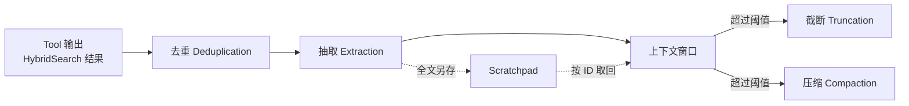
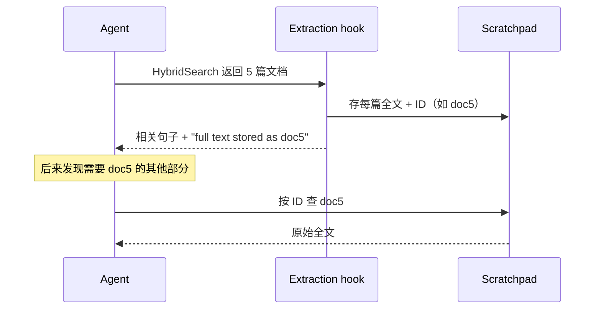
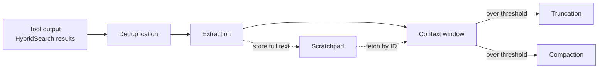
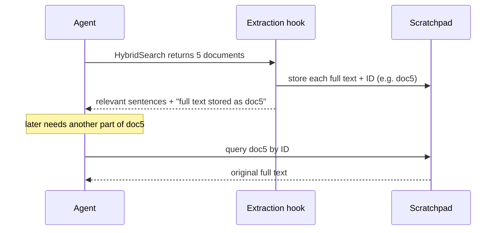

> DeepLearning.AI × Chroma｜Context Engineering 课程 Module 3（Context Management）的
> 模块介绍、各节视频笔记和模块总结（不含 lab）

## 从 Module 2 到 Module 3
Module 2 解决的是 **right information**：agent 自己决定需要什么信息、用哪个搜索工具去找、
要不要再去别的数据源查。信息找得到了，但**一遍遍搜索会把上下文窗口塞满**。

Module 3 只盯 **right format**：用一组 context management 操作，
让 agent 能用上很多数据源，又不被重复、过时、干扰性的上下文拖住。

## Module 3 学了什么

- **进入上下文之前**（tool 调用后的 hook）：去掉重复文档，只留和任务相关的句子。
- **进入上下文之后**（按 token 数触发的 hook）：删掉旧数据（截断），
  或把一长段历史换成简短的事实摘要（压缩）。
- **另存而不是丢掉**：把完整原文放到 scratchpad，上下文里只留一个指针，以后需要再取回。

前面两类操作都是**有损**的，所以还要用 trace 和 eval 检查它们丢了什么。
贯穿全模块的例子是一个 **research agent**，回答「容易验证、但很难回答」的多步问题——
那种简单 Google 一下答不出来的问题。

## 各节笔记

| # | 视频 | 一句话 |
|---|---|---|
| 1 | [Introduction to Context Management](#m3-zh-01) | 原样追加的上下文又长又乱；用剪枝、截断、压缩重新组织 |
| 2 | [Example: Research Agent](#m3-zh-02) | 在 BrowseComp-Plus 里找学者，重复和走错的搜索塞满上下文 |
| 3 | [Pruning](#m3-zh-03) | 不改写只删：去重、抽取、截断 |
| 4 | [Compaction](#m3-zh-04) | 让模型写交接摘要替换历史；按阈值触发或作为 tool |
| 5 | [Evaluating Context Management](#m3-zh-05) | 有无 hook 对比 trace，端到端 eval 加每个 hook 的组件 eval |
| 6 | [Scratchpads](#m3-zh-06) | 上下文外的存储，留指针、按需取回；task list 扛得住压缩 |
| 7 | [Guest Speaker Drew Breunig (Part 3)](#m3-zh-07) | 毒化会自我强化；把 agent 拆成多步，让 memory 各管一段 |

## 01 Introduction to Context Management

### 核心观点
找到高质量信息靠好的搜索工具，但**怎么把信息呈现给 agent** 同样重要。
信息管不好，和搜索工具不好一样糟。所以要有意识地设计上下文窗口的格式，并随时间维护它。

### 朴素实现：什么都原样追加
回到 Module 2 的 coding agent 修 bug。朴素实现里，上下文就是一份流水账：
原始的 tool 输出和模型输出，按发生顺序往后追加。

1. system prompt（含 tool 定义）+ 用户 prompt：「帮我修这个 bug，这是报错」。
2. 搜索代码库，一堆代码片段进入上下文，其中有出 bug 的那段——**第一份代码**。
3. 推理时引用了几段代码——**第二份**。
4. 写入修复，tool input 里是稍作改动的代码——**第三份**。
5. 跑测试，这个错修好了，但冒出新错误，又得重新搜……循环几轮。

结果是：大量重复或高度相似的代码片段，大块的 tool input / output，
还有很多「到底什么相关」的探索过程。上下文**又长、又乱、按时间而不是按重要性组织**，
里面有过时、冲突、重复的信息——正是 Module 1 讲的那些失败模式。
模型每一轮都要花很多推理去重新理解发生了什么，而且任务越往后越难。

### 怎么整理

| 问题 | 做法 | 名字 |
|---|---|---|
| 上下文大部分是 tool 输出 | 只放选定字段或相关片段；或放摘要，全文另存 | 剪枝 pruning |
| 有不再相关的 tool 调用 | 关键代码和结论保留后，删掉重复的搜索结果 | 剪枝 pruning |
| 窗口太长 | 按 token 目标删掉最早的对话，简单粗暴 | 截断 truncation |
| 窗口太长 | 把一长段探索、修改、测试换成摘要：试了什么、改了什么、还剩什么 | 压缩 compaction |

删细节时要保证剩下的上下文仍然知道：**做过什么、改了什么、测试结果如何、还有什么没解决**。
细节存到别处的，留一个引用。

### 要点
- 这些操作是你**在 harness 里做的设计选择**。
- 目标是每次模型调用都有一份清晰的工作上下文：harness 不是重放全部历史，
  而是**有意识地构建**这一步需要的上下文。

## 02 Example: Research Agent

### 场景
一个 research agent 搜索文档库来回答问题。为了专注于输出和上下文的演变，
只给它一个工具 **HybridSearch**，从 Chroma collection 里检索文档。

数据来自 **BrowseComp-Plus**：评估 agent 搜索能力的 benchmark，内容是普通网页文本，
可以当作网页搜索数据的替身。它的问题需要**多次搜索、跨多个来源推理**才能答出来，
所以上下文里会积累大量 tool 调用和相关推理。

文档分三类：

| 类型 | 作用 |
|---|---|
| Target docs | 含有正确答案需要的信息 |
| Evidence docs | 提供找到 target docs 的佐证 |
| Distractor docs | 故意误导，让搜索更难 |

例题像那种「记得一个人的很多事，就是想不起名字」的朋友：
这个人**协调过一个研究小组、合编过一本 2018 年的 Routledge 书、2020 年前召集过一个 panel、
博士论文研究一位英国作家**——他是谁？

### 上下文是怎么变乱的
- 第一次搜「研究小组的协调人」，返回 5 篇文档，每篇的 doc ID、匹配分数、全文都进上下文。
- 基于这些再搜下一轮，新文档和 metadata 继续追加。
- 中途发现走错了路，换一组搜索重来。
- 最终答对了，但一路攒了大量上下文：
  - 很多文档**被检索了不止一次**——重复；
  - 每篇都是**全文**放进来——太长，中间的信息不好用，agent 容易失焦；
  - 走错那条路上的文档**和问题无关**。

### 改进思路
- **去重**：用 hook 把 tool 输出里的 doc ID 和已检索列表比对，已在上下文里的不再加。
- **抽取**：只把文档里相关的部分放进来，而不是全文。
- **截断或压缩**：上下文变长时压缩信息。
- 每次剪枝或压缩，都在上下文里**留下记录**，让模型知道信息从哪来、有没有被改动过。

两个要小心的地方：
- 去重和抽取一起用时，一篇文档因为「已经有一部分在上下文里」被挡掉，
  但另一步需要的是它的**另一部分**，就再也拿不到了。
- 压缩时要想清楚会丢多少信息，尤其是**对摘要再做摘要**。

## 03 Pruning

### 共同点：不改写，只删
剪枝类技术都**不改写文本**，只是按原样裁剪或删除，让上下文尽量相关、尽量短。
有的发生在信息进入上下文**之前**（一开始就少占空间），
有的发生在**之后**（缩短整体长度）。

### 去重 Deduplication
长任务里，重复检索到的文档如果都往里加，会积累大量重复信息。

| 层面 | 怎么判断 | 能抓到什么 |
|---|---|---|
| 文档 ID | harness 记录已加入的 doc ID，每次搜索后过滤 | 同一篇被重复检索（例：doc 42 已在上下文，第二次不再传） |
| 文本精确 / 归一化匹配 | 字符串查找；先归一化空白等差异再比 | 完全相同或几乎相同的内容 |
| Embedding 相似度 | 超过阈值算重复（lab 里用的方法） | 不同来源 / 不同 ID 的近似内容（例：doc 67） |

实际中常组合使用：ID 检查抓重复检索，文本检查抓换了来源的同样内容。

**什么时候做**：检索之后、加入上下文之前。

**告诉 agent**：被当成重复丢掉的来源，也要让 agent 知道「这篇是重复的所以没加」。
否则它可能以为搜索结果变少甚至没结果，影响后面要不要再搜的判断。

### 抽取 Extraction
更进一步：按**句子或段落**评估和任务的相关性，只把最相关的部分放进上下文。

例：查询是「2009 年成立的研究小组的协调人」，检索到的 chunk 是：

> Dr Rodriguez coordinated a state-funded research group founded by Dr Singh in 2009.
> Dr Singh later wrote a paper sharing the results in 2014.

只有第一句相关，第二句可以丢掉。

抽取通常实现成 tool 调用**之后**触发的 hook，相关性有两类判断方法：

| 方法 | 优点 | 缺点 |
|---|---|---|
| Cross-encoder reranker / embedding 相似度 | 快、便宜，给出可以设阈值的分数 | 只看当前查询 |
| LLM as a judge（lab 里用的） | 能考虑整个任务，不只当前查询 | 慢 |

抽取避免了大量无关文本（会引发 clash、confusion），也让上下文窗口用得更有效率。

**和去重一起用要小心**：按 doc ID 挡文档时，可能挡掉一篇对当前任务有用的文档——
它之前是为了**别的任务**以抽取形式加进来的。
在 doc ID 之外再记录**行号**之类的 metadata，可以核对实际文本是否真的重复。

### 截断 Truncation
就算去重、抽取都做好了，长任务的上下文还是会一直变长，最终出现 context rot。
到某个触发点（比如窗口用量到某个百分比）就要删信息。

- **最简单粗暴**：从工作历史的开头砍掉一定数量的 token，保留 system prompt 和 tool 定义，
  并在 turn 的边界上切。容易实现，一些极简开源 harness 就这么做；
  但可能丢掉重要信息，比如早期失败的尝试、用户最初的请求，要盯着截断后的表现。
- **针对特定类型的上下文**：比如删掉 tool 输入输出里的某些字段。
  lab 里的 hook 会删掉**旧搜索结果里的 reasoning 字段**：
  它在决定下一步时有用，决定做完后就只占空间。

判断标准：**这段信息只在某一刻有用，还是整个任务期间都有用？**只在某一刻有用的，适合截掉。

截断仍然有风险。有时更好的做法是换一种表示：用一份保留信息、但短得多的摘要替换历史——
这就是下一节的压缩。

## 04 Compaction

### 是什么
压缩用**一份摘要替换一段 turn 或动作**来缩短上下文，很多 agent harness 都实现了它。
摘要由模型生成，可以由 hook 调起，也可以由模型自己在上下文到某个长度时调起。

和截断比：截断删掉旧 tool 调用后，即使留了「已截断」的提示，
从那些调用里**推出来的中间结论也一起没了**。压缩则能保留「发生了什么」的记录。

上下文达到某个长度时，harness 触发 hook，把部分历史交给模型并要求总结，例如：

> Tackled two questions. Ran 6 searches and retrieved 35 distinct sources. Found sources
> that match the first three clues and identified the following candidate scholars:
> Dr. Jorge Sacido-Romero, Dr. Manuela Palacios. Need to confirm which candidate has a PhD
> on an English writer.

被总结的那段历史从上下文移除，换成这份摘要，之后的 turn 就靠它了解之前的事。

要设计的就两件事：**摘要怎么写**，**什么条件下触发**。

### 摘要怎么写：一次交接
各家 harness 的压缩 prompt 有共同点：看已经发生的事，写一份保留关键细节、
能让任务继续下去的摘要。

可以类比护士换班：白班交给夜班的不是每个细节，而是最重要的、会直接影响夜班的信息，
外加「需要更多信息去哪找」。压缩 prompt 也一样，只不过是 **agent 交接给自己**。

- **OpenAI Codex** 的压缩 prompt：总结到目前为止的工作或对话，
  并明确要求细节程度要足以让**另一个模型接着干**。
- **Claude Code** 的压缩 prompt：开头就点明要写摘要，然后具体列出要包含什么——
  已有进展、关键决策、重要上下文、还剩什么要做、继续推进需要的关键数据；
  最后再提醒一次，目标是**无缝交接**给下一个模型。

摘要放回上下文时要保证格式清楚：
- 用标题、标签之类的结构告诉后续调用这是什么、怎么用；
  也可以用 Pydantic schema 强制输出结构化数据（lab 里有例子）。
- 最重要的是**明确标出这是之前发生的事的摘要**。

### 什么时候触发

| 方式 | 怎么做 | 特点 |
|---|---|---|
| Hook（多数 harness） | 每次调模型前检查上下文长度，超过阈值就先压缩历史 | 想让窗口保持在 75% 以下，可以设 75% 或更低（如 65%）留余量 |
| Tool | 把压缩做成 agent 能调用的工具，由 agent 决定何时压缩 | 更 task-aware：比如规划长任务时，在开始前主动压缩，保证上下文够用 |

## 05 Evaluating Context Management

### 这些操作都是有损的
到这里 harness 里有四个操作：**去重、抽取、截断、压缩**。它们让上下文更短、更相关，
并留下操作记录。但它们共同的问题是**有损**：数据被删或被改，会影响整个系统的行为。

### 端到端：先对比 trace
和前几个模块一样，从 trace 开始：
- 在同一组问题上，分别**开 / 关** context management hook 跑 research agent，
  对比最终输出和中间步骤。
- 输出差不多，说明 context management 没有破坏整体轨迹；差别大的地方，就是要建 eval
  的地方。

**端到端 eval**：BrowseComp-Plus 的答案可验证，可以建一个参考问题集，
用不同 hook 配置跑，比较准确率。真实系统里要建 **golden set**：
已知正确答案的任务（必要时还有理想的动作序列），既包括 agent 已经答对的（抓回归），
也包括发现过的错误。

端到端 eval 告诉你整体变好还是变差，但看不出**每个 hook 各自**表现如何，这要靠组件 eval。

### 组件 eval

| 操作 | 怎么评 | 常见失败 |
|---|---|---|
| 抽取 | 准备一小批检索文档，标出对某任务相关的文本，和 hook 实际保留 / 丢掉的句子比对，看 **recall** | 留太多浪费 token；丢太多导致 trace 里的失败——常见的是**自信地答错**，而看全文本可以排除那个错误答案 |
| 去重 | 记录每个被挡掉的文档，跑完检查其中有没有答案或通往答案的线索 | 假阴性让 agent 重复搜已有的东西；更常见的是**假阳性**：按 ID 挡掉了，但上下文里那部分不是现在要的那部分 |
| 截断 / 压缩 | 在触发前的上下文上，写下继续完成任务**需要的事实**，看压缩后的摘要里还能不能找回每一条 | 截断更简单：不改写，只看删掉的 token 里有没有清单上的东西 |

抽取的 eval 要专门测「**和当前查询相关**」vs「**和整个任务相关**」：
「这位学者在哪教过书」和「谁编了这本书」这次搜索无关，但和「根据一组线索认出这位学者」
这个总任务相关。如果抽取 hook 里的 LLM judge 只看到当前查询，就会把这句丢掉。

压缩的事实清单，在找学者的例子里是：目前的候选人、已确认的线索、放弃了的路径、下一步。
早期可以人工核对，之后可以用 LLM as a judge 数事实，输出「必需事实进入摘要的比例」。

### 根据 eval 迭代
- 候选人名字总是丢 → 改压缩 prompt，要求保留名字。
- 放弃的搜索路径总是丢 → 也是 prompt 问题，写明必须提到放弃或失败的策略。
- 第一次压缩没问题，第二、三次越来越差 → **summary-of-summaries drift**。
  可以降低压缩频率，或者压缩原始历史而不是上一份摘要。

### 局限
更好的抽取 prompt、更明确的保留指令能让这些操作**少丢一点**，但做不到不丢，
而且**丢了就没法恢复**。比如 agent 需要的是早期结果的原话，而压缩已经把原话毁掉了——
prompt 调得再好也找不回来。这引出下一节的 scratchpad。

## 06 Scratchpads

### 核心观点
**别把上下文窗口当成信息唯一能待的地方。** harness 可以在模型调用之外维护存储。

**Scratchpad** 是 agent（或 harness 代它）可以写下东西、之后再读回来的地方。
它可以很简单：磁盘上的一个文本文件，或者 agent 代码里的一个 dict / list。
关键是它**在上下文窗口之外，不占 token**；需要时 agent 用工具取回来放进上下文。

### 抽取 + scratchpad
原来的抽取 hook 只把相关句子放进上下文，其余部分丢掉，
要用剩下的内容就得**再跑一次搜索**——而 tool 调用可能很慢，也可能很贵。

这解决了上一节去重和抽取的冲突：被挡掉的文档里有后来需要的段落，也不再是失败，
因为原文还在。抽取也可以**更激进**，因为丢掉的句子总能找回来。

### Task list：存 agent 自己的工作
同样的思路也适用于 agent 自己的工作，最常见的是 task list：
- 开始多步任务时写下计划——对 research agent 来说，是要确认的线索、打算跑的搜索和顺序。
- 干活时用工具勾掉完成项、加新项。
- 这份清单是**事实来源**，决定下一步时读回来。

它会变成 agent 工作的历史记录，可以任意长，因为不在上下文里。
它**扛得住剪枝和压缩**，而且是 agent 在它认为重要的时刻亲手写下、实时更新的。

### 三个注意点
1. **agent 要知道 scratchpad 里有什么**：每次把东西卸到 harness 存储，
   都要在上下文里留指针（ID、文件名，或者一句话描述）。
2. **取回本身是一次 tool 调用**，有延迟和 token 开销。偶尔查没问题；
   如果 trace 里 agent 一直在往回取，说明抽取或压缩**太激进了**，
   那些信息本该留在上下文里。
   端到端 eval 上会表现为步数变多。
3. **scratchpad 也会过时**：agent 写了「当前最佳候选：Laura Rojo Rodriguez」，
   后来找到了指向别人的证据，就必须更新那条记录，否则之后取回时会毒化上下文。

### 要点
把信息临时或永久写到上下文之外，指向了定义里的最后一项——**right time**：
需要的时候才把信息及时取回来。Module 4 的 memory 会详细讲这个。

## 07 Guest Speaker Drew Breunig (Part 3)

> 这一段的字幕在对话中途就断了，下面只记到断开的地方。

### Prompt 越写越长
教一个人或一个 agent 做事，第一步往往是把能想到的都写下来——实际上就是一个很长的 prompt，
先丢给最新最强的模型试试。然后在旁边看着它干活：
「这里错了」「我不会这么做」「你忘了这个」，
于是 prompt 越来越长，变得难以维护：信息互相冲突、含糊，太长又让模型分心，context rot
出现。

Andrew 的问题：每天都能持续地教模型一点东西、甚至让它自己持续学习，这很诱人，
今天有哪些工具能匹配这种开发循环，未来又会有什么？

### 毒化会自我强化
Context rot 是长时间积累出来的。更糟的是，上下文里一旦有一点毒，就会越来越严重：
模型会谈论它、思考它、基于它推理，像一粒沙结晶成珍珠——只不过是「坏珍珠」。

这正是 **memory 系统的危险**：
- 严格把关**什么能进 memory**，挡住坏东西；
- 持续**修剪和打理** memory，不断检查每条是否还有必要。

### 把 agent 拆成多步 workflow
Memory 类系统恰好是**把 agent 拆成多步 workflow** 的好理由——
就像面向对象编程里给模块划清 namespace 一样做隔离：
- Deep research agent 的**规划阶段**：搞清楚要做什么、用户意图是什么，这是大 agent
  擅长的。
- **读网页**这种事可以交给小模型：给一个主题，「提取关于这个主题的关键事实」。
  它可以并行，而且可以只给它**和读网页、提取信息相关的** feedback 和 memory。

这样就有了清晰的边界：哪里该用这份 memory，哪里不该。
如果给多步骤 agent 设计一个**大一统的 memory 系统**，会出现大量 clash。

Drew 举了自己的例子：在 Claude 里既聊正在写的书，又问家里维修的问题，
它经常把从一个领域学到的关于他的东西用到另一个领域。
这是个很难的问题，Google 搜索和 YouTube 推荐当年就遇到过同样的问题，也没解决。

### 要点
- 毒化的上下文会被模型反复引用、自我强化，memory 系统会放大这一点。
- Memory 要守门（进什么）也要修剪（留什么）。
- 按任务拆分 agent，让每段 memory 只服务一个清楚的子任务，避免跨领域 clash。

## 模块总结
- Agent 可能检索到高质量、相关的数据，但在需要一遍遍搜索的复杂多步查询里，
  **重复、过时、干扰性的上下文**会随时间堆积。
- 用 **hook** 实现了 context management 操作，给 agent 三种把上下文整理成 right format
  的策略：
  1. **进入之前**：过滤重复、去掉无关文本，只抽取对任务重要的信息。
     重复的上下文占 token 却不带来新信息，无关文本让 agent 分心。
  2. **进入之后**：剪掉旧数据，把长文本压缩成简短的事实摘要。
  3. **需要完整原文时**（tool 输出、查询计划）：用 scratchpad 把数据卸到短期存储。
- 这些操作配合使用。作为开发者要决定**用哪些组合、每个怎么配置、什么时候跑**。
- 读 trace 可以更严谨地评估这些决定：不只看答案对不对，还看查询次数、
  evidence docs 里的重复数、被剪掉的 distractor docs 数量。

学完后，你能构建**自己管理上下文**的 agent，提高它在长时间无人监督下成功完成任务的机会。

## 后续模块
最后一个要素是 **right time**：把有用的上下文存起来，在需要时交给 agent，
让工作上下文保持高度相关、更紧凑。Module 4 讲 **memory**——存储精选的上下文，在需要时带给
agent。

> DeepLearning.AI × Chroma | Context Engineering, Module 3 (Context Management):
> introduction, notes for each video, and conclusion (labs not included)

## From Module 2 to Module 3
Module 2 was about the **right information**: the agent decides what it needs, which
search
tool to use, and whether to query other sources. It can fill its knowledge gaps, but
**searching again and again fills up the context window**.

Module 3 is about the **right format**: a set of context management operations that let
the
agent use many data sources without getting stuck with duplicate, stale or distracting
context along the way.

## What Module 3 Covers

- **Before data enters the context** (hooks after tool calls): filter out duplicate
  documents and keep only the sentences relevant to the task.
- **After it is in the context** (hooks triggered by token count): drop old data
  (truncation), or replace a long stretch of history with a short factual summary
  (compaction).
- **Store instead of discard**: offload the full original to a scratchpad, leave a pointer
  in context, and fetch it back when needed.

The first two kinds of operation are **lossy**, so you also use traces and evals to check
what they lose. The running example is a **research agent** that answers multi-step
questions that are easy to verify but hard to answer — the kind a simple Google search
can't.

## Lesson Notes

| # | Video | In one line |
|---|---|---|
| 1 | [Introduction to Context Management](#m3-en-01) | Append-everything context is long and messy; reorganize it with pruning, truncation, compaction |
| 2 | [Example: Research Agent](#m3-en-02) | Finding a scholar in BrowseComp-Plus; duplicate and dead-end searches fill the context |
| 3 | [Pruning](#m3-en-03) | Cut, don't rewrite: deduplication, extraction, truncation |
| 4 | [Compaction](#m3-en-04) | A model writes a handoff summary to replace history; triggered by threshold or as a tool |
| 5 | [Evaluating Context Management](#m3-en-05) | Compare traces with and without hooks; end-to-end evals plus a component eval per hook |
| 6 | [Scratchpads](#m3-en-06) | Storage outside the context, pointers in it, fetched on demand; task lists survive compaction |
| 7 | [Guest Speaker Drew Breunig (Part 3)](#m3-en-07) | Poison reinforces itself; decompose the agent so each memory serves one step |

## 01 Introduction to Context Management

### Key Idea
Good search tools find high-quality information, but **how you present it to the agent**
matters just as much. Poorly managed information can be as bad as bad search tools, so be
intentional about how you format and maintain the context window over time.

### The Naive Version: Append Everything
Back to Module 2's coding agent fixing a bug. In a naive implementation the context is a
plain log: raw tool and model outputs appended in the order they happen.

1. System prompt (with tool definitions) + user prompt: "Can you help me fix this bug?
   Here's the error message."
2. It searches the codebase; a batch of snippets lands in context, including the buggy
   code — **copy one**.
3. Its reasoning quotes some of that code — **copy two**.
4. It writes a fix; the tool input holds a slight variation of the code — **copy three**.
5. Tests pass for that error, but a new one appears, so it searches again… and the cycle
   repeats.

You end up with lots of repeated or near-identical snippets, bulky tool input/output
sections, and a lot of exploring what's even relevant. The context is **long, messy,
ordered by time rather than by what matters now**, and full of stale, conflicting and
repeated information — the failure modes from Module 1. The model has to do a lot of
reasoning every turn just to understand what has happened, and it gets harder as the task
goes on.

### How to Clean It Up

| Problem | What to do | Name |
|---|---|---|
| Most of the context is tool output | Include only selected fields or excerpts; or a short summary with the full output stored elsewhere | Pruning |
| Tool calls that are no longer relevant | Remove duplicate search results once the relevant code and findings are kept | Pruning |
| The window is too long | Delete the earliest part of the conversation to hit a token goal — brute force | Truncation |
| The window is too long | Replace a long stretch of exploration, edits and tests with a summary: what was tried, what changed, what's left | Compaction |

When you remove details, the remaining context must still say **what was done, what was
changed, what the tests showed and what's unsolved**. Where details are stored elsewhere,
leave a reference.

### Takeaways
- These operations are **design choices you build into the harness**.
- The goal is clear working context for every model call: instead of replaying all the
  history, the harness **constructs** the context each step needs.

## 02 Example: Research Agent

### The Scenario
A research agent searches a document corpus to answer a query. To focus on outputs and how
the context evolves, it gets a single tool, **HybridSearch**, which retrieves documents
from
a Chroma collection.

The documents come from **BrowseComp-Plus**, a benchmark for evaluating agents' search,
made of ordinary web page text — a useful proxy for web search data. Its questions need
**multiple searches and reasoning over multiple sources**, so the context fills with tool
calls and the reasoning around them.

There are three kinds of documents:

| Type | Role |
|---|---|
| Target docs | Contain the information needed for the correct answer |
| Evidence docs | Supporting evidence that leads to the target docs |
| Distractor docs | Misleading on purpose, to make the search harder |

The example question is like a friend who remembers lots of facts about someone but not
their name: this person **coordinated a research group, co-edited a 2018 Routledge book,
convened a panel before 2020, and has a PhD on an English writer** — who are they?

### How the Context Gets Messy
- The first search, for the coordinator of a research group, returns 5 documents; each
  one's doc ID, match score and full text go into context.
- The next search builds on that, and its documents and metadata are appended too.
- Partway through, the agent realizes it went down a bad path and starts a new set of
  searches.
- It does reach an answer, but it has piled up a lot of context:
  - many documents were **retrieved more than once** — duplicates;
  - every document went in **in full** — too long, the middle gets less useful and the
    agent can lose focus;
  - the documents from the dead-end path are **irrelevant**.

### Ideas for Improvement
- **Deduplicate**: a hook compares doc IDs in the tool output against the running list of
  retrieved docs and skips ones already in context.
- **Extract**: insert only the relevant parts of a document, not the whole thing.
- **Truncate or compact**: condense information when the context gets long.
- Every time you prune or compact, **leave a record** in context so the model knows where
  information came from and whether it has been changed.

Two things to watch:
- With deduplication and extraction together, a document blocked because part of it is
  already in context may hold a **different part** that a later step needs — and it can
  no longer get in.
- When compacting, think about how much you lose, especially when **summarizing
  summaries**.

## 03 Pruning

### What They Share: Cut, Don't Rewrite
Pruning techniques **don't rewrite text**; they cut or remove it as is, so the context is
as relevant and as short as possible. Some act **before** information enters the context
(so it takes less space from the start), others **after** (to shorten the overall length).

### Deduplication
On a long task, adding every re-retrieved document piles up duplicate information.

| Level | How to check | What it catches |
|---|---|---|
| Document ID | The harness tracks doc IDs already added and filters each search against them | The same doc retrieved again (e.g. doc 42 is already in context, so it isn't passed in after the second search) |
| Exact / normalized text match | String search; normalize whitespace etc. first | Identical or nearly identical content |
| Embedding similarity | Above a threshold counts as a duplicate (used in the lab) | Near-duplicates from a different source or ID (e.g. doc 67) |

In practice you combine them: the ID check catches re-retrieval, the text check catches
the same content arriving from a different source.

**When**: right after retrieval, before adding to the context.

**Tell the agent**: let it know a source was found but left out as a duplicate. Otherwise
it may read the search as returning fewer or even no results, which skews its later
decisions about searching again.

### Extraction
One step further: judge the relevance of individual **sentences or passages** to the task
and pass only the most relevant ones into context.

Example: the query is "coordinator of a research group founded in 2009" and the retrieved
chunk says:

> Dr Rodriguez coordinated a state-funded research group founded by Dr Singh in 2009.
> Dr Singh later wrote a paper sharing the results in 2014.

Only the first sentence is relevant, so drop the second.

Extraction is usually a hook that fires **after** the tool call. Two ways to judge
relevance:

| Method | Pros | Cons |
|---|---|---|
| Cross-encoder reranker / embedding similarity | Fast, cheap, returns a score you can threshold | Only sees the current query |
| LLM as a judge (used in the lab) | Can weigh the broader task, not just the query | Slower |

Extraction keeps lots of irrelevant text out (which causes clash and confusion) and makes
efficient use of the window.

**Careful combining it with deduplication**: blocking by doc ID can block a document
that's relevant to the current task because it was added earlier, in extracted form, for
**a different task**. Storing metadata such as **line numbers** alongside the doc ID lets
you check whether the actual text is really a duplicate.

### Truncation
Even with careful deduplication and extraction, the context keeps growing on a long task
and eventually rots. At some trigger — say a percentage of the window used — you cut
information.

- **Simplest, not smartest**: cut some number of tokens from the start of the work
  history, keeping the system prompt and tool definitions and cutting at a turn boundary.
  It's easy and used in some minimal open-source harnesses, but it can lose important
  information such as early failed attempts or the user's original request, so watch how
  the agent performs afterwards.
- **Target specific kinds of context**, such as certain fields in tool inputs or outputs.
  The lab's hook removes **the reasoning fields from older search results**: they help
  when deciding what to do next, but once the decision is made they just take up space.

Rule of thumb: **is this useful only for a moment, or for the whole task?** If only for a
moment, it's a good candidate to cut.

Truncation is still risky. Sometimes it's better to change the representation: replace the
history with a summary that keeps the information but is much shorter — compaction, next.

## 04 Compaction

### What It Is
Compaction shortens the context by **replacing a set of turns or actions with a summary**
of what happened, and many agent harnesses implement it. A model writes the summary,
invoked by a hook or by the model itself when the context reaches a certain length.

Compared with truncation: after truncation cuts old tool calls, even with a note saying it
did, **the intermediate conclusions drawn from them are gone too**. Compaction keeps a
record of what happened.

When the context reaches some length, the harness fires a hook that hands part of the
history to a model with an instruction to summarize it, for example:

> Tackled two questions. Ran 6 searches and retrieved 35 distinct sources. Found sources
> that match the first three clues and identified the following candidate scholars:
> Dr. Jorge Sacido-Romero, Dr. Manuela Palacios. Need to confirm which candidate has a PhD
> on an English writer.

The summarized history is removed and replaced with this summary, which later turns rely
on to understand what came before.

That leaves two design questions: **how to summarize** and **when to trigger it**.

### How to Summarize: A Handoff
Compaction prompts across harnesses have something in common: look at what has happened
and produce a summary that keeps the key details so the task can continue.

Think of nurses handing off from the day shift to the night shift: not every detail, just
the most important ones that directly affect the next shift, plus where to find more. The
compaction prompt is the same, except **the agent hands off to itself**.

- **OpenAI Codex**'s compaction prompt asks for a summary of the work or conversation so
  far, with an explicit callout that the detail should let **another model continue the
  work**.
- **Claude Code**'s prompt leads with the summary instruction, then lists what to include
  for the handoff — progress so far, key decisions, important context, what remains, and
  critical data needed to move forward — and ends with another reminder that the goal is
  a **seamless handoff** to the next model.

When you put the summary back into context, keep it well formatted:
- Give it structure (headers, tags) that tells later calls what it is and how to use it;
  you can also enforce structure with a Pydantic schema and structured output (see the
  lab).
- Most importantly, **make it explicit that this is a summary of what happened before**.

### When to Trigger It

| Option | How | Notes |
|---|---|---|
| Hook (most harnesses) | Check context length before every model call; if over the threshold, compact the history first | To stay under 75% full, trigger at 75% or lower (e.g. 65%) for a buffer |
| Tool | Expose compaction as a tool the agent can call when it decides to | More task-aware: e.g. an agent planning a long task compacts before starting so it has room |

## 05 Evaluating Context Management

### These Operations Are Lossy
The harness now has four operations: **deduplication, extraction, truncation and
compaction**. They make the context shorter and more relevant and leave notes about what
they did. But they share one problem: they are **lossy** — data is removed or changed,
which can affect the whole system's behavior.

### End to End: Compare Traces First
As in earlier modules, start with traces:
- Run the research agent on a set of questions **with and without** the context management
  hooks, then compare the final output and the intermediate steps.
- Similar outputs mean context management isn't hurting the trajectory; big differences
  point to where you need an eval.

**End-to-end evals**: BrowseComp-Plus has verifiable answers, so build a reference set of
questions, run different hook configurations and compare accuracy. In real systems, build
a **golden set** of tasks with known correct answers (and, if relevant, an ideal sequence
of actions), including questions the agent already gets right (to catch regressions) and
errors you've spotted.

End-to-end evals say whether the system got better or worse, but not how **each hook**
performs. That needs component evals.

### Component Evals

| Operation | How to evaluate | Common failures |
|---|---|---|
| Extraction | Build a small set of retrieved docs with the text relevant to a task marked; compare with what the hook keeps or drops, and measure **recall** | Keeping too much wastes tokens; dropping too much causes the failures in the traces — often **confidently wrong answers** that the full document would have ruled out |
| Deduplication | Log every blocked document; at the end of the run, check whether any held the answer or a step toward it | False negatives make the agent search again for what it has; more common are **false positives**: blocked by ID, but the part in context isn't the part needed now |
| Truncation / compaction | On the context just before the trigger, write down the **facts needed** to finish the task, then check each is recoverable from the summary | Truncation is simpler: nothing is rewritten, so just check whether the removed tokens held anything on the list |

Extraction evals should test **relevance to the current query** vs **relevance to the
whole task**. Where a scholar taught isn't relevant to a search for who edited a book, but
it is relevant to identifying the scholar from several clues. An LLM judge that only sees
the current query will drop that sentence — include cases like this.

For the scholar task, the compaction fact list is: candidates so far, confirmed clues,
abandoned paths and the next step. Check by hand at first; later an LLM judge can count
the facts and score the fraction of required facts that made it into the summary.

### Iterate on What the Evals Show
- Candidate names keep dropping out → tell the compaction prompt to preserve names.
- Abandoned search paths keep dropping out → also a prompt fix: say failed or abandoned
  strategies must be mentioned.
- The first summary is fine but the second and third degrade → **summary-of-summaries
  drift**. Compact less often, or compact the raw history instead of the previous summary.

### The Limit
Better extraction prompts and more explicit preservation instructions make these
operations **less lossy**, but not lossless — and **there's no recovery later**. If the
agent needed the exact wording of an early result, compaction has destroyed it, and no
prompt tuning brings it back. Hence scratchpads, next.

## 06 Scratchpads

### Key Idea
**Stop treating the context window as the only place information can live.** The harness
can keep storage outside the model call.

A **scratchpad** is a place where the agent (or the harness on its behalf) writes things
down and reads them back later. It can be very simple — a text file on disk, or a dict or
list inside the agent's code. What matters is that it's **outside the context window, so
it costs no tokens**; when the agent needs something, it uses a tool to pull it back into
context.

### Extraction + Scratchpad
The original extraction hook passes only the relevant sentences into context and discards
the rest, so getting the rest means **running the search again** — and tool calls can be
slow and expensive.

This resolves the deduplication-vs-extraction conflict from the last lesson: a blocked
document holding a section needed later is no longer a failure, because the original is
still there. You can also extract **more aggressively**, since a dropped sentence is
always
recoverable.

### Task Lists: Storing the Agent's Own Work
The same idea applies to the agent's own work. The most common example is a task list:
- When starting a multi-step problem, the agent writes a plan — for the research agent,
  the clues to confirm and the searches to run, in order.
- As it works, it uses tools to check items off or add new ones.
- The list is the **source of truth** it reads back when deciding what to do next.

It becomes a history of what the agent has done and can grow as long as you like, since
it isn't in context. It **survives pruning and compaction**, and the agent writes and
updates it as the work happens, at the moments it decides matter.

### Three Cautions
1. **The agent must know what's in the scratchpad**: whenever something is offloaded,
   leave a pointer in context — an ID, a file name, or a one-line description.
2. **Retrieval is itself a tool call**, with its latency and tokens. Occasional lookups
   are
   fine; if traces show the agent constantly pulling things back, extraction or compaction
   is **too aggressive** and that information should have stayed in context. End-to-end
   evals show this as a jump in step count.
3. **Scratchpads go stale too**: if the agent writes "current best candidate: Laura Rojo
   Rodriguez" and then finds evidence for someone else, it has to update that note, or the
   note can poison a later turn when retrieved.

### Takeaways
Writing information, temporarily or permanently, outside the context window points to the
last part of the definition — the **right time**: retrieving information just in time,
when it's needed. Module 4 covers this in depth as memory.

## 07 Guest Speaker Drew Breunig (Part 3)

> The transcript for this clip cuts off mid-conversation; these notes stop where it does.

### The Prompt Keeps Growing
Teaching a person or an agent to do something usually starts with writing down everything
you can think of — effectively a big long prompt — and throwing it at the latest frontier
model. Then you watch over its shoulder: "you're messing up there", "I wouldn't do it that
way", "you're forgetting this". The prompt grows longer and longer until it's unwieldy:
conflicting or confusing information, and so long that the model gets distracted and
context rot kicks in.

Andrew's question: being able to teach the model a little every day, or let it keep
learning by itself, is very appealing — what tools match that development cycle today, and
what's coming?

### Poison Reinforces Itself
Context rot emerges over a long period. Worse, once there's a bit of poison in the context
it tends to get worse, because the model talks about it, thinks about it and reasons with
it — like a grain of sand crystallizing into a pearl, only a bad one.

That's the peril of **memory systems**:
- be very judicious about **what gets into memory**, to keep bad things out;
- keep **pruning and gardening** it, constantly checking whether each item is still
  needed.

### Decompose the Agent into a Multi-Step Workflow
Memory systems are a strong argument for **decomposing an agent into a multi-step
workflow** — isolation, like giving modules a crisp namespace in object-oriented
programming:
- A deep research agent's **planning stage** — working out what to do and what the user
  intends — is what big agents are good at.
- **Reading a website** can go to a small model: given a topic, "extract key facts about
  this topic". It can run in parallel, and get feedback and memories relevant only to
  reading a page and extracting information for a topic.

That gives a clean line for where a memory applies and where it doesn't. A **holistic
memory system** for a multi-step agent would produce a lot of clash.

Drew's own example: in Claude he talks about a book he's writing and also asks about
household repair, and it often applies what it learned about him in one domain to the
other. It's a hard problem — Google Search and YouTube recommendations had exactly the
same one and didn't solve it.

### Takeaways
- Poisoned context gets repeated and reinforced by the model, and memory systems amplify
  that.
- Memory needs a gatekeeper (what goes in) and a gardener (what stays).
- Split the agent by task so each memory serves one clear sub-task and domains don't
  clash.

## Module Recap
- Agents can retrieve high-quality, relevant data and still pile up **duplicate, stale or
  distracting context** over time, especially on complex multi-step queries that need
  search after search.
- You implemented context management operations as **hooks**, giving the agent three
  strategies to shape its context into the right format:
  1. **Before** documents enter the context: filter duplicates and remove irrelevant text,
     extracting only what matters for the task. Duplicates cost tokens and add nothing;
     irrelevant text distracts.
  2. **After** they enter: prune old data and compact long text into short factual
     summaries.
  3. **When the full original is needed** (tool outputs, query plans): offload it to
     short-term storage in a scratchpad.
- The operations work together. As the developer you decide **which combination, how to
  configure each, and when to run them**.
- Reading traces lets you evaluate those decisions rigorously: not just answer
  correctness, but the number of queries, duplicates among evidence docs, and pruned
  distractor docs.

You can now build agents that **manage their own context**, improving their chances of
working over long periods without supervision.

## What's Next
The last piece is the **right time**: store useful context and give it to the agent when
it needs it, keeping the working context relevant and compact. Module 4 covers **memory**,
which stores curated context and brings it to the agent when needed.

